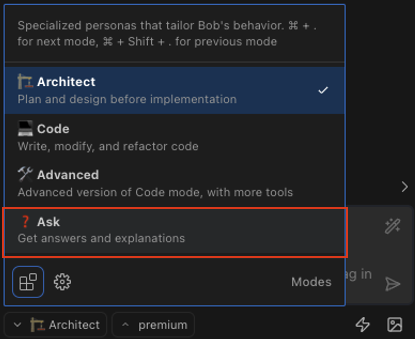
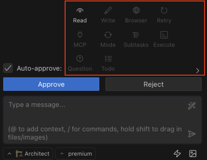

# IBM i RPG Modernization with Bob

Welcome to the IBM i RPG Modernization lab! In this hands-on experience, you'll learn how Bob can help you understand, modernize, and enhance legacy RPG applications running on IBM i.

## Lab Overview

In this lab, you will:

1. **Understand and document** an existing RPG application
2. **Modernize the database layer** from DDS to SQL DDL
3. **Refactor RPG code** to modern free-format RPG
4. **Implement new features** to enhance the application
5. **Generate unit tests** for the new functionality

## About the Sample Application

The sample application we'll be working with is a simple customer and country management system written in RPG. It includes:

- Physical and logical files for storing country and customer data
- RPG programs for managing this data
- Display files for the user interface
- Service programs with reusable functions

This application represents a typical IBM i application that would benefit from modernization techniques.

## Getting Started with Bob

Bob is your AI coding assistant in VS Code. Before we dive into the lab, let's make sure you know how to interact with Bob effectively:

### How to Chat with Bob

1. **Start a conversation** - Click on the Bob icon in the sidebar or use the chat panel
2. **Be specific** - Provide clear context about what you're trying to achieve
3. **Use different modes** - Bob has different modes optimized for specific tasks:
   - 🏗️ **Plan Mode** - For planning, designing, and documentation
   - 💻 **Code Mode** - For writing, modifying, and refactoring code
   - ❓ **Ask Mode** - For explanations and questions
   - 🛠️ **Advanced Mode** - For complex coding tasks

[Focus on Bob](command:bob-walkthroughs.views.focusSidebar)  

Change Bob's mode to **Ask Mode** by clicking on the mode selector in the Bob panel and choosing "❓ Ask Mode"

and... [Say hi!](command:bob-walkthroughs.chat.startPrompt?%5B%22Hello%21%20How%20are%20you%3F%22%5D)

Notice that Bob is not a simple chatbot. It exposes its reasoning and surrounding before responding to a greeting. This behavior is what makes Bob a highly capable assistant, as this lab will demonstrate.

## Lab Structure

This lab is divided into several sections:

1. **Project Documentation** - Understanding the existing application
2. **Database Modernization** - Converting from DDS to SQL DDL
3. **RPG Code Modernization** - Refactoring to free-format RPG
4. **Feature Implementation** - Adding new functionality
5. **Unit Test Generation** - Creating tests for the new features
6. **Documentation Update** - Documenting all the changes

## General Notes

To understand Bob’s behavior, focus on reading and analyzing its reasoning. Human supervision is essential to guide the AI and ensure successful outcomes.

Before executing any action, Bob will request approval of its plan. This is the point to review and adjust the plan manually if necessary. An option to Auto-approve Bob’s actions exists:

By default, only “View” is selected. For this lab, maintain this default setting.

## Possible Hallucinations
Note that Bob may generate invalid code in some cases, non-desirable file names or wrong file extensions, which is why it is important to always have a human in the loop to review any generate content. If you notice common mistakes, try asking Bob to fix these errors or modify your original prompt so it avoids such pitfalls. If you notice that it constantly makes the same mistake, try updating the behavioral guidelines in the mode which you are using. You'll learn how to automate this in section [Customize Bob Modes](04-rpg-code-modernization.md#customize-bob-modes).