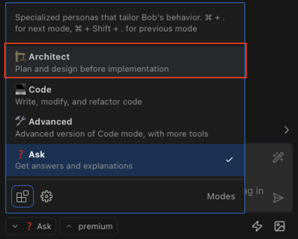
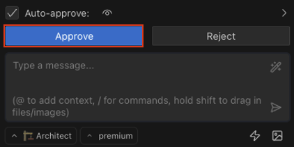
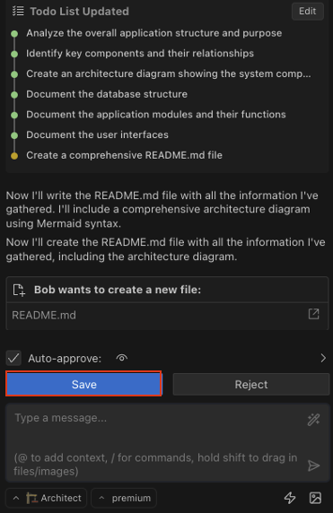
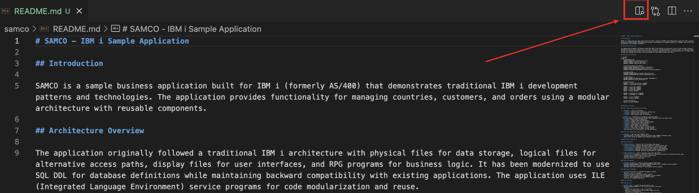

# Project Documentation

Now that we're familiar with Bob and the lab structure, let's start by understanding the existing RPG application. We'll use Bob's Plan Mode to analyze the codebase and create comprehensive documentation.

## Understanding Plan Mode

Plan Mode is specifically designed for tasks like:
- Understanding existing codebases
- Creating technical documentation
- Designing system architecture
- Planning implementation strategies

This mode is perfect for our first task of documenting the application.

## Step 1: Switch to Plan Mode

First, switch to Plan Mode by clicking on the mode selector in the Bob panel and choosing "🏗️ Plan"

## Step 2: Generate Project Documentation

Ask Bob to analyze the codebase and create documentation with an architecture diagram:

[Ask Bob to document the project](command:bob-walkthroughs.chat.startPrompt?%5B%22Provide%20a%20summary%20of%20the%20code%20in%20this%20workspace%20%28samco%29%20including%20an%20architecture%20diagram%20in%20a%20README.md%20file%22%5D)

## Step 3: Review Bob's Analysis

Do not click "Approve" just yet, Bob will analyze the codebase and generate a plan (Todo list) to create a README.md file with:

- A summary of the application's purpose and structure
- Identification of key components (programs, service programs, display files)
- Analysis of the database design (physical and logical files)
- An architecture diagram showing the relationships between components

Pay attention to how Bob:
- Understands the RPG application structure
- Identifies the relationships between different components
- Recognizes the database design patterns
- Interprets the RPG code functionality

### Key Components to Look For

In Bob's analysis, you should see information about:

1. **Database Files**:
   - COUNTRY.PF - Physical file for country data
   - COUNTR1.LF - Logical file for accessing countries by name
   - SAMREF.PF - Reference file with field definitions

2. **RPG Programs**:
   - COU300.RPGLE - Service program with country functions
   - COU301.RPGLE - Program for selecting country codes
   - CUS200.PGM.SQLRPGLE - Program for working with customers

3. **Display Files**:
   - COU301D.DSPF - Display file for selecting countries
   - COU200D.DSPF - Display file for working with countries

## Step 4: Approve Plan

Proceed to approve Bob's plan:

Keep aproving Bob's decisions, you'll see it writing into a markdown file. At this point, save the file:

## Step 5: Preview the Documentation

Once Bob has updated the README.md file, preview it to see the rendered Mermaid diagram:

1. Open the README.md file
2. Click the "Preview" button in the top-right corner of the editor. This icon will appear when a markdown file is opened:

3. Observe how the architecture diagram visualizes the application components and their relationships

## Benefits of Bob's Documentation

Bob's architectural analysis provides several benefits:

- **Onboarding new developers** - Comprehensive documentation helps new team members understand the codebase quickly
- **Planning enhancements** - The architecture diagram makes it easier to identify where changes should be made
- **Identifying improvement areas** - Bob's analysis can highlight areas that would benefit from modernization
- **Knowledge preservation** - Documenting legacy systems helps preserve institutional knowledge

## What We've Learned

In this section, we've seen how Bob can:
- Analyze and understand complex RPG applications
- Generate comprehensive documentation with architecture diagrams
- Adapt to changes in the codebase
- Help developers quickly understand legacy systems
