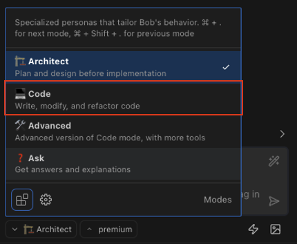
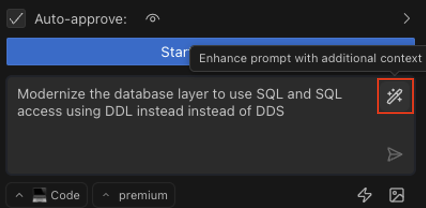
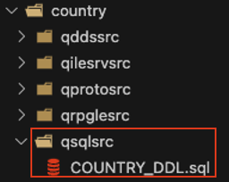
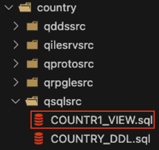
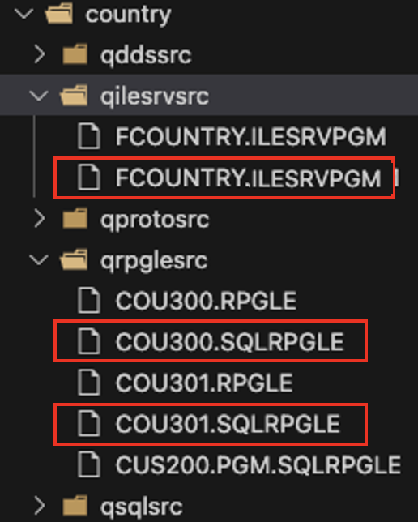
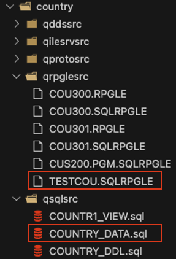
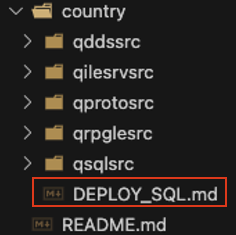
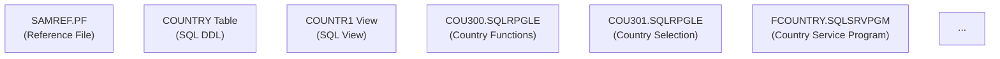

# Database Modernization

In this section, we'll modernize the database layer of our application by converting from traditional DDS (Data Description Specifications) to modern SQL DDL (Data Definition Language). This is a critical step in modernizing IBM i applications.

## Understanding the Challenge

Many IBM i applications were built using DDS for defining database files:
- Physical files (PF) for storing data
- Logical files (LF) for providing alternative access paths

Modern applications benefit from using SQL DDL instead:
- Better integration with industry standards
- Enhanced functionality and performance
- Improved maintainability and readability
- Easier integration with modern tools and applications

## Step 1: Switch to Code Mode

For this task, we'll use Bob's Code Mode, which is optimized for writing and modifying code.

Click on the mode selector in the Bob panel and choose "💻 Code"



## Step 2: Request Database Modernization

Let's ask Bob to modernize our database layer. This task may require a well-crafted prompt, so let's see what can Bob do for us.
Begin by drafting the request (do not send it yet, just write it down):

```text
Modernize the database layer to use SQL and SQL access using DDL instead of DDS
```

Next, ask Bob to refine the prompt with its understanding of the project by clicking **Enhance prompt with additional context**:



Review the suggested prompt and adjust as needed. Since an LLM is generating the improvement, each user will receive a unique variation, but the core idea will remain consistent. For example, the resulting prompt in this case was:

```text
Refactor the database layer to implement a robust SQL architecture, using DDL instead of DDS and embedded SQL access instead of record level access, while ensuring backward compatibility with existing application interfaces
```

Use this prompt, Bob’s suggestion, or your own modified version. Once finalized, send it to Bob to begin planning the database modernization.

## Step 3: Review and Approve Bob's Modernization Plan

Bob will analyze the codebase and provide a plan for modernizing the database layer. This plan should include:

- Analyzing current DB structure
- Converting DDS files (COUNTRY.PF, COUNTR1.LF) to SQL DDL
- Updating record-level access to use SQL statements
- Testing backward compatibility with existing interfaces

Among other tasks..., review this plan carefully to understand Bob's approach and approve it.  
Bob may ask you to approve other actions, such as running commands. This will help Bob interact with your project structure, for example, creating directories.

## Step 4: Review the SQL DDL Implementation

You should see a new folder `qsqlsrc` with the new Country DDL file:



After Bob generates the SQL DDL file, review it carefully and note the key differences between DDS and SQL DDL:

### Column Definitions and Data Types
- DDS uses field references and specific IBM i data types
- SQL DDL uses standard SQL data types and explicit column definitions

### Constraints and Keys
- DDS defines keys separately
- SQL DDL integrates constraints like PRIMARY KEY directly in the table definition

### Comments
- DDS uses special comment formats
- SQL DDL has standard comment syntax

You should see a similar output:

```sql
-- SQL DDL for COUNTRY table
-- Replaces the DDS-based COUNTRY.PF file

-- Drop table if it exists
DROP TABLE IF EXISTS COUNTRY;

-- Create the COUNTRY table
CREATE TABLE COUNTRY (
    COID CHAR(2) NOT NULL,
    COUNTR VARCHAR(30) NOT NULL,
    COISO CHAR(3) NOT NULL,
    PRIMARY KEY (COID)
) 
RCDFMT FCOUN
LABEL ON TABLE IS 'Country file'
LABEL ON COLUMN COID IS 'Country Code'
LABEL ON COLUMN COUNTR IS 'Country Name'
LABEL ON COLUMN COISO IS 'ISO-3 Country Code';

-- Add column headings
LABEL ON COLUMN COUNTRY (
    COID TEXT IS 'CO ID',
    COUNTR TEXT IS 'COUNTRY NAME',
    COISO TEXT IS 'ISO'
);

-- Create an index on COUNTR to support the logical file functionality
CREATE INDEX COUNTRY_NAME_IDX ON COUNTRY (COUNTR);

-- Comments
COMMENT ON TABLE COUNTRY IS 'Country reference table';
COMMENT ON COUNTRY (
    COID IS 'ISO-2 country code',
    COUNTR IS 'Full country name',
    COISO IS 'ISO-3 country code'
);

-- Made with Bob
```

## Step 5: Review the SQL View Implementation

You should see the view file within the same `qsqlsrc` folder:



Review it and note how:

- SQL views replace logical files for providing alternative access paths
- Views can be more flexible than logical files
- Views integrate better with standard SQL tools and applications

You should see a similar output:

```sql
-- SQL View for COUNTR1 logical file
-- Replaces the DDS-based COUNTR1.LF file

-- Drop view if it exists
DROP VIEW IF EXISTS COUNTR1;

-- Create the COUNTR1 view
-- This view provides the same functionality as the COUNTR1 logical file
-- which allows access to country records by country name
CREATE VIEW COUNTR1 
AS SELECT 
    COID,
    COUNTR,
    COISO
FROM COUNTRY
ORDER BY COUNTR;

-- Set the record format name to match the original logical file
LABEL ON TABLE COUNTR1 IS 'Country file by name';

-- Add record format name
ALTER VIEW COUNTR1 ADD RCDFMT FCOUN;

-- Comments
COMMENT ON TABLE COUNTR1 IS 'View of countries ordered by name';

-- Made with Bob
```

## Step 6: Review Updated RPG Programs to Use SQL Access

You should see the next three files created, under `qrpglesrc` and `qilesrvsrc`:



Review the changes Bob made to the RPG programs and note:

### New File Extension
- To allow sql code in RPG, the programs are now under the `sqlrpgle` extension.
- SQL service program created, replacing the original `FCOUNTRY` service program

### Improved Code Readability
- SQL statements are often more self-explanatory than record-level access
- The intent of database operations is clearer

### Performance Considerations
- SQL can leverage the SQL Query Engine (SQE) for better performance
- Set-at-a-time operations can be more efficient than record-by-record processing

### Error Handling Improvements
- SQL provides more robust error handling mechanisms
- SQLSTATE and SQLCODE provide standardized error information

Instead of manually opening, chaining, and closing physical files, the new approach uses SQL `SELECT` to fetch data directly and removes the need for explicit file handling.  

Below are the key excerpts showing the difference. Old RPG code:

```rpgle
    /free
        if not %open(COUNTRY);
          open COUNTRY;
        endif;
         if P_COID <> COID;
           K_COID =  P_COID;
           clear *all FCOUN;
           chain kf COUNTRY;
         endif;
    /end-free
```

New SQL RPG code:

```rpgle
**free

        if P_COID <> K_COID;
            K_COID = P_COID;
            
            // Use embedded SQL to retrieve country data
            exec sql 
               SELECT COUNTR, COISO
               INTO :COUNTR, :COISO
               FROM COUNTRY
               WHERE COID = :P_COID;
               
            // Check if record was found
            if SQLCODE = '00000' or SQLCODE = '01000';
               Found = *ON;
            endif;
         endif;
```

## Step 7: Review Backward Compatibility Test

Bob has created a test program (TESTCOU.SQLRPGLE) and sample data script (COUNTRY_DATA.sql) to verify that the SQL implementation maintains backward compatibility with the existing interfaces:



The test program (TESTCOU.SQLRPGLE) includes:

- **Comprehensive Testing**: Tests all country functions with both existing and non-existent country codes
- **Function Verification**: Validates that GetCountryName, GetCountryIso3, and ExistCountry work correctly
- **Selection Testing**: Tests the country selection interface
- **Clear Results Display**: Shows success/failure indicators for each test

Key sections of the test program:

```rpgle
**free

// Test with existing country
TestCountry('US');
          
// Test with non-existent country
TestCountry('ZZ');
          
// Test country selection
TestSelection('CA');
```

The sample data script (COUNTRY_DATA.sql) provides:

- **Clean Data Setup**: Deletes existing data before inserting new records
- **Comprehensive Sample Data**: Inserts 20 common countries with their ISO codes
- **Verification Queries**: Includes queries to verify the data was inserted correctly

```sql
-- Insert sample country data
INSERT INTO COUNTRY (COID, COUNTR, COISO) VALUES
('US', 'United States', 'USA'),
('CA', 'Canada', 'CAN'),
('MX', 'Mexico', 'MEX'),
...
```

This testing approach ensures that the modernized SQL implementation works exactly like the original DDS-based implementation, allowing for a seamless transition.

## Step 8: Review Modernization Guide

Bob has created a comprehensive deployment guide (DEPLOY_SQL.md) that outlines the steps to implement the SQL-based database architecture.



The guide includes:

- **Step-by-Step Instructions**: Clear commands for creating tables, views, and compiling modules
- **Rollback Plan**: Instructions for reverting to the original DDS-based implementation if needed
- **Verification Steps**: Methods to verify the implementation is working correctly

Key sections of the deployment guide:

1. **Create SQL Tables and Views**:
   ```sql
   RUNSQLSTM SRCFILE(QSQLSRC) SRCMBR(COUNTRY_DDL)
   RUNSQLSTM SRCFILE(QSQLSRC) SRCMBR(COUNTR1_VIEW)
   RUNSQLSTM SRCFILE(QSQLSRC) SRCMBR(COUNTRY_DATA)
   ```

2. **Compile SQL-based Modules**:
   ```
   CRTSQLRPGI OBJ(COU300) SRCFILE(QRPGLESRC) SRCMBR(COU300.SQLRPGLE)
   CRTSQLRPGI OBJ(COU301) SRCFILE(QRPGLESRC) SRCMBR(COU301.SQLRPGLE)
   ```

3. **Create SQL-based Service Program**:
   ```
   CRTSRVPGM SRVPGM(FCOUNTRY) MODULE(COU300 COU301) EXPORT(*SRCFILE) SRCFILE(QILESRVSRC) SRCMBR(FCOUNTRY.SQLSRVPGM)
   ```

This guide provides a clear roadmap for implementing the database modernization in a production environment, ensuring a smooth transition from DDS to SQL.

## Step 9: Review Updated Documentation

Bob has automatically updated the main README.md file to reflect the database modernization changes, providing comprehensive documentation of the new architecture.

Key updates to the documentation include:

- **Updated Architecture Diagram**: Shows the new SQL-based components and their relationships
- **SQL Tables and Views**: Documents the new SQL DDL-based database structure
- **SQL-based Modules**: Describes the updated modules that use embedded SQL
- **Database Modernization Section**: Explains the modernization approach and benefits
- **Deployment Reference**: Links to the detailed deployment guide

The updated architecture diagram clearly shows the transition from DDS to SQL:



The documentation now accurately reflects the modernized state of the application, making it easier for developers to understand the new SQL-based architecture while highlighting the benefits of the modernization.

## Benefits of Database Modernization

This modernization brings several benefits:

- **Better integration** with modern tools and standards
- **Improved performance** through SQL optimization
- **Enhanced maintainability** and readability
- **Easier integration** with web and mobile applications
- **Future-proofing** your application

## What We've Learned

In this section, we've seen how Bob can:
- Analyze existing DDS database definitions
- Convert them to modern SQL DDL
- Transform logical files into SQL views
- Update RPG code to use SQL access
- Maintain backward compatibility with existing interfaces
