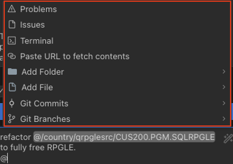
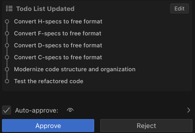
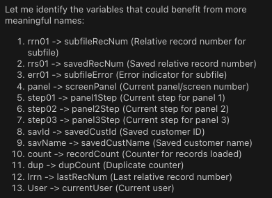
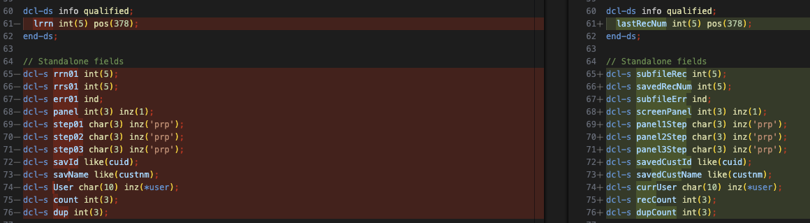
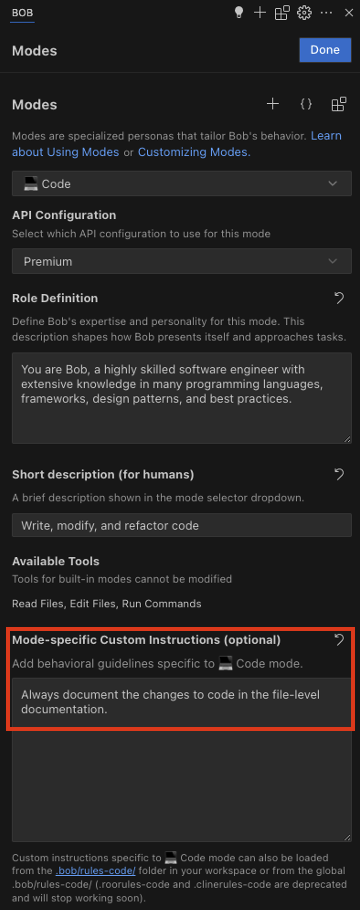

# RPG Code Modernization

In this section, we'll modernize the RPG code by converting it from fixed-format to free-format, improving variable names, and converting subroutines to subprocedures. These changes will make the code more readable, maintainable, and aligned with modern programming practices.

## Understanding RPG Evolution

RPG has evolved significantly over the years:
- **RPG III** - Column-dependent format with limited capabilities
- **RPG IV** - Introduced in 1994 with expanded capabilities but still column-dependent
- **Free-format RPG** - Modern syntax that's not column-dependent, introduced gradually since 2001
- **Fully free RPG** - Complete free-format capabilities including calculations and declarations

Modern free-format RPG offers many advantages:
- More readable and intuitive syntax
- Not restricted by column positions
- Easier to learn for developers familiar with other languages
- Better support for modern development tools

## Step 1: Ensure Code Mode is Active

Make sure Bob is still in Code Mode. If not, switch to Code Mode by clicking on the mode selector and choosing "💻 Code"


## Step 2: Request RPG Code Modernization

Let's ask Bob to modernize one of our RPG programs. Write down the next prompt in the chat:

```text
refactor @country/qrpglesrc/CUS200.PGM.SQLRPGLE to fully free RPGLE
```
It is important that you type-in the prompt, so you can see the options that Bob gives you when typing `@`:



Bob will analyze the code and provide a plan for converting it to fully free-format RPG:



## Step 3: Review the Transformation

After Bob completes the transformation, review the changes and note how:

- Fixed-format declarations have been converted to free-format
- Calculation specifications have been converted to free-format
- File operations have been modernized
- Control flow structures have been updated

Let's examine some specific examples of the transformation:

### Declaration Statements
- Fixed-format declarations with specific columns for name, type, length, etc.
- Free-format declarations using DCL-* statements

**Original (Fixed Format):**
```rpgle
     D indds           ds
     D  help                   1      1n
     D  exit                   3      3n
     D  prompt                 4      4n
     D  refresh                5      5n
     D  create                 6      6n
```

**Modernized (Free Format):**
```rpgle
**free

dcl-ds indds qualified;
  help ind pos(1);
  exit ind pos(3);
  prompt ind pos(4);
  refresh ind pos(5);
  create ind pos(6);
end-ds;
```

### Calculation Operations
- Fixed-format calculations with operation codes in specific columns
- Free-format calculations using modern operators and expressions

Note: The original code was already using free-format calculations within a `/free` directive, but in traditional fixed-format RPG, it would have looked like this:

**Traditional Fixed Format (pre-RPG IV):**
```rpgle
C                     READ      CUSTOME2
C                     DOW       NOT %EOF(CUSTOME2) AND COUNT < 14
C                     ADD       1             RRN01
C                     ADD       1             COUNT
C                     WRITE     SFL01
C                     READ      CUSTOME2
C                     ENDDO
```

**Modernized (Fully Free Format):**
```rpgle
**free

dcl-proc s01lod;
  s01rst();
  rrb01 = rrn01 + 1;
  opt01 = 0;
  count = 0;
  read custome2;
  dow not %eof(custome2) and count < 14;
    rrn01 += 1;
    count += 1;
    write sfl01;
    read custome2;
  enddo;
  indds.sflend = %eof(custome2);
  step01 = dsp;
  s01sav();
end-proc;
```

### File Operations
- Fixed-format file operations with specific operation codes
- Free-format file operations with clearer syntax

**Original (Fixed Format):**
```rpgle
     fcustome2  if   e           k disk    rename(fcust:fcust2)
     fcustome1  uf a e           k disk
     fcus200d   cf   e             workstn
     F                                     indds(indds)
     F                                     sfile(sfl01:rrn01)
     F                                     Infds(Info)
```

**Modernized (Free Format):**
```rpgle
**free

dcl-f custome2 if e keyed disk rename(fcust:fcust2);
dcl-f custome1 usage(*update) keyed disk;
dcl-f cus200d cf e workstn indds(indds) sfile(sfl01:rrn01) infds(info);
```

### Subroutines to Subprocedures

**Original (Subroutine):**
```rpgle
**free

begsr pnl01;
  select ;
  when step01 = prp ;
    exsr s01prp;
  when step01 = lod ;
    exsr s01lod;
  when step01 = dsp ;
    exsr s01dsp;
  when step01 = key ;
    exsr s01key;
  when step01 = chk ;
    exsr s01chk;
  when step01 = act ;
    exsr s01act ;
  endsl;
endsr;
```

**Modernized (Subprocedure):**
```rpgle
**free

dcl-proc pnl01;
  select;
    when step01 = prp;
      s01prp();
    when step01 = lod;
      s01lod();
    when step01 = dsp;
      s01dsp();
    when step01 = key;
      s01key();
    when step01 = chk;
      s01chk();
    when step01 = act;
      s01act();
  endsl;
end-proc;
```

## Step 4: Improve Variable Names

Now let's ask Bob to improve the variable names in the code:

```text
replace variable names for the file @country/qrpglesrc/CUS200.FREEF.SQLRPGLE with more meaningful ones, but keep them as short as possible while being explainable
```

Feel free to usse Bob to improve this prompt and sent it.

## Step 5: Review the Variable Renaming

Bob will analyze all variables and only consider the once that could benefit from a change:



After Bob completes the variable renaming, review the changes and note how:

- Cryptic abbreviations have been replaced with more descriptive names
- Names now better reflect their purpose and usage
- The code is more self-documenting
- The balance between brevity and clarity has been maintained



## Step 6: (Optional) Convert Subroutines to Subprocedures

Sometimes Bob won't convert subroutines to subprocedures in Step 2, since it is not explicitely asked to do so. If this is the case, try to modernize the code by converting subroutines to subprocedures and letting Bob adapt the whole code to it.

[Convert Subroutines](command:bob-walkthroughs.chat.startPrompt?%5B%22convert%20subroutines%20to%20subprocedures%20and%20use%20parameters%20where%20possible%22%5D)

Bob will analyze the code and convert the subroutines to proper subprocedures with parameters.

## Step 7: Document Subprocedure

Lastly, let's create the documentation for the [s02chk](command:bob-walkthroughs.openDocument?%5B%22country%2Fqrpglesrc%2FCUS200.FREE.SQLRPGLE%22%2C%22330-358%22%5D) subprocedure.

Ask Bob the following:

```text
Create the subprocedure documentation for the s02chk subprocedure, in file @country/qrpglesrc/CUS200.FREE.SQLRPGLE. Add the changes in the file documentation.
```
**Note**: if you are using the same chat for all the lab, you don't need to specify the file every time you ask something that references the same file, Bob will infer it from the conversation.

Notice the level of explanation for the subprocedure documentation:

```rpgle
**free

//==============================================================================
// Check Customer Data Validity
//==============================================================================
// Purpose: Validates customer data before saving to database
//
// Validation rules:
// 1. Country code must exist in the country table
// 2. Customer name cannot be blank
// 3. Phone number cannot be blank and must contain only digits
// 4. Customer name + phone combination must be unique in the database
//
// Input:
//   - cucoun - Country code
//   - custnm - Customer name
//   - cuphone - Customer phone number
//   - mode - Operation mode (CRT or UPD)
//
// Side effects:
//   - Sets error indicators if validation fails
//   - Sets panel2Step to 'dsp' if any validation fails, otherwise 'act'
//   - Trims phone number
//   - Sets errData with customer name + phone if duplicate found
//
// Dependencies:
//   - ExistCountry() function from country service program
//   - CUSTOMER table for duplicate checking
//==============================================================================
dcl-proc s02chk;
```

Moreover, the changes are documented in the file-level documentation, as executed as `Bob`:

```rpgle
**free

//==============================================================================
// Author:      VTAQUIN    16/12/2016 10:10  01.02.02
// Modifs:      04 BOB      25/09/2025 15:48  01.02.13    00/
//                =====> Variable names refactored for clarity   =====
//              03 VTAQUIN    20/05/2020 10:50  01.02.12    00/
//              02 VTAQUIN    20/05/2020 00:00  01.02.10    00/
//              01 VTAQUIN    16/01/2017 11:39  01.02.04    00/
//              02 VTAQUIN    16/12/2016 10:10  01.02.02    00/
//                =====> Type RPGLE      changed to SQLRPGLE   =====
//              01 VTAQUIN    03/11/2016 17:19  01.01.00    00/
//==============================================================================
```

### Customize Bob Modes
In practice, these types of instructions can be integrated into one of Bob's modes. For this example, you can modify `Code` mode to add this instruction so you don't have to specify it every time Bob makes a code change:



## Benefits of RPG Code Modernization

This modernization brings several benefits:

- **Improved readability** - Code is easier to understand and maintain
- **Better organization** - Modular code with clear interfaces
- **Enhanced maintainability** - Easier to modify and extend
- **Easier debugging** - Clearer structure makes issues easier to identify
- **Skill transferability** - Modern RPG is more similar to other languages
- **Future-proofing** - Alignment with IBM's direction for RPG

## What We've Learned

In this section, we've seen how Bob can:
- Convert fixed-format RPG to free-format
- Improve variable names for better readability
- Transform subroutines into proper subprocedures
- Enhance code modularity and reusability
- Maintain the functionality while modernizing the structure
