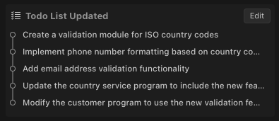
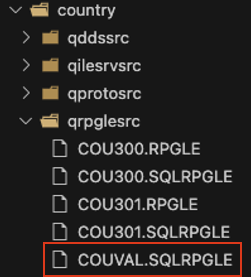
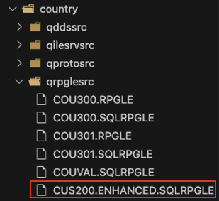

# RPG Feature Implementation

In this section, we'll implement a new feature to enhance our application: country data validation and enrichment. This feature will add validation for ISO country codes, format phone numbers based on country codes, and validate email addresses.

## Understanding the Need

Data validation and enrichment are critical for ensuring data quality and providing a better user experience. For our country management application, we can enhance it by:

- Validating ISO country codes against international standards
- Formatting phone numbers according to country-specific patterns
- Validating email addresses to ensure they follow proper format

These enhancements will improve data quality and user experience without requiring major changes to the application structure.

## Step 1: Ensure Code Mode is Active

Make sure Bob is still in Code Mode. If not, switch to Code Mode by clicking on the mode selector and choosing "💻 Code"


## Step 2: Request Feature Implementation

Let's ask Bob to implement our new feature:

```text
Add a new feature to validate and enrich country data in the application. Specifically:
   - Add validation for ISO country codes to ensure they match international standards
   - Create a new subprocedure to format phone numbers based on country codes
   - Add a function to validate email addresses
Do not create tests, that will be done later on
```

Bob will analyze the request and provide a plan for implementing these features.

## Step 3: Review Bob's Implementation Plan

Bob will propose a plan that likely includes:

- Creating a new service program for validation functions
- Adding ISO validation to existing country code handling
- Implementing phone number formatting based on country standards
- Adding email validation functionality

Review this plan carefully to understand Bob's approach.




## Step 4: Review the ISO Validation Implementation

You should see a similar file under `qrpglesrc`:



Review the code and note a comprehensive ISO country validation system:

- Created a data structure with ISO country codes and related information
- Implemented validation functions that check against this data
- Added detailed country information retrieval

Here's the ISO country validation implementation:

```rpgle
**free

// ISO country code validation table
dcl-ds iso_country_codes qualified dim(250) ctdata;
  country_code char(2);
  country_name varchar(50);
  iso3_code char(3);
  phone_code varchar(5);
  phone_format varchar(20);
end-ds;

// IsValidIsoCountry - Validates if a country code is a valid ISO code
dcl-proc IsValidIsoCountry export;
  dcl-pi *n ind;
    p_country_code char(2) const;
  end-pi;
  
  dcl-s i int(10);
  dcl-s found ind inz(*off);
  
  // Convert to uppercase for comparison
  dcl-s country_code char(2);
  country_code = %xlate(%lower:%upper:p_country_code);
  
  // Search for the country code in the ISO table
  for i = 1 to iso_country_count;
    if iso_country_codes(i).country_code = country_code;
      found = *on;
      leave;
    endif;
  endfor;
  
  return found;
end-proc;
```

The implementation includes a table of ISO country codes loaded using the CTDATA keyword, which is an elegant RPG feature for including data directly in the source code:

```rpgle
**free

**CTDATA iso_country_codes
US United States                                  USA 1     (###) ###-####
CA Canada                                         CAN 1     (###) ###-####
MX Mexico                                         MEX 52    ## #### ####
GB United Kingdom                                 GBR 44    #### ######
FR France                                         FRA 33    # ## ## ## ##
```

## Step 5: Review the Phone Formatting Implementation

The phone formatting feature demonstrates Bob's ability to implement complex string manipulation in RPG. The implementation:

- Uses country-specific formatting patterns
- Handles different international phone number formats
- Adds country calling codes automatically

Here's the phone formatting implementation:

```rpgle
**free

dcl-proc FormatPhoneNumber export;
  dcl-pi *n varchar(30);
    p_country_code char(2) const;
    p_phone_number varchar(20) const;
  end-pi;
  
  dcl-ds country_info likeds(GetIsoCountryInfo(p_country_code));
  dcl-s formatted_number varchar(30);
  dcl-s digits varchar(20);
  
  // If country not found, return the original number
  if not country_info.valid;
    return p_phone_number;
  endif;
  
  // Extract only digits from the phone number
  digits = '';
  for i = 1 to %len(%trimr(p_phone_number));
    if %subst(p_phone_number:i:1) >= '0' and %subst(p_phone_number:i:1) <= '9';
      digits += %subst(p_phone_number:i:1);
    endif;
  endfor;
  
  // Apply the format
  formatted_number = '';
  format_pos = 1;
  digit_pos = 1;
  
  for i = 1 to %len(%trimr(country_info.phone_format));
    if %subst(country_info.phone_format:i:1) = '#';
      if digit_pos <= %len(digits);
        formatted_number += %subst(digits:digit_pos:1);
        digit_pos += 1;
      endif;
    else;
      formatted_number += %subst(country_info.phone_format:i:1);
    endif;
  endfor;
  
  // Add the country code prefix
  formatted_number = '+' + %trimr(country_info.phone_code) + ' ' + formatted_number;
  
  return formatted_number;
end-proc;
```

This function uses a template-based approach where '#' characters in the format string are replaced with actual digits from the phone number, creating properly formatted international phone numbers.

## Step 6: Review the Email Validation Implementation

The email validation function demonstrates modern string handling capabilities in RPG:

- Comprehensive validation of email format
- Checks for valid characters in local and domain parts
- Validates domain structure

Here's the email validation implementation:

```rpgle
**free

dcl-proc IsValidEmail export;
  dcl-pi *n ind;
    p_email varchar(100) const;
  end-pi;
  
  dcl-s email varchar(100);
  dcl-s at_pos int(10);
  dcl-s dot_pos int(10);
  dcl-s local_part varchar(64);
  dcl-s domain_part varchar(255);
  
  // Trim the email address
  email = %trimr(p_email);
  
  // Find the @ symbol
  at_pos = %scan('@':email);
  if at_pos <= 1 or at_pos = %len(email);
    return *off;
  endif;
  
  // Extract local part and domain part
  local_part = %subst(email:1:at_pos-1);
  domain_part = %subst(email:at_pos+1);
  
  // Check for dot in domain part
  dot_pos = %scan('.':domain_part);
  if dot_pos <= 1 or dot_pos = %len(domain_part);
    return *off;
  endif;
  
  // Check for invalid characters in local part
  if %check('ABCDEFGHIJKLMNOPQRSTUVWXYZabcdefghijklmnopqrstuvwxyz' +
            '0123456789!#$%&''*+-/=?^_`{|}~.':local_part) > 0;
    return *off;
  endif;
  
  return *on;
end-proc;
```

This function uses RPG built-in functions like `%scan`, `%subst`, and `%check` to perform sophisticated string validation, showing how modern RPG can handle complex text processing tasks.

## Step 7: Review the Integration

The integration of these new features into the existing application shows Bob's ability to enhance legacy code without disrupting its structure:

- Added validation calls in the appropriate places
- Enhanced the data structure with new error indicators
- Added documentation to explain the validation rules

Instead of overwriting the existing file, Bob may generate a separate one. In this case:



Bob does not always follow standard naming conventions. Here it produced a readable and recognizable name, but not one typically used in practice. Adjust file names as needed, or define the naming convention directly in the prompt.

Here's how the new features are integrated into the customer validation procedure:

```rpgle
**free

dcl-proc s02chk;
  panel2Step = act;
  
  // Validate country code using the new ISO validation
  if not IsValidIsoCountry(cucoun);
    indds.errCountry = *on;
    panel2Step = dsp;
  endif;
  
  // Validate customer name
  if custnm = *blanks;
    indds.errName = *on;
    panel2Step = dsp;
  endif;
  
  // Validate phone number
  if cuphone = *blanks;
    indds.errPhone = *on;
    panel2Step = dsp;
  else;
    cuphone = %trim(cuphone);
    if %check('0123456789':%trim(cuphone)) > 0;
      indds.errPhoneNum = *on;
      panel2Step = dsp;
    else;
      // Format phone number according to country format
      formattedPhone = FormatPhoneNumber(cucoun: cuphone);
    endif;
  endif;
  
  // Validate email if provided
  if cuemail <> *blanks and not IsValidEmail(%trim(cuemail));
    indds.ErrEmail = *on;
    panel2Step = dsp;
  endif;
end-proc;
```

The integration also includes detailed documentation that explains the validation rules and dependencies:

```rpgle
**free

//==============================================================================
// Check Customer Data Validity
//==============================================================================
// Purpose: Validates customer data before saving to database
//
// Validation rules:
// 1. Country code must be a valid ISO country code
// 2. Customer name cannot be blank
// 3. Phone number cannot be blank and must contain only digits
// 4. Email address must be valid if provided
// 5. Customer name + phone combination must be unique in the database
//
// Dependencies:
// - IsValidIsoCountry() function from country service program
// - IsValidEmail() function from country service program
// - FormatPhoneNumber() function from country service program
//==============================================================================
```

This comprehensive documentation helps future developers understand the validation logic and dependencies.

## Benefits of the New Feature

This new feature brings several benefits:

- **Improved data quality** - Validation ensures data meets standards
- **Better user experience** - Formatted phone numbers are easier to read
- **Enhanced data integrity** - Validation prevents invalid data entry
- **Modern functionality** - Advanced validation in a legacy application

## What We've Learned

In this section, we've seen how Bob can:
- Analyze requirements for new features
- Create new service programs with specialized functions
- Implement validation and formatting logic
- Integrate new functions into existing applications
- Maintain backward compatibility while adding new features
