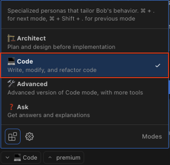
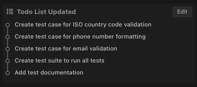
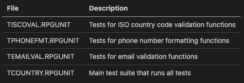

# RPG Unit Test Generation

In this section, we'll create unit tests for the country data validation and enrichment features we implemented in the previous section. Unit testing is a critical practice for ensuring code quality and reliability, even in traditional RPG environments.

## Understanding RPG Unit Testing

Unit testing in RPG has traditionally been challenging, but modern tools like RPGUnit make it possible to apply test-driven development practices to RPG code. Benefits include:

- Verifying that code works as expected
- Documenting expected behavior
- Making it safer to refactor or modify code
- Catching regressions early
- Improving overall code quality

## Step 1: Ensure Code Mode is Active

Make sure Bob is still in Code Mode. If not, switch to Code Mode by clicking on the mode selector and choosing "💻 Code"



## Step 2: Request Unit Test Generation

Let's ask Bob to generate unit tests for our new validation and formatting functions, use the next prompt within the same conversation from the previous task:

```text
Generate unit test cases using the RPGUnit Framework code for the country data validation and enrichment functions we just implemented. Include test code for ISO country code validation, phone number formatting, and email validation. We won’t be executing these tests, but we want to see how you would structure them.
```

Bob will analyze the validation and formatting functions and generate appropriate unit tests.



## Step 3: Review the Test Structure

After Bob generates the test code, review the overall structure and note:

- How the tests are organized into modules
- The setup of test data and fixtures
- The assertions used to verify expected behavior
- The comments explaining the testing approach

The resulting structure in our case is:



**Note**: Notice the file extension, in our case is .RPGUNIT which doesn't exist. This is a typical scenario of "Model Hallucination", that's why is important to keep the human in the loop. If this happens, tell Bob to rename the files.

## Step 4: Examine ISO Validation Tests

Note how Bob has:
- Created tests for both valid and invalid country codes
- Included tests for edge cases like case sensitivity
- Added tests for the country information retrieval function
- Used clear assertion messages that explain the expected behavior

Here's an example of the ISO validation tests:

```rpgle
**FREE

dcl-proc test_valid_country_codes export;
  // Test with known valid country codes
  assert(IsValidIsoCountry('US') : 'US should be a valid country code');
  assert(IsValidIsoCountry('CA') : 'CA should be a valid country code');
  assert(IsValidIsoCountry('MX') : 'MX should be a valid country code');
  assert(IsValidIsoCountry('GB') : 'GB should be a valid country code');
  assert(IsValidIsoCountry('JP') : 'JP should be a valid country code');
  
  // Test case insensitivity
  assert(IsValidIsoCountry('us') : 'us (lowercase) should be a valid country code');
  assert(IsValidIsoCountry('Ca') : 'Ca (mixed case) should be a valid country code');
end-proc;
```

## Step 5: Examine Phone Formatting Tests

Note how Bob has:
- Created tests for US and international phone number formats
- Included tests for different input formats (with dashes, spaces, etc.)
- Added tests for edge cases like invalid country codes
- Tested case sensitivity in country codes
- Verified handling of phone numbers with different lengths

Here's an example of the phone formatting tests:

```rpgle
**FREE

dcl-proc test_us_phone_formatting export;
  // Test with various US phone number formats
  assert(FormatPhoneNumber('US': '1234567890') = '+1 (123) 456-7890' :
         'US 10-digit number should be formatted correctly');
         
  assert(FormatPhoneNumber('US': '123-456-7890') = '+1 (123) 456-7890' :
         'US number with dashes should be formatted correctly');
         
  assert(FormatPhoneNumber('US': '(123) 456-7890') = '+1 (123) 456-7890' :
         'US number with parentheses should be formatted correctly');
         
  assert(FormatPhoneNumber('US': '123 456 7890') = '+1 (123) 456-7890' :
         'US number with spaces should be formatted correctly');
end-proc;
```

## Step 6: Examine Email Validation Tests

Finally, let's look at the tests for the email validation function:

- Created tests for various valid email formats
- Included tests for invalid email formats
- Added tests for email length limits
- Tested handling of special characters
- Verified whitespace handling
- Included tests for domain-specific rules

Here's an example of the email validation tests:

```rpgle
**FREE

dcl-proc test_valid_emails export;
  // Test with standard email formats
  assert(IsValidEmail('user@example.com') :
         'Standard email should be valid');
         
  assert(IsValidEmail('first.last@example.com') :
         'Email with dot in local part should be valid');
         
  assert(IsValidEmail('user+tag@example.com') :
         'Email with plus in local part should be valid');
         
  assert(IsValidEmail('user-name@example.co.uk') :
         'Email with hyphen and subdomain should be valid');
end-proc;
```

## Step 7: Review Test Organization

Bob has created a main test suite that runs all the individual test cases:

```rpgle
**FREE

// Main procedure
dcl-proc TCOUNTRY;
  dcl-pi *n;
  end-pi;
  
  // Display header
  dsply '======================================================';
  dsply 'Running Country Validation Test Suite';
  dsply '======================================================';
  
  // Run ISO country code validation tests
  dsply ' ';
  dsply 'Running ISO Country Code Validation Tests...';
  run_test_iso_validation();
  
  // Run phone number formatting tests
  dsply ' ';
  dsply 'Running Phone Number Formatting Tests...';
  run_test_phone_formatting();
  
  // Run email validation tests
  dsply ' ';
  dsply 'Running Email Validation Tests...';
  run_test_email_validation();
  
  // Display footer
  dsply ' ';
  dsply '======================================================';
  dsply 'Country Validation Test Suite Complete';
  dsply '======================================================';
  
  return;
end-proc;
```

This organization provides several benefits:
- Tests are grouped by functionality
- Each test module focuses on a specific feature
- The main test suite provides a single entry point to run all tests
- Test results are clearly displayed with headers and footers
- Individual test cases can be run separately or as part of the suite

This documentation ensures that developers can understand how to run and maintain the tests even if they weren't involved in their creation.

## Benefits of Unit Testing in RPG

Unit testing brings several benefits to RPG development:

- **Improved code quality** - Tests help identify issues early
- **Documentation of behavior** - Tests serve as executable documentation
- **Safer refactoring** - Tests catch regressions when code is changed
- **Easier maintenance** - Well-tested code is easier to maintain
- **Modern practices** - Applying industry-standard practices to RPG

## What We've Learned

In this section, we've seen how Bob can:
- Generate comprehensive unit tests for RPG code
- Structure tests with proper setup and assertions
- Create tests for various scenarios including edge cases
- Apply modern testing practices to traditional RPG code
- Document expected behavior through test cases
