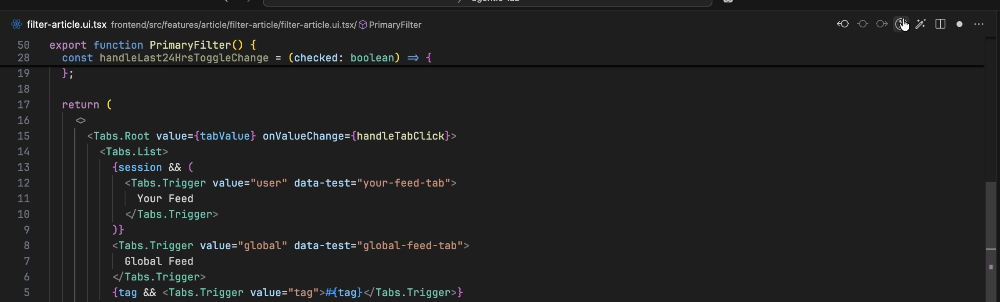

# Literate coding
Sometimes you just want to describe your ideal feature in plain language. Here where Bob shine with `literate coding`.

Let's explore it by trying to add a toggle to filter out articles published within the last 24 hours in Bobverse.
1. [Open to articles-feed.ui.tsx](command:bob-walkthroughs.openDocument?%5B%22frontend%2Fsrc%2Fwidgets%2Farticles-feed%2Farticles-feed.ui.tsx%22%5D).
2. Turn on literate coding mode via `cmd+m` or the UI by clicking the magic wand .
3. Describe your intent: on line 71, enter `Add toggle to show latest articles created in the last 24 hours`.
4. Now we want to make sure to have a unique message when toggle is on but no articles are found:
5. [Jump to line 81 articles-feed.ui.tsx](command:bob-walkthroughs.openDocument?%5B%22frontend%2Fsrc%2Fwidgets%2Farticles-feed%2Farticles-feed.ui.tsx%22%5D)
6. Enter `Add unique message when toggle enabled`.
7. Click _Generate_
8. Bob will create code according to your intent. When done, check the code in the diff view that is displayed.
9. Click _Accept all_.
10. Save the file.
11. Open the browser and reload bobverse at http://localhost:30402/. Notice the toggle at the top of the article list. Enable the toggle to only see the most recent articles.
