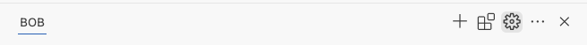
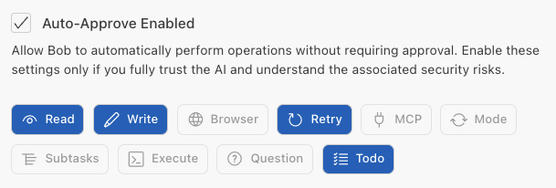

# Step 1: Static Code Analysis

## First, lets verify the prerequisites are installed

Ask Bob to run the devsecops-lab-prereq.sh script to ensure the tools are all installed for the lab.

**Try it out:**<br>
[devsecops-lab-prereq.sh](command:bob-walkthroughs.chat.startPrompt?%5B%22run%20the%20bash%20script%20'devsecops-lab-prereq.sh'%20from%20the%20working%20directory%20to%20ensure%20the%20local%20environment%20has%20all%20the%20necessary%20tools%20installed.%22%5D)

> _Prompt used:_ <br>
Run the bash script 'devsecops-lab-prereq.sh' from the working directory to ensure the local environment has all the necessary tools installed.

Now let's install the npm modules required. On your terminal, run the following command:

```
cd vulnerable-webapp
npm install
```

**Enable Auto-approve on Bob**<br>
Auto-approve settings speed up your workflow by eliminating repetitive confirmation prompts. <br>

Go to Bob 'settings' <br>


Enable 'Read', 'Write', 'Retry' and 'Todo'<br>


## Identify vulnerabilities

Review the source code for potential security issues.

```
mkdir -p ../reports
npm audit --json > ../reports/npm-audit-report.json
```

Run **ESLint** with security plugins to identify potential security issues on the terminal:

```
npm install --save-dev eslint eslint-plugin-security
npx eslint -c eslint-security.config.js app.js --format html --output-file ../reports/eslint-report.html
```

## Remediate issues

**To fix the npm audit errors**<br>
Run the following command:
```
npm audit fix --force
npm audit --json > ../reports/npm-audit-report.json
```
**To fix the remaining errors**<br>
Open the **generated reports (DevSecOps-lab/reports)** and review the identified issues. <br>
In Bob chat, ask Bob to help understand and fix the issues. <br>
> _Use prompt:_ <br>
  Resolve the npm audit and ESLint scan results from @<'Add folder' and select 'reports-folder'>