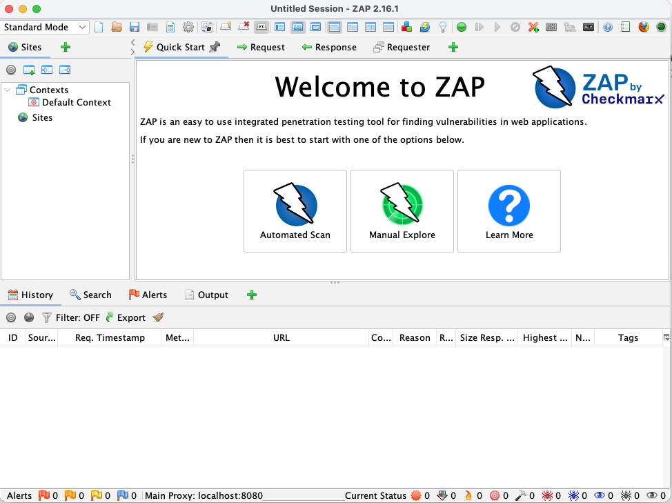
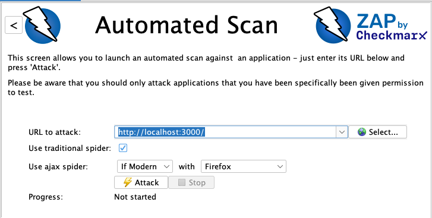
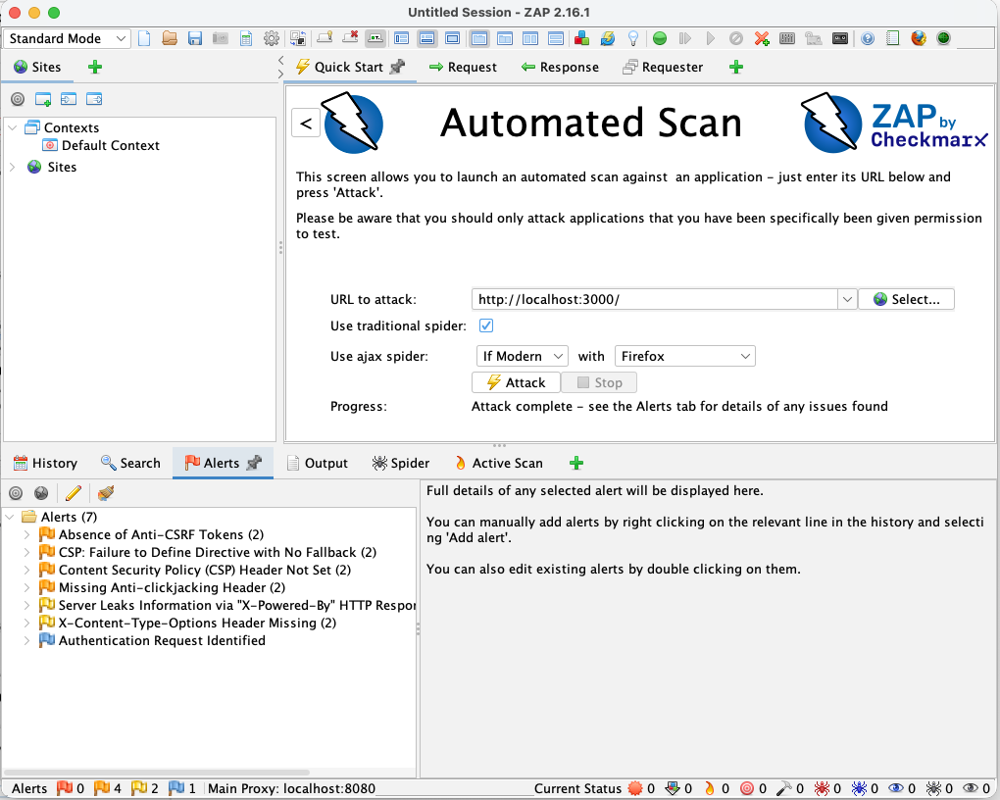
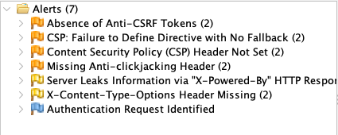
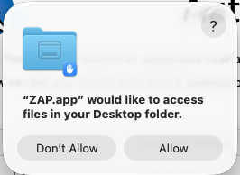
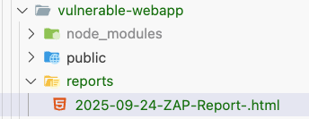

# Step 3: Dynamic Application Security Testing with OWASP ZAP

## Identify vulnerabilities:

1. You need to run a security scan using the **OWASP ZAP** tool to detect runtime vulnerabilities.
2. On your macOS, go to Applications > "ZAP.app". Or `command+space` type zap.app
    - ‼️ _If the app is not opening, you will see a message like: "ZAP.app" cannot be opened because the developer cannot be verified. To circumvent this warning, you would need to go to System Preferences > Security & Privacy at the bottom of the dialog. You will see a message saying that "ZAP" was blocked. Next to it, if you trust the downloaded installer, you can click Open anyway._
    - You can skip updating the add-ons.
3. Ignore the Update Add-on window, and click close.
4. Click on **"Automated Scan"**
5. Enter the URL: **http://localhost:3000**
6. Hit **⚡️ Attack**
7. Review the **Alerts** tab

**Screenshots for reference:**

Zap Homescreen





Click '⚡️ Attack' to initiate the scan



View the Alert list:



## Remediate issues: 

**Export ZAP report and add to your working directory**

Go to 'Reports' > 'Generate Report'


Select 'Desktop' to save your report:



Add report to your working directory



---

**Share the ZAP scan report with [Bob](command:bob-walkthroughs.views.focusSidebar) for resolution of identified issues.** <br>

> _Use prompt:_ <br>
Resolve the OWASP ZAP scan results from @/reports/zap-report.html

---

**Verify the Fixes** <br>
Once the fixes are applied, restart the application: <br>
1. Stop the Node.js application using Ctrl + C.
2. Run the following commands to reinstall dependencies and start the app:
```
npm install
npm start
```

**Re-run the ZAP Scan** <br>
In the ZAP application: <br>
1. Delete the existing alerts.
2. Manually perform a new scan.
3. Find out the number of alerts. _(you will notice that the number of alerts has reduced)_

**[Revisit After Completing All Lab Tasks]** <br>
_This step can be deferred until all other lab tasks are completed._ <br>
To solve the remaining alerts generated: <br>
1. Return to the ZAP app.
2. Delete previously saved local reports and regenerate fresh ones.
3. Share the updated ZAP report with Bob and ask to review and address the identified issues.

_Note: If you face any error while running this, highlight the error on the terminal > right click > Bob > fix this command._

---

**Stop the application**

Use `control+C` in the terminal to stop the node application.