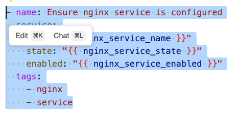
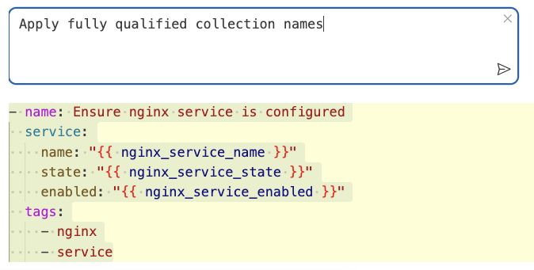
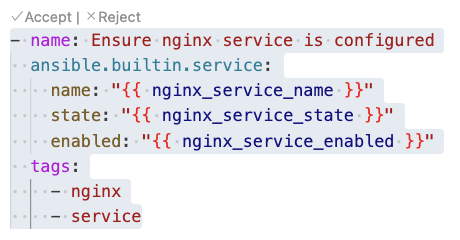
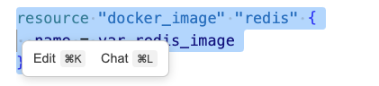
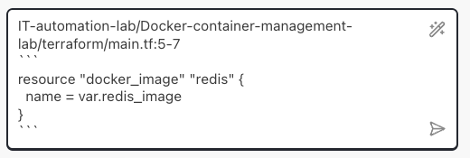

# Let’s explore some of Bob’s features:

## 💡 Code Actions

Bob integrates with VS Code’s Code Actions to offer AI-powered suggestions like quick fixes and refactorings.

Try this:
1. Open your Terraform `main.tf` file
2. Select a resource block (e.g., tx_web)
3. Click the light bulb icon and choose **Explain with Bob**

Bob will analyze the code and provide a detailed explanation, including:
- **Purpose and functionality**
- **Key components and interactions**
- **Patterns or techniques used**

---

## 🛠️ Custom Modes

Customize Bob’s behavior for specific tasks or workflows. Modes can be:  
**Global** – available across all projects  
**Project-specific** – defined within a single project  

To create a custom mode:
1. First, switch to **Advanced** Mode in [Bob](command:bob-walkthroughs.views.focusSidebar)
2. Type in the below prompt:
> Create a new mode called IT Automation. It should be able to read configuration files and generate automation scripts (e.g., Ansible playbooks, Terraform modules, Kubernetes manifests) in a safe, idempotent, auditable way and apply best practices.

**Apply the mode:**  
Once you have done creating the **IT Automation mode**, lets use that to apply it to this repository.  
Select **IT Automation mode** in [Bob](command:bob-walkthroughs.views.focusSidebar) chat and apply best practices to one single Ansible file.
> Example prompt: "Explain what Ansible best practices can be applied to my ansible file @ansible-playbook.yml"

---

## Try in-line edits (⌘K)

Go to any of the **Ansible playbook** or **Ansible role** and make an in-line edit.  
Select an Ansible task and initiate an in-line edit by hitting `⌘K`  

Try it out:  
 

Type "Apply Ansible fully qualified collection name"  

Bob will refactor your code with the edits mentioned. You can either 'Accept' or 'Reject' the changes 

---

## Try add to chat context (⌘L)

Go to any source code file, select a code block and initiate a chat context by hitting `⌘L`  
The code snippet will be pasted to Bob chat, where you can then ask your questions or request help.  

Try it out:  

Bob chat:  
