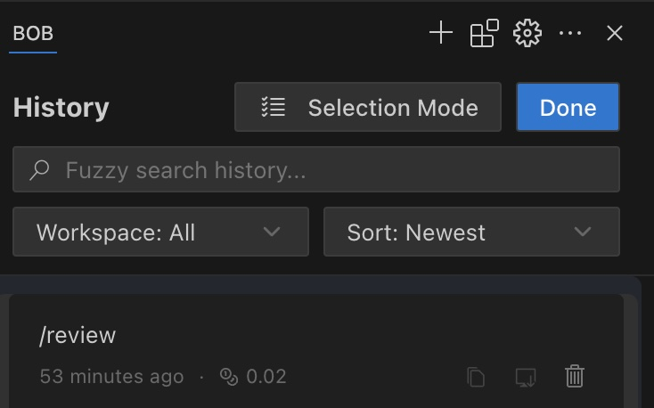

# This is Bob

Bob has an excellent memory and keeps track of all your conversations to provide a seamless experience.

## What is History?

History is a record of all your past interactions with Bob:

1. **Past Conversations** - All your previous chats with Bob
2. **Completed Tasks** - Projects you've worked on together

## How History Works

- **Easy Navigation** - Quickly find and resume past conversations
- **Workspace or all?** - See all tasks or focus just on the ones for the current workspace, so you can keep your overview

## Try It Out!

[Focus on History](command:bob-walkthroughs.views.focusHistory)

