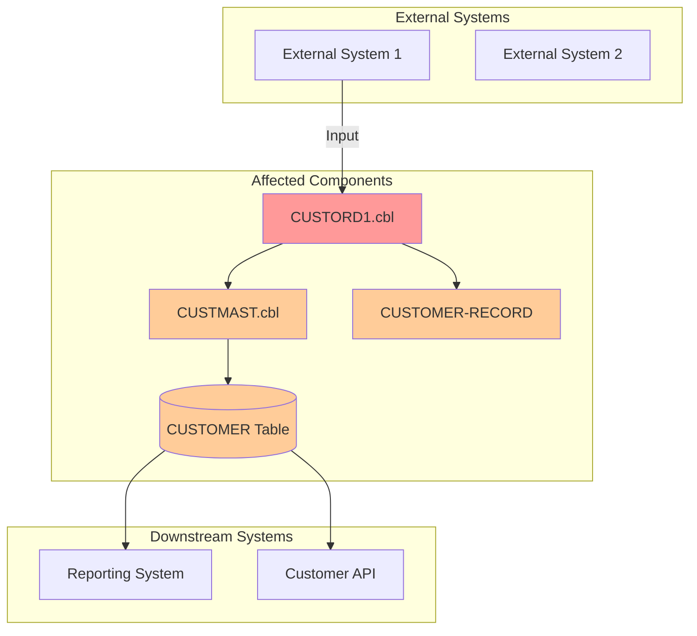
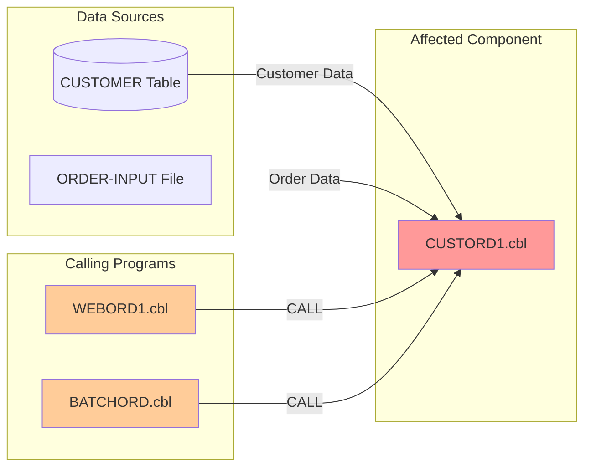
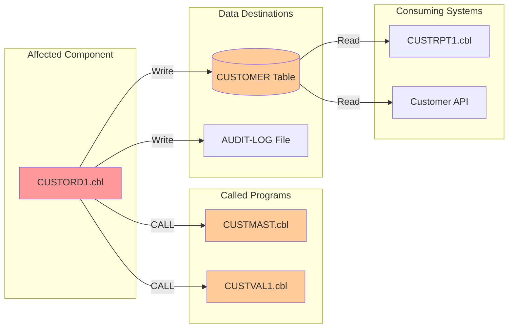
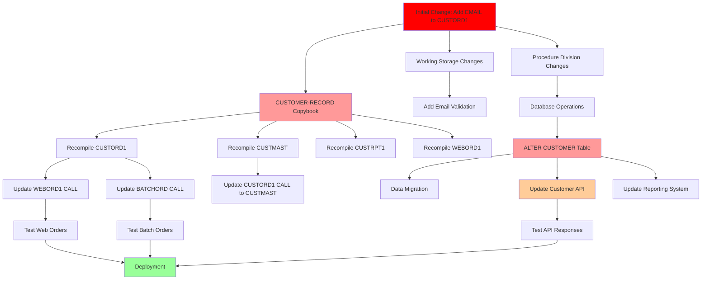
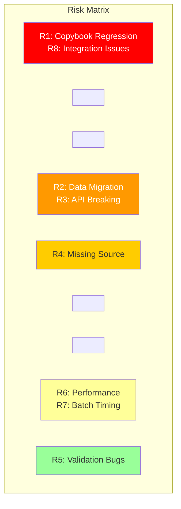

# Impact Analysis Skill

This skill guides you through creating comprehensive impact analysis reports for proposed mainframe codebase changes. It identifies all affected components, traces dependencies, assesses risks, and visualizes the ripple effects of changes before implementation begins.

## Important: Workspace Folder Structure

- **`.bobz/`** (hidden, gitignored) - Stores temporary/local files:
  - `local-settings.json` - Database location and user preferences (machine-specific)
- **`bobz/`** (visible, committed) - Persistent project files:
  - `impact-analysis/` - Generated impact analysis reports

## Prerequisites

Before starting, ensure:

- User has provided a clear change request or modification description
- Access to either:
  - Z Understand service (recommended for comprehensive dependency analysis), OR
  - Local workspace with COBOL/PL/I source files
- Understanding of the system components to be modified

## Complete Workflow Overview

The impact analysis workflow has five phases:

1. **Phase 1: Local-First Analysis & Context Gathering** - Start with local analysis, then optionally enrich with Z Understand
2. **Phase 2: Discovery & Scope Definition** - Identify components and boundaries
3. **Phase 3: Dependency & Impact Analysis** - Trace dependencies and assess impacts
4. **Phase 4: Risk Assessment & Validation** - Identify risks and ask clarifying questions
5. **Phase 5: Report Generation & Documentation** - Generate and save the impact analysis report

---

## Phase 1: Local-First Analysis & Context Gathering

**Purpose**: Start with local analysis, gather system context, and optionally enrich the findings with Z Understand.

**CRITICAL**: This phase MUST start with local database validation. Do NOT begin by asking the user to choose between Z Understand service and local workspace analysis.

### Step 1.1: Validate Local Database Availability (MANDATORY FIRST STEP)

**Check for Existing Database First**:

1. Read `.bobz/local-settings.json` and check for a valid `databaseLocation` field
2. If a valid database exists, proceed directly to Step 1.2
3. If no database is found or the database location is invalid, ask the user whether they want to scan the relevant program or parent folder to generate a local database
4. Only if the user explicitly approves the scan, proceed with `scan_program`
5. If the user declines scanning, continue the workflow without local SQL analysis and ask whether they want to use Z Understand for further analysis

**Tool**: `scan_program` (only after explicit user approval and only if a valid database does not already exist)

**Parameters**:

- `uri`: Absolute folder URI (e.g., `file:///workspace/Cobol Programs`)

**Important Notes**:

- ALWAYS use parent folder URI unless user explicitly requests single file scan
- Tool will detect COBOL and PL/I files automatically
- If multiple languages found, tool will prompt user to select
- NEVER run this tool without explicit user approval
- Only run this tool if no valid database exists in `.bobz/local-settings.json`

**Example**:

```xml
<scan_program>
<uri>file:///workspace/Cobol Programs</uri>
</scan_program>
```

**After Scan Completes** (or if database already exists):

- Database location stored/confirmed in `.bobz/local-settings.json`
- Proceed to Step 1.2 (Perform Local SQL Analysis)

---

### Step 1.2: Perform Local SQL Analysis (MANDATORY WHEN LOCAL DATABASE IS AVAILABLE)

**CRITICAL RULE**: If a local database is available, you MUST use `execute_sql_query` for the initial local analysis.

**Tool**: `execute_sql_query`

**Required Usage**:

- Use SQL queries against the local database to identify affected programs, resources, dependencies, and relationships relevant to the requested change
- Use the database path from `.bobz/local-settings.json`
- Treat `execute_sql_query` as the baseline local analysis tool, not an optional supplement

**Supporting Tools**:

- `get_paragraphs` for paragraph structure
- `get_control_flow` for complexity and execution flow
- `zopeneditor-cobol-get-data-flow` — traces how a specific COBOL data item is read, written, and propagated through a program; use whenever a change involves a particular field or variable to immediately see its full blast radius
- `BOB_TOOL_READ_FILE` for source review
- `search_files` for targeted dependency discovery
- These tools supplement the local SQL analysis, but do NOT replace it

**When No Local Database Exists** (user declined scan or scan not yet run):

Fall back to the Z Open Editor program analysis tools in place of `get_control_flow` and `get_paragraphs`:

- `zopeneditor-cobol-get-program-control-flow` — retrieves parsed control flow (sections, paragraphs, execution paths) from the COBOL Language Server for a program open in the editor
- `zopeneditor-pli-get-program-control-flow` — same for PL/I programs open in the editor
- `zopeneditor-cobol-get-data-flow` — still applicable; use as described above

**After Local Analysis Completes**:

- Summarize the initial local findings
- Proceed to Step 1.3 (Gather Change Specification)
- Before generating the final impact analysis report, you MUST ask the user whether they want Z Understand service to be used for deeper or broader follow-up analysis when local analysis was used
- Use a follow-up in this style:
  - Ask follow-up: "Local analysis is complete. Before I generate the final impact analysis report, would you like me to also use Z Understand service for broader dependency and cross-program analysis?"
  - Option 1: "Yes, include Z Understand analysis before finalizing the report"
  - Option 2: "No, continue with the local analysis results only"
  - Based on user choice:
    - Option 1: Proceed with the Z Understand follow-up steps in this workflow
    - Option 2: Continue directly to final impact analysis report generation

---

### Step 1.3: Gather Change Specification

**Collect Change Details**:

Review the user's initial request and identify what information is still needed. Only ask for information that wasn't provided in the original query.

**Potentially needed information** (ask only if not already provided):

- **Change Title**: Brief name for the change
- **Change Type**: Enhancement, Refactor, Bug Fix, Migration, or other
- **Detailed Description**: What specifically needs to be changed
- **Business Objective**: Why this change is needed
- **Entry Points**: Which programs, services, or jobs are the starting point
- **Known Dependencies**: Any components the user knows will be affected

**Example Follow-up Question** (if needed):

```txt
To perform a comprehensive impact analysis, I need a few more details:

1. What type of change is this? (Enhancement/Refactor/Bug Fix/Migration)
2. Which program(s) or component(s) are the primary entry points for this change?
3. What is the business objective or reason for this change?
```

**Provide Suggested Answers**:

- For change type: Provide 3-4 common options
- For entry points: Suggest based on workspace files if available
- For business objective: Provide examples like "Improve performance", "Add new feature", "Fix data integrity issue"

**After Information Gathered**:

- Proceed to Step 1.4 (Gather System Context)

---

### Step 1.4: Gather System Context

**For Local-First Baseline Analysis**:

1. **Query the Local Database**
   - Tool: `execute_sql_query`
   - Use SQL queries to identify programs, resources, dependencies, and relationships relevant to the requested change
   - This is the required first analysis path whenever a local database is available

2. **Get Program Structure**
   - Tool: `get_paragraphs`
   - Parameters:
     - `db_path` (from scan or local-settings.json)
     - `program_names` (affected programs)
   - Retrieves paragraph structure to supplement SQL findings

3. **Analyze Complexity**
   - **Database available**: use `get_control_flow` with the database path from `.bobz/local-settings.json`
   - **No database**: use `zopeneditor-cobol-get-program-control-flow` (COBOL) or `zopeneditor-pli-get-program-control-flow` (PL/I) for programs open in the editor

4. **Trace Data Item Impact** (always applicable when a specific field or variable is involved)
   - Tool: `zopeneditor-cobol-get-data-flow` (`programName`, `dataItemName`)
   - Use regardless of database availability whenever the change involves a specific COBOL data item
   - Returns a graph of every location where the item is read, written, or passed — directly answers "what will be affected if I change this field?"

**Mandatory Z Understand Prompt Before Report Generation**:

If local analysis was used, you MUST ask the user whether they want to use Z Understand service for deeper or broader analysis before generating the final impact analysis report.

**Example Follow-up Request Style**:

- Ask follow-up: "Local analysis is complete. Before I generate the final impact analysis report, would you like me to also use Z Understand service for broader dependency and cross-program analysis?"
- Option 1: "Yes, include Z Understand analysis before finalizing the report"
- Option 2: "No, continue with the local analysis results only"
- Based on user choice:
  - Option 1: Proceed with the Z Understand follow-up steps in this workflow
  - Option 2: Continue directly to final impact analysis report generation

If the user agrees:

1. **Sign In to Z Understand**
   - Tool: `sign_in_to_z_understand`
   - Confirm connection and continue with workspace alignment validation

2. **Validate Workspace Alignment** (Z Understand + Local Workspace)
   - Use `BOB_TOOL_LIST_FILES` to check whether the workspace contains COBOL/PL/I source files
   - Use `get_project_programs` to compare workspace program names with the Z Understand project
   - Sample 2-3 key programs using `BOB_TOOL_READ_FILE` to look for major structural differences
   - Document whether the workspace is fully aligned, partially aligned, or misaligned

3. **Gather Additional Z Understand Context**
   - Tool: `get_projects`
   - Tool: `get_project_programs`
   - Tool: `get_project_tables`
   - Tool: `get_project_variables`
   - Tool: `get_project_variable_usage_paragraphs`
   - Tool: `get_project_statement_types`
   - Tool: `get_project_resource_usage`
   - Tool: `get_project_paragraph`
   - Use the relevant Z Understand tools to deepen or validate the local SQL findings, not replace them

**Collect System Information**:

Gather high-level context about the system architecture and technologies involved.

**Information to Collect** (ask only if not obvious from workspace):

- **Architecture Overview**: Brief description of system architecture (optional)
- **Key Technologies**: COBOL, PL/I, Java, APIs, DB2, IMS, CICS, etc.
- **System Boundaries**: What systems/services interact with this codebase
- **Known Constraints**: Performance, security, or operational constraints

**Example Follow-up Question** (if needed):

```txt
To understand the full impact, please provide:

1. What are the key technologies involved? (e.g., COBOL, DB2, CICS, IMS)
2. Are there any external systems or APIs that interact with the affected components?
3. Are there any performance or security constraints I should be aware of?
```

**After Context Gathered**:

- Proceed to Phase 2 (Discovery & Scope Definition)

---

## Phase 2: Discovery & Scope Definition

**Purpose**: Identify all components involved in the change and define system boundaries

### Step 2.1: Identify Primary Components

**Using Z Understand Path**:

1. **Get Program Details** for entry point programs
   - Tool: `get_program_details`
   - Parameters: `program_name` (from Step 1.3)
   - Captures: Program structure, paragraphs, variables, file operations

2. **Identify Called Programs**
   - Tool: `get_program_calls` or analyze CALL statements in program details
   - Captures: All programs called by entry point

3. **Identify Database Operations**
   - Analyze program details for SQL statements, file I/O
   - Identify tables/files accessed

**Using Local Workspace Path**:

1. **Read Entry Point Programs**
   - Tool: `BOB_TOOL_READ_FILE` for each entry point program
   - Analyze code structure

2. **Search for Dependencies**
   - Tool: `search_files` with patterns:
     - `CALL\s+['"]?([A-Z0-9]+)` (for CALL statements)
     - `EXEC\s+SQL` (for SQL operations)
     - `EXEC\s+CICS` (for CICS commands)
     - `CALL\s+['"]?CBLTDLI` (for IMS operations)

3. **List Related Files**
   - Tool: `BOB_TOOL_LIST_FILES` to identify copybooks, JCL, configuration files

**Output**:

- List of all programs directly involved
- List of database tables/files accessed
- List of external services/APIs called
- List of copybooks/includes used

---

### Step 2.2: Define Scope Boundaries

**Determine What's In Scope**:

Based on the change specification and discovered components, define:

- **In Scope**: Components that WILL be modified or directly affected
- **Out of Scope**: Components that will NOT be changed (but may be impacted)
- **System Boundaries**: Where the change stops (external systems, APIs)

**Document Functional Area**:

- Identify the functional area impacted (e.g., "Customer Order Processing", "Account Management")
- Summarize the business function affected

**Output**:

- Clear scope definition
- Functional area summary
- System boundary identification

---

## Phase 3: Dependency & Impact Analysis

**Purpose**: Trace dependencies and assess the full impact of the change

### Step 3.1: Analyze Upstream Dependencies

**Identify What Feeds Into This**:

**Using Z Understand Path**:

1. **Find Calling Programs**
   - Tool: `get_project_resource_usage` with `type: "program"` and `name: "AFFECTED-PROGRAM"`
   - Identifies programs that call the affected components
   - Returns usage locations with line numbers and statement types

2. **Identify Data Sources**
   - Tool: `get_project_tables` to list all tables in the project
   - Tool: `get_project_resource_usage` with `type: "table"` to find table usage
   - Analyze database operations to find input tables/files
   - Identify external services that provide data

3. **Analyze Variable Dependencies**
   - Tool: `get_project_variables` with `progId` to get all variables in affected program
   - Tool: `get_project_variable_usage_paragraphs` to find where variables are used
   - Understand data flow through variable usage

**Using Local Workspace Path**:

1. **Find Calling Programs**
   - Tool: `execute_sql_query` to query database
   - Query programs that call the affected components
   - Example: Find all programs calling a specific program
   - Database path from `.bobz/local-settings.json`
   - This local SQL analysis is mandatory when a local database is available

2. **Analyze Control Flow**
   - **Database available**: use `get_control_flow` with `ScannerOutputParentDir` and `resultPath` from `.bobz/local-settings.json`
   - **No database**: use `zopeneditor-cobol-get-program-control-flow` (COBOL) or `zopeneditor-pli-get-program-control-flow` (PL/I) for programs open in the editor

3. **Analyze Data Sources**
   - **Database available**: use `execute_sql_query` to query tables/files read by affected programs (ResourceType=1 for SQL tables, ResourceType=9 for files); filter by `OccurrencesStmt.ParaID != 0` for runtime access
   - Tool: `get_variables` to extract variable information (`programId`, `programPath`) — when database available
   - Tool: `get_paragraphs` to identify program structure and entry points — when database available
   - **Always**: use `zopeneditor-cobol-get-data-flow` (`programName`, `dataItemName`) for any specific data item involved in the change to trace exactly how it is populated upstream

**Output**:

- List of upstream programs/services
- List of input data sources
- Data flow diagram (to be created in Phase 5)

---

### Step 3.2: Analyze Downstream Dependencies

**Identify What Consumes This**:

**Using Z Understand Path**:

1. **Find Called Programs**
   - Tool: `get_project_resource_usage` with `type: "program"` from within affected program
   - Identifies programs called by affected components
   - Returns call locations with line numbers

2. **Identify Data Consumers**
   - Tool: `get_project_resource_usage` with `type: "table"` to find table writes
   - Tool: `get_project_resource_usage` with `type: "table_field"` for specific field usage
   - Analyze database operations to find output tables/files
   - Identify external services that consume data

3. **Analyze Paragraph Dependencies**
   - Tool: `get_project_paragraph` to get paragraph details
   - Tool: `get_project_resource_usage` to find paragraph usage across programs
   - Understand internal program flow and shared logic

**Using Local Workspace Path**:

1. **Find Called Programs**
   - Tool: `execute_sql_query` to query database
   - Query programs called by affected components
   - Example: Find all CALL statements in a specific program
   - Database path from `.bobz/local-settings.json`
   - This local SQL analysis is mandatory when a local database is available

2. **Analyze Control Flow**
   - **Database available**: use `get_control_flow` with `ScannerOutputParentDir` and `resultPath` from `.bobz/local-settings.json`
   - **No database**: use `zopeneditor-cobol-get-program-control-flow` (COBOL) or `zopeneditor-pli-get-program-control-flow` (PL/I) for programs open in the editor

3. **Analyze Data Consumers**
   - **Database available**: use `execute_sql_query` to query tables/files written by affected programs (ResourceType=1 for SQL tables, ResourceType=9 for files); filter by `OccurrencesStmt.ParaID != 0` for runtime access
   - Tool: `get_paragraphs` to understand program structure and logic flow — when database available
   - **Always**: use `zopeneditor-cobol-get-data-flow` (`programName`, `dataItemName`) for any specific data item produced or modified by the change to trace all downstream consumers — reveals every paragraph and calling program that depends on the changed data

**Output**:

- List of downstream programs/services
- List of output data destinations
- Data flow diagram (to be created in Phase 5)

---

### Step 3.3: Analyze Internal Dependencies

**Identify Internal Relationships**:

**Using Z Understand Path**:

1. **Copybook Dependencies**
   - Tool: `get_project_resource_usage` with `type: "include"`
   - Identifies all copybooks used by affected programs
   - Shows which programs use which copybooks
   - Determine if copybook changes are needed

2. **Shared Variables/Data Structures**
   - Tool: `get_project_variables` to get variable definitions
   - Tool: `get_project_variable_usage_paragraphs` to find cross-program variable usage
   - Identify shared data structures
   - Determine if changes affect other programs using same structures

3. **Common Modules/Functions**
   - Tool: `get_project_paragraph` to get paragraph details
   - Tool: `get_project_resource_usage` to find paragraph usage
   - Identify shared paragraphs or functions
   - Determine if changes affect other callers

4. **Statement Type Analysis**
   - Tool: `get_project_statement_types` to get available statement types
   - Use with `get_project_resource_usage` to filter by specific statement types (e.g., READ, WRITE, CALL)
   - Analyze specific operations and their impact

**Using Local Workspace Path**:

1. **Copybook Dependencies**
   - Tool: `execute_sql_query` to query database
   - Query copybooks (ResourceType=13) used by affected programs
   - DO NOT filter by ParaID (include both ParaID=0 and ParaID!=0) for declarations
   - Identify all copybooks used
   - Determine if copybook changes are needed

2. **Shared Variables/Data Structures**
   - Tool: `get_variables` to extract variable information from programs
   - Parameters:
     - `programId`: ID of program
     - `programPath`: Absolute path of the program file
   - Tool: `execute_sql_query` to query variable usage across programs
   - Identify shared data structures
   - Determine if changes affect other programs using same structures

3. **Common Modules/Functions**
   - **Database available**:
     - Tool: `get_paragraphs` (`db_path` from local-settings.json, `program_names`)
     - Tool: `get_control_flow` to understand program flow and paragraph relationships
     - Tool: `execute_sql_query` to query paragraph usage across programs
   - **No database**:
     - Tool: `zopeneditor-cobol-get-program-control-flow` or `zopeneditor-pli-get-program-control-flow` to map paragraph/procedure relationships from the Language Server
   - **Always**: use `zopeneditor-cobol-get-data-flow` for any shared data item to immediately see which paragraphs interact with it across the program
   - Identify shared paragraphs or functions
   - Determine if changes affect other callers

4. **Statement Type Analysis**
   - Tool: `execute_sql_query` to query specific statement types
   - Filter by statement types (e.g., READ, WRITE, CALL operations)
   - Filter by `OccurrencesStmt.ParaID != 0` for runtime operations
   - Analyze specific operations and their impact

**Output**:

- List of copybooks affected
- List of shared data structures
- List of common modules/functions

---

### Step 3.4: Assess Code-Level Impact

**For Each Affected Component**:

Document:

- **Component Name**: Program, copybook, or file name
- **Impact Type**: Modify, Refactor, Delete, Create
- **Specific Changes Required**: What needs to change in this component
- **Complexity**: Low, Medium, High
- **Workspace Availability**: Available, Missing (if using Z Understand + Local)

**Example**:

```txt
Component: CUSTORD1.cbl
Impact Type: Modify
Changes Required:
  - Add new field CUSTOMER-EMAIL to working storage
  - Modify PROCESS-ORDER paragraph to validate email
  - Update database write to include email field
Complexity: Medium
Workspace: Available
```

---

### Step 3.5: Assess Application-Level Impact

**Identify Cross-Module Effects**:

1. **Interface Changes**
   - Determine if program interfaces (parameters, linkage section) change
   - Identify all programs that call affected programs

2. **Data Contract Changes**
   - Determine if data structures passed between programs change
   - Identify all programs that share data structures

3. **Batch Job Impact**
   - Identify JCL jobs that execute affected programs
   - Determine if job parameters or dependencies change

**Output**:

- List of interface changes
- List of data contract changes
- List of affected batch jobs

---

### Step 3.6: Assess System-Level Impact

**Identify External System Effects**:

1. **External APIs**
   - Determine if API contracts change
   - Identify external systems that call these APIs

2. **Database Schema**
   - Determine if database schema changes are needed
   - Identify other applications that access same tables

3. **Integration Points**
   - Identify message queues, file transfers, or other integration points
   - Determine if integration contracts change

**Output**:

- List of external API impacts
- List of database schema changes
- List of integration point impacts

---

### Step 3.7: Assess Operational Impact

**Identify Operational Effects**:

1. **Build/Deployment**
   - Determine if build process changes
   - Identify deployment dependencies or sequence requirements

2. **Runtime**
   - Determine if runtime configuration changes
   - Identify performance implications

3. **Scheduling**
   - Determine if batch job schedules need adjustment
   - Identify job dependencies that may be affected

**Output**:

- Build/deployment impact summary
- Runtime impact summary
- Scheduling impact summary

---

### Step 3.8: Create Change Propagation Map

**Trace the Full Ripple Effect**:

Document the complete chain of impacts:

```txt
Initial Change → Affected Component → Dependent Component → External/System Impact
```

**Example**:

```txt
Change: Add CUSTOMER-EMAIL field to CUSTORD1.cbl
  ↓
Affected: CUSTORD1.cbl (modify working storage, add validation)
  ↓
Dependent: CUSTMAST.cbl (calls CUSTORD1, may need to pass email)
  ↓
Dependent: CUSTOMER-RECORD copybook (add email field)
  ↓
System: CUSTOMER table (add EMAIL column)
  ↓
External: Customer API (update response schema to include email)
```

**Be Explicit and Complete**:

- Trace every path from initial change to final impact
- Don't skip intermediate steps
- Include both direct and indirect impacts

---

## Phase 4: Risk Assessment & Validation

**Purpose**: Identify risks and validate assumptions with user

### Step 4.1: Identify Risks

**For Each Risk Identified**:

Document:

- **Risk Description**: Clear description of the risk
- **Likelihood**: High, Medium, Low
- **Impact**: High, Medium, Low
- **Risk Category**: Regression, Hidden Dependency, Data Integrity, Runtime Failure, Performance, Security
- **Mitigation Strategy**: How to reduce or eliminate the risk

**Focus Areas**:

1. **Regression Risks**
   - Existing functionality that might break
   - Programs that call modified components

2. **Hidden Dependencies**
   - Undocumented relationships between components
   - Shared data structures not obvious from code

3. **Data Integrity Risks**
   - Database schema changes affecting existing data
   - Data migration requirements

4. **Runtime Failures**
   - Performance degradation
   - Memory or resource issues
   - Error handling gaps

5. **Security Risks**
   - New data exposure
   - Authentication/authorization changes

**Output**:

- Risk assessment table with all identified risks

---

### Step 4.2: Ask Clarifying Questions (MANDATORY)

**MANDATORY: Ask Follow-up Questions**:

Before finalizing the impact analysis, you MUST ask the user 1-2 follow-up questions to clarify any assumptions or unknowns identified during analysis.

**Purpose**: Validate assumptions and fill information gaps before generating the final report.

**What to Ask About**:

- System behavior assumptions that need confirmation
- Data format or constraint questions
- External system dependencies that are unclear
- Performance or security requirements
- Missing information about components or processes

**Example Follow-up Questions**:

```txt
Before finalizing the impact analysis, I need to clarify a few points:

1. I'm assuming the CUSTOMER table can be modified without affecting other applications. Can you confirm no other systems directly access this table?
   - "Correct, only our applications access CUSTOMER"
   - "No, the Data Warehouse also reads CUSTOMER directly"
   - "Unsure, need to check with DBA team"

2. The analysis shows CUSTMAST.cbl calls CUSTORD1.cbl, but I couldn't determine if it passes customer data. Does CUSTMAST need to be updated to pass the email field?
   - "Yes, CUSTMAST passes customer data and needs updating"
   - "No, CUSTMAST doesn't pass customer data"
   - "CUSTMAST only passes customer ID, not full data"
```

**Provide Suggested Answers**:

- For each question, provide 2-3 likely answers
- Make answers specific and actionable
- Include an "Unsure" option when appropriate

**After User Responds**:

- Incorporate user responses into the impact analysis
- Adjust risk assessment based on clarified information
- Update confidence level if needed
- Proceed to Step 4.3

---

### Step 4.3: Assess Confidence Level

**Determine Overall Confidence**:

Based on:

- Completeness of information gathered
- Clarity of requirements
- Availability of documentation
- Alignment between Z Understand and workspace (if applicable)
- Number of unknowns remaining

**Confidence Levels**:

- **High**: Complete information, clear requirements, all dependencies identified
- **Medium**: Most information available, some unknowns remain, dependencies mostly identified
- **Low**: Significant information gaps, many unknowns, dependencies unclear

**Document Justification**:

Explain why the confidence level was assigned:

```txt
Confidence: Medium

Justification:
- All primary components identified through Z Understand analysis
- Some external system dependencies remain unclear
- Database schema impact well understood
- 2 assumptions require validation before implementation
```

---

## Phase 5: Report Generation & Documentation

**Purpose**: Generate and save the comprehensive impact analysis report

### Step 5.1: Generate Impact Analysis Report

**Use the Impact Analysis Report Template** (see template section below)

**Include**:

1. Change summary and specification
2. Scope definition with boundaries
3. System overview and context
4. Complete dependency analysis (upstream, downstream, internal)
5. Multi-level impact analysis (code, application, system, operational)
6. Change propagation map with mermaid diagrams
7. Risk assessment table
8. Assumptions and unknowns
9. Confidence assessment
10. Effort estimation (if possible)

**CRITICAL CONSTRAINT**: Impact analysis reports must NOT exceed 1000 lines. If the analysis would be longer, break it into multiple focused reports or reference external documentation if necessary.

**Mermaid Diagrams to Include**:

1. **System Context Diagram**: Shows affected components and their relationships
2. **Dependency Flow Diagram**: Shows upstream and downstream dependencies
3. **Change Propagation Diagram**: Shows ripple effect of changes
4. **Risk Heat Map** (optional): Visual representation of risk levels

---

### Step 5.2: Create Output Directory

**Create Directory Structure**:

```txt
bobz/
└── impact-analysis/
    └── [change-name]-[timestamp]/
        └── IMPACT-ANALYSIS.md
```

**Tool**: `BOB_TOOL_WRITE_FILE` (automatically creates directories)

**Example**:

```xml
<BOB_TOOL_WRITE_FILE>
```

### Step 5.3: Save Impact Analysis Report

**Confirm Save Location**:

Inform user where the report will be saved:

```txt
Impact analysis report will be saved to:
bobz/impact-analysis/[change-name]-[timestamp]/IMPACT-ANALYSIS.md
```

**After Save Completes**:

- Confirm successful save
- Provide summary of key findings
- Suggest next steps (e.g., "Review the report and proceed with implementation planning")

---

## Impact Analysis Report Template Format

### Complete Template Structure

````markdown
# Impact Analysis Report: [Change Title]

**Created**: [ISO 8601 timestamp]
**Author**: [Author name or "IBM Bob Premium Package for Z AI Assistant"]
**Analysis Method**: [Z Understand | Local Workspace | Z Understand + Local Workspace]
**Workspace Alignment**: [Fully Aligned | Partially Aligned | Not Applicable | Misaligned]
**Confidence Level**: [High | Medium | Low]

---

## 1. Change Summary

### Change Specification

**Title**: [Change Title]

**Type**: [Enhancement | Refactor | Bug Fix | Migration | Other]

**Description**: [Detailed description of the proposed change]

**Business Objective**: [Why this change is needed - business value or goal]

### System Context

**Architecture Overview**: [Brief description of system architecture - optional]

**Key Technologies**: [COBOL, PL/I, Java, DB2, IMS, CICS, APIs, etc.]

**Entry Points**: [Primary programs, services, or jobs affected]

**Known Dependencies**: [Any dependencies identified upfront]

**Workspace Notes**: [If using Z Understand + Local Workspace, note any alignment issues, missing files, or version differences]

---

## 2. Scope Definition

### In Scope

Components that WILL be modified or directly affected:

- [Component 1]: [Brief description]
- [Component 2]: [Brief description]
- [Component 3]: [Brief description]

### Out of Scope

Components that will NOT be changed (but may be impacted):

- [Component 1]: [Brief description]
- [Component 2]: [Brief description]

### System Boundaries

Where the change stops:

- **External Systems**: [List external systems at the boundary]
- **APIs**: [List API boundaries]
- **Data Boundaries**: [List data boundaries]

### Functional Area

**Primary Functional Area**: [e.g., "Customer Order Processing", "Account Management"]

**Business Function Summary**: [Brief description of the business function affected]

---

## 3. System Overview

### System Context Diagram



**Legend**:

- 🔴 Red: Primary components to be modified
- 🟠 Orange: Secondary components affected
- ⚪ White: External/downstream systems

### Components Analyzed

**Total Programs**: [Number]

**Programs in Z Understand**: [Number] (if applicable)

**Programs in Workspace**: [Number] (if applicable)

**Programs Missing from Workspace**: [Number] (if applicable)

**Key Programs**:

| Program      | Description                 | Workspace Status | Impact Level |
| ------------ | --------------------------- | ---------------- | ------------ |
| CUSTORD1.cbl | Customer order processing   | Available        | High         |
| CUSTMAST.cbl | Customer master maintenance | Available        | Medium       |
| ORDVAL1.cbl  | Order validation            | Missing          | Low          |

**Database Tables/Files**:

| Table/File | Purpose              | Access Type | Impact Level |
| ---------- | -------------------- | ----------- | ------------ |
| CUSTOMER   | Customer master data | Read/Write  | High         |
| ORDERS     | Order transactions   | Read        | Medium       |
| AUDIT-LOG  | Audit trail          | Write       | Low          |

**External Systems/APIs**:

| System/API       | Purpose              | Integration Type | Impact Level |
| ---------------- | -------------------- | ---------------- | ------------ |
| Customer API     | Customer data access | REST API         | High         |
| Reporting System | Business reports     | Batch file       | Medium       |

---

## 4. Dependency Analysis

### Upstream Dependencies

**What Feeds Into This**:

#### Input Programs/Services

| Component    | Relationship   | Data Provided | Impact                    |
| ------------ | -------------- | ------------- | ------------------------- |
| WEBORD1.cbl  | Calls CUSTORD1 | Order data    | Must pass new email field |
| BATCHORD.cbl | Calls CUSTORD1 | Batch orders  | Must pass new email field |

#### Input Data Sources

| Source           | Type       | Data Provided | Impact                   |
| ---------------- | ---------- | ------------- | ------------------------ |
| CUSTOMER table   | Database   | Customer info | Must include email field |
| ORDER-INPUT file | Sequential | Order details | No change needed         |

#### Dependency Flow Diagram (Upstream)



---

### Downstream Dependencies

**What Consumes This**:

#### Output Programs/Services

| Component    | Relationship   | Data Consumed    | Impact                       |
| ------------ | -------------- | ---------------- | ---------------------------- |
| CUSTRPT1.cbl | Reads CUSTOMER | Customer reports | Must handle new email field  |
| Customer API | Reads CUSTOMER | API responses    | Must include email in schema |

#### Output Data Destinations

| Destination    | Type       | Data Written     | Impact                 |
| -------------- | ---------- | ---------------- | ---------------------- |
| CUSTOMER table | Database   | Customer records | Add EMAIL column       |
| AUDIT-LOG file | Sequential | Audit records    | Include email in audit |

#### Dependency Flow Diagram (Downstream)



---

### Internal Dependencies

**Internal Relationships**:

#### Copybooks/Includes

| Copybook        | Used By                      | Purpose                 | Impact          |
| --------------- | ---------------------------- | ----------------------- | --------------- |
| CUSTOMER-RECORD | CUSTORD1, CUSTMAST, CUSTRPT1 | Customer data structure | Add EMAIL field |
| ORDER-RECORD    | CUSTORD1, WEBORD1            | Order data structure    | No change       |

#### Shared Data Structures

| Structure        | Shared By          | Purpose         | Impact          |
| ---------------- | ------------------ | --------------- | --------------- |
| WS-CUSTOMER-DATA | CUSTORD1, CUSTMAST | Working storage | Add EMAIL field |

#### Common Modules/Functions

| Module/Function   | Used By            | Purpose             | Impact               |
| ----------------- | ------------------ | ------------------- | -------------------- |
| VALIDATE-CUSTOMER | CUSTORD1, CUSTMAST | Customer validation | Add email validation |

---

## 5. Impact Analysis

### Code-Level Impact

**Detailed Component Changes**:

#### CUSTORD1.cbl (Primary Entry Point)

**Impact Type**: Modify

**Specific Changes Required**:

1. **Working Storage Section**:
   - Add `05 WS-CUSTOMER-EMAIL PIC X(50)` to customer data structure
   - Add `05 WS-EMAIL-VALID PIC X VALUE 'N'` for validation flag

2. **Procedure Division**:
   - Modify `PROCESS-ORDER` paragraph:
     - Add call to `VALIDATE-EMAIL` paragraph
     - Add email to database write statement
   - Create new `VALIDATE-EMAIL` paragraph:
     - Check email format (contains @, valid domain)
     - Set `WS-EMAIL-VALID` flag

3. **File/Database Operations**:
   - Update `EXEC SQL INSERT INTO CUSTOMER` to include EMAIL column
   - Update `EXEC SQL UPDATE CUSTOMER` to include EMAIL column

**Complexity**: Medium

**Workspace Status**: Available

**Lines of Code Affected**: ~50 lines (estimated)

---

#### CUSTMAST.cbl (Called by CUSTORD1)

**Impact Type**: Modify

**Specific Changes Required**:

1. **Linkage Section**:
   - Add `05 LK-CUSTOMER-EMAIL PIC X(50)` to parameter structure

2. **Procedure Division**:
   - Modify `UPDATE-CUSTOMER-MASTER` paragraph to handle email field
   - Pass email field to database operations

**Complexity**: Low

**Workspace Status**: Available

**Lines of Code Affected**: ~20 lines (estimated)

---

#### CUSTOMER-RECORD Copybook

**Impact Type**: Modify

**Specific Changes Required**:

1. Add `05 CUST-EMAIL PIC X(50)` to customer record structure
2. Update record length calculation if needed

**Complexity**: Low

**Workspace Status**: Available

**Lines of Code Affected**: ~5 lines

**Ripple Effect**: All programs using this copybook must be recompiled

---

#### WEBORD1.cbl (Calls CUSTORD1)

**Impact Type**: Modify

**Specific Changes Required**:

1. **Working Storage**:
   - Add email field to order input structure

2. **Procedure Division**:
   - Capture email from web input
   - Pass email to CUSTORD1 in CALL statement

**Complexity**: Low

**Workspace Status**: Available

**Lines of Code Affected**: ~15 lines

---

#### CUSTRPT1.cbl (Reads CUSTOMER table)

**Impact Type**: Modify

**Specific Changes Required**:

1. **Working Storage**:
   - Add email field to report structure

2. **Procedure Division**:
   - Include email in SELECT statement
   - Add email to report output

**Complexity**: Low

**Workspace Status**: Missing (in Z Understand only)

**Lines of Code Affected**: ~10 lines

**Note**: This program is not in the local workspace. Changes will need to be made in the source repository.

---

### Application-Level Impact

**Cross-Module Effects**:

#### Interface Changes

| Interface           | Change              | Affected Programs | Impact                      |
| ------------------- | ------------------- | ----------------- | --------------------------- |
| CUSTORD1 parameters | Add email parameter | WEBORD1, BATCHORD | Must update CALL statements |
| CUSTMAST parameters | Add email parameter | CUSTORD1          | Must update CALL statement  |

#### Data Contract Changes

| Contract         | Change          | Affected Components         | Impact                 |
| ---------------- | --------------- | --------------------------- | ---------------------- |
| CUSTOMER-RECORD  | Add EMAIL field | All programs using copybook | Must recompile all     |
| WS-CUSTOMER-DATA | Add EMAIL field | CUSTORD1, CUSTMAST          | Update working storage |

#### Batch Job Impact

| Job       | Programs Executed  | Impact | Changes Required                          |
| --------- | ------------------ | ------ | ----------------------------------------- |
| CUSTBATCH | BATCHORD, CUSTORD1 | Medium | Update JCL to handle email field          |
| CUSTRPT   | CUSTRPT1           | Low    | No JCL changes, program handles new field |

---

### System-Level Impact

**External System Effects**:

#### Database Schema Changes

**CUSTOMER Table**:

```sql
ALTER TABLE CUSTOMER
ADD COLUMN EMAIL VARCHAR(50);

-- Add index for email lookups (optional)
CREATE INDEX IDX_CUSTOMER_EMAIL ON CUSTOMER(EMAIL);

-- Add constraint for email format (optional)
ALTER TABLE CUSTOMER
ADD CONSTRAINT CHK_EMAIL_FORMAT
CHECK (EMAIL LIKE '%@%.%');
```

**Impact**:

- Requires database migration
- Existing records will have NULL email (need data migration strategy)
- Other applications accessing CUSTOMER table must handle new column

**Affected Applications**:

- Customer API (must update schema)
- Reporting System (must update queries)
- Data Warehouse ETL (must update extraction)

---

#### External API Changes

**Customer API**:

**Current Response**:

```json
{
  "customerId": "12345",
  "name": "John Doe",
  "address": "123 Main St"
}
```

**New Response**:

```json
{
  "customerId": "12345",
  "name": "John Doe",
  "address": "123 Main St",
  "email": "john.doe@example.com"
}
```

**Impact**:

- API contract change (backward compatible if email is optional)
- API consumers may need updates
- API documentation must be updated

---

#### Integration Point Changes

| Integration Point   | Type          | Change                         | Impact                                   |
| ------------------- | ------------- | ------------------------------ | ---------------------------------------- |
| Customer Data Feed  | File Transfer | Add email field to file layout | Downstream systems must handle new field |
| Order Message Queue | MQ Message    | Add email to message schema    | Message consumers must handle new field  |

---

### Operational Impact

**Build/Deployment**:

- **Build Process**: No changes required
- **Deployment Sequence**:
  1. Deploy database schema changes first
  2. Deploy updated copybooks
  3. Deploy updated programs (CUSTORD1, CUSTMAST, WEBORD1, etc.)
  4. Deploy API changes
  5. Update batch jobs
- **Rollback Plan**: Database rollback requires removing EMAIL column (may lose data)

**Runtime**:

- **Configuration Changes**: None required
- **Performance Impact**:
  - Minimal impact on program execution
  - Database writes slightly slower (additional column)
  - Consider adding index on EMAIL column for lookups
- **Memory Impact**: Minimal (50 bytes per customer record)

**Scheduling**:

- **Batch Jobs**: CUSTBATCH job may run slightly longer (additional field processing)
- **Job Dependencies**: No changes to job dependencies
- **Timing Windows**: No impact on batch windows

---

## 6. Change Propagation Map

### Complete Ripple Effect



### Detailed Propagation Paths

#### Path 1: Direct Code Changes

```
Add EMAIL field to CUSTORD1.cbl
  ↓
Modify CUSTOMER-RECORD copybook
  ↓
Recompile all programs using CUSTOMER-RECORD
  ↓
Update CALL statements in calling programs
  ↓
Test all affected programs
```

#### Path 2: Database Changes

```
Add EMAIL field to CUSTORD1.cbl
  ↓
Update database INSERT/UPDATE statements
  ↓
ALTER CUSTOMER table schema
  ↓
Migrate existing data (set EMAIL to NULL or default)
  ↓
Update database indexes (optional)
  ↓
Test database operations
```

#### Path 3: API Changes

```
Add EMAIL to CUSTOMER table
  ↓
Update Customer API to include EMAIL in queries
  ↓
Update API response schema
  ↓
Update API documentation
  ↓
Notify API consumers of schema change
  ↓
Test API endpoints
```

#### Path 4: Integration Changes

```
Add EMAIL to CUSTOMER table
  ↓
Update Customer Data Feed file layout
  ↓
Update downstream system file parsers
  ↓
Update Order Message Queue schema
  ↓
Update message consumers
  ↓
Test integration points
```

---

## 7. Risk Assessment

### Risk Assessment Table

| Risk ID | Description                                          | Category          | Likelihood | Impact | Risk Level | Mitigation Strategy                                                    |
| ------- | ---------------------------------------------------- | ----------------- | ---------- | ------ | ---------- | ---------------------------------------------------------------------- |
| R1      | Existing programs break due to copybook change       | Regression        | Medium     | High   | **HIGH**   | Comprehensive regression testing of all programs using CUSTOMER-RECORD |
| R2      | Database migration fails or loses data               | Data Integrity    | Low        | High   | **MEDIUM** | Test migration in non-prod first; backup data before migration         |
| R3      | API consumers break due to schema change             | Regression        | Medium     | Medium | **MEDIUM** | Make email field optional; version API; notify consumers in advance    |
| R4      | CUSTRPT1 changes cannot be tested (not in workspace) | Hidden Dependency | Medium     | Medium | **MEDIUM** | Obtain CUSTRPT1 source code; add to workspace before implementation    |
| R5      | Email validation logic has bugs                      | Runtime Failure   | Medium     | Low    | **LOW**    | Thorough unit testing of validation logic; use standard email regex    |
| R6      | Performance degradation on CUSTOMER table            | Performance       | Low        | Medium | **LOW**    | Add index on EMAIL column; monitor query performance                   |
| R7      | Batch jobs fail due to increased processing time     | Runtime Failure   | Low        | Medium | **LOW**    | Monitor batch job execution times; adjust timing windows if needed     |
| R8      | Downstream systems cannot handle new email field     | Integration       | Medium     | High   | **HIGH**   | Coordinate with downstream teams; test integration points thoroughly   |

### Risk Heat Map



**Legend**:

- 🔴 High Risk (Likelihood: High, Impact: High)
- 🟠 Medium-High Risk
- 🟡 Medium Risk
- 🟢 Low Risk

### Critical Risks (Requiring Immediate Attention)

#### R1: Copybook Regression Risk

**Description**: Modifying CUSTOMER-RECORD copybook will force recompilation of all programs using it. Any program not properly updated may fail at runtime.

**Mitigation**:

1. Identify ALL programs using CUSTOMER-RECORD (use Z Understand or search_files)
2. Create comprehensive test suite covering all programs
3. Test each program individually after recompilation
4. Perform integration testing of program chains
5. Have rollback plan ready

**Action Items**:

- [ ] Generate complete list of programs using CUSTOMER-RECORD
- [ ] Create test cases for each program
- [ ] Schedule regression testing window
- [ ] Prepare rollback scripts

---

#### R8: Integration Issues with Downstream Systems

**Description**: Downstream systems (Reporting, Data Warehouse, etc.) may not handle the new EMAIL field correctly, causing integration failures.

**Mitigation**:

1. Identify all downstream systems accessing CUSTOMER table
2. Coordinate with downstream teams before deployment
3. Make EMAIL field optional/nullable to maintain backward compatibility
4. Test integration points in non-production environment
5. Have monitoring in place to detect integration failures

**Action Items**:

- [ ] Contact Reporting System team
- [ ] Contact Data Warehouse team
- [ ] Schedule integration testing
- [ ] Set up monitoring alerts

---

## 8. Missing Files (If Using Z Understand + Local Workspace)

**Note**: This section only applies when using Z Understand analysis with local workspace. If using local workspace only, this section can be omitted.

### Files Identified in Z Understand But Missing from Workspace

The following files were identified as impacted by this change through Z Understand analysis, but are not available in the local workspace for modification:

| Program      | Impact Level | Required Changes                        | Recommendation                                                |
| ------------ | ------------ | --------------------------------------- | ------------------------------------------------------------- |
| CUSTRPT1.cbl | Medium       | Add email field to report output        | Obtain source code and add to workspace before implementation |
| BATCHVAL.cbl | Low          | Update validation logic to handle email | Coordinate with team that maintains this program              |

### Impact of Missing Files

**Development Impact**:

- Changes to missing files cannot be implemented locally
- Testing of missing files cannot be performed in local environment
- Integration testing may be incomplete without these files

**Recommendations**:

1. **High Priority**: Obtain source code for high/medium impact files and add to workspace
2. **Medium Priority**: Coordinate with teams that maintain missing files
3. **Low Priority**: Document required changes for missing files in implementation plan

**Workarounds** (if files cannot be obtained):

- Document required changes in detail for other teams to implement
- Create integration test cases that can be run once changes are deployed
- Schedule coordination meetings with teams maintaining missing files

---

## 9. Confidence Assessment

### Overall Confidence: Medium

### Justification

**Strengths** (High Confidence Areas):

- ✅ Primary components (CUSTORD1, CUSTMAST) well understood through Z Understand analysis
- ✅ Database schema impact clearly identified
- ✅ Copybook dependencies fully mapped
- ✅ Code-level changes well defined for available programs

**Weaknesses** (Low Confidence Areas):

- ⚠️ CUSTRPT1.cbl not available in workspace - changes cannot be fully validated
- ⚠️ Downstream system dependencies not fully confirmed
- ⚠️ Data migration strategy undefined
- ⚠️ External system coordination pending

**Confidence by Category**:

| Category                 | Confidence | Reason                                         |
| ------------------------ | ---------- | ---------------------------------------------- |
| Code-Level Impact        | High       | All primary programs analyzed in detail        |
| Application-Level Impact | Medium     | Some programs missing from workspace           |
| System-Level Impact      | Medium     | External system dependencies need confirmation |
| Operational Impact       | Medium     | Performance impact needs validation            |
| Risk Assessment          | High       | Comprehensive risk identification completed    |

### Recommendations to Increase Confidence

1. **Obtain Missing Source Code**:
   - Add CUSTRPT1.cbl to workspace
   - Verify all programs using CUSTOMER-RECORD are available

2. **Validate External Dependencies**:
   - Confirm with Reporting System team
   - Confirm with Data Warehouse team
   - Confirm with API consumers

3. **Define Data Migration Strategy**:
   - Work with business to define email population approach
   - Determine if email should be mandatory or optional

4. **Perform Load Testing**:
   - Test performance impact of email field
   - Validate batch job timing

---

## 10. Effort Estimation

### Complexity Analysis

| Component       | Complexity | Estimated Effort | Dependencies             |
| --------------- | ---------- | ---------------- | ------------------------ |
| CUSTORD1.cbl    | Medium     | 4-6 hours        | CUSTOMER-RECORD copybook |
| CUSTMAST.cbl    | Low        | 2-3 hours        | CUSTOMER-RECORD copybook |
| CUSTOMER-RECORD | Low        | 1 hour           | None                     |
| WEBORD1.cbl     | Low        | 2-3 hours        | CUSTORD1 interface       |
| BATCHORD.cbl    | Low        | 2-3 hours        | CUSTORD1 interface       |
| CUSTRPT1.cbl    | Low        | 2-3 hours        | CUSTOMER-RECORD copybook |
| Database Schema | Medium     | 2-4 hours        | Data migration strategy  |
| Customer API    | Medium     | 4-6 hours        | Database schema          |
| Testing         | High       | 16-24 hours      | All components           |
| Documentation   | Low        | 4-6 hours        | All components           |

### Total Effort Estimate

**Development**: 40-60 hours (5-7.5 days)

**Testing**: 16-24 hours (2-3 days)

**Deployment**: 8-12 hours (1-1.5 days)

**Total**: 64-96 hours (8-12 days)

**Note**: Estimates assume:

- Single developer working full-time
- No major blockers or unknowns
- Standard testing and deployment processes
- Coordination with external teams proceeds smoothly

### Critical Path

1. Obtain missing source code (CUSTRPT1) - 1 day
2. Update CUSTOMER-RECORD copybook - 0.5 days
3. Update all programs using copybook - 2-3 days
4. Database schema changes and migration - 1-2 days
5. API updates - 1 day
6. Integration testing - 2-3 days
7. Deployment - 1 day

**Total Critical Path**: 8.5-11.5 days

---

## 11. Next Steps

### Immediate Actions

1. **Validate Assumptions**:
   - Confirm CUSTOMER table can be modified
   - Confirm downstream system compatibility
   - Define data migration strategy

2. **Obtain Missing Resources**:
   - Add CUSTRPT1.cbl to workspace
   - Verify all dependent programs are available

3. **Coordinate with Teams**:
   - Schedule meeting with Reporting System team
   - Schedule meeting with Data Warehouse team
   - Notify API consumers of upcoming changes

### Before Implementation

1. **Review and Approve Impact Analysis**:
   - Review with technical lead
   - Review with business stakeholders
   - Address any concerns or questions

2. **Create Implementation Plan**:
   - Use implementation-planning skill to create detailed plan
   - Define execution sequence
   - Identify parallel work opportunities
   - **IMPORTANT**: Implementation plans must NOT exceed 1000 lines. If the plan would be longer, break it into multiple phases or reference external documentation if necessary

3. **Set Up Testing Environment**:
   - Prepare test data
   - Set up integration test environment
   - Define test cases

### During Implementation

1. **Follow Change Propagation Map**:
   - Execute changes in defined sequence
   - Test each component after modification
   - Monitor for unexpected impacts

2. **Track Progress**:
   - Update status regularly
   - Document any deviations from plan
   - Escalate blockers immediately

3. **Maintain Communication**:
   - Keep stakeholders informed
   - Coordinate with dependent teams
   - Report risks as they emerge

---

## Appendix A: Analysis Data

### Programs Analyzed

**Z Understand Programs** (if applicable):

- CUSTORD1.cbl - Customer order processing (entry point)
- CUSTMAST.cbl - Customer master maintenance
- WEBORD1.cbl - Web order interface
- BATCHORD.cbl - Batch order processing
- CUSTRPT1.cbl - Customer reporting (not in workspace)

**Workspace Programs**:

- CUSTORD1.cbl - Available
- CUSTMAST.cbl - Available
- WEBORD1.cbl - Available
- BATCHORD.cbl - Available
- CUSTRPT1.cbl - Missing

### Key Variables/Data Structures

**CUSTOMER-RECORD Copybook**:

```cobol
01  CUSTOMER-RECORD.
    05  CUST-ID             PIC 9(10).
    05  CUST-NAME           PIC X(50).
    05  CUST-ADDRESS        PIC X(100).
    05  CUST-PHONE          PIC X(15).
    *> NEW FIELD TO BE ADDED:
    05  CUST-EMAIL          PIC X(50).
```

**WS-CUSTOMER-DATA (Working Storage)**:

```cobol
01  WS-CUSTOMER-DATA.
    05  WS-CUST-ID          PIC 9(10).
    05  WS-CUST-NAME        PIC X(50).
    05  WS-CUST-ADDRESS     PIC X(100).
    05  WS-CUST-PHONE       PIC X(15).
    *> NEW FIELD TO BE ADDED:
    05  WS-CUST-EMAIL       PIC X(50).
    05  WS-EMAIL-VALID      PIC X VALUE 'N'.
```

### Control Flow Insights

**CUSTORD1.cbl Main Flow**:

```
MAIN-PROCESS
  ├── VALIDATE-INPUT
  ├── PROCESS-ORDER
  │   ├── VALIDATE-CUSTOMER (to be modified)
  │   ├── VALIDATE-EMAIL (new paragraph)
  │   ├── CALL CUSTMAST
  │   └── WRITE-TO-DATABASE (to be modified)
  └── WRITE-AUDIT-LOG
```

### Cross-Program Dependencies

**Call Hierarchy**:

```
WEBORD1.cbl
  └── CALL CUSTORD1
        └── CALL CUSTMAST
              └── EXEC SQL (CUSTOMER table)

BATCHORD.cbl
  └── CALL CUSTORD1
        └── CALL CUSTMAST
              └── EXEC SQL (CUSTOMER table)
```

**Data Flow**:

```
Web Input → WEBORD1 → CUSTORD1 → CUSTMAST → CUSTOMER Table → CUSTRPT1 → Reports
Batch File → BATCHORD → CUSTORD1 → CUSTMAST → CUSTOMER Table → Customer API → External Systems
```

---

## Appendix B: Workspace Alignment Details

**Alignment Status**: [Fully Aligned | Partially Aligned | Misaligned | Not Applicable]

**Programs in Both Z Understand and Workspace**:

- CUSTORD1.cbl - Aligned
- CUSTMAST.cbl - Aligned
- WEBORD1.cbl - Aligned
- BATCHORD.cbl - Aligned

**Programs Only in Z Understand**:

- CUSTRPT1.cbl - Missing from workspace

**Programs Only in Workspace**:

- None

**Code Alignment Notes**:

- Minor differences detected in CUSTORD1.cbl (recent local edits)
- All other programs show identical structure
- No major structural differences detected

**Recommendations**:

- Add CUSTRPT1.cbl to workspace before implementation
- Sync recent local edits to Z Understand project (optional)

---

## Appendix C: Tool Usage Log

**Tools Used During Analysis**:

1. `sign_in_to_z_understand` - Connected to Z Understand project
2. `get_project_programs` - Retrieved program list
3. `BOB_TOOL_LIST_FILES` - Listed workspace source files
4. `BOB_TOOL_READ_FILE` - Read CUSTORD1.cbl, CUSTMAST.cbl, WEBORD1.cbl
5. `search_files` - Searched for CALL statements and SQL operations
6. `get_program_details` - Retrieved detailed program information from Z Understand

**Analysis Method**: Z Understand + Local Workspace

**Workspace Alignment**: Partially Aligned (CUSTRPT1 missing from workspace)

---

**End of Impact Analysis Report**
````

---

## Rules and Best Practices

### Analysis Rules

1. **Be Precise, Not Generic**:
   - Use specific program names, not "affected programs"
   - Use specific table names, not "database tables"
   - Use specific field names, not "data fields"

2. **Do NOT Skip Steps**:
   - Complete all phases in sequence
   - Do not assume information without validation
   - Ask follow-up questions when needed

3. **Do NOT Assume Missing Context**:
   - Explicitly state assumptions
   - Document unknowns
   - Ask user to clarify ambiguities

4. **Prefer Structured Formats**:
   - Use tables for component lists
   - Use bullet points for impacts
   - Use mermaid diagrams for flows

5. **Highlight High-Risk Areas**:
   - Use visual indicators (🔴, 🟠, 🟡, 🟢)
   - Create risk heat maps
   - Prioritize critical risks

6. **Separate Concerns**:
   - Impact vs Risk vs Effort
   - Code-level vs Application-level vs System-level
   - In-scope vs Out-of-scope

### Mermaid Diagram Guidelines

**Use Mermaid Diagrams For**:

1. **System Context**: Show affected components and relationships
2. **Dependency Flow**: Show upstream and downstream dependencies
3. **Change Propagation**: Show ripple effect of changes
4. **Risk Heat Map**: Visual representation of risk levels
5. **Call Hierarchy**: Show program call chains
6. **Data Flow**: Show data movement through system

**Diagram Best Practices**:

- Use color coding (red for primary changes, orange for secondary, white for external)
- Include legends to explain colors and symbols
- Keep diagrams focused (one concept per diagram)
- Use subgraphs to group related components
- Add descriptive labels to all nodes and edges

### Follow-up Question Guidelines

**When to Ask Follow-up Questions**:

- Missing critical information (entry points, change type, business objective)
- Unclear requirements or constraints
- Assumptions that need validation
- Unknowns that affect confidence level

**How to Ask Follow-up Questions**:

1. **Be Specific**: Ask about concrete details, not vague concepts
2. **Provide Context**: Explain why the information is needed
3. **Offer Suggestions**: Provide 2-4 likely answers
4. **Limit Questions**: Ask 1-2 questions at a time, not 5-10
5. **Make Answers Actionable**: Suggestions should be complete, not placeholders

**Example Good Follow-up**:

```txt
Before finalizing the impact analysis, I need to validate two assumptions:

1. I'm assuming the CUSTOMER table can be modified without affecting other applications. Can you confirm no other systems directly access this table?
   - "Correct, only our applications access CUSTOMER"
   - "No, the Data Warehouse also reads CUSTOMER directly"
   - "Unsure, need to check with DBA team"

2. Should the email field be mandatory for new customers, or optional?
   - "Mandatory - all new customers must provide email"
   - "Optional - email can be NULL"
   - "Mandatory for web orders, optional for batch"
```

**Example Bad Follow-up**:

```txt
I need more information:
1. What are the requirements?
2. What are the constraints?
3. What are the dependencies?
4. What are the risks?
5. What is the timeline?
```

---

## Success Criteria

**Impact Analysis is Complete When**:

1. ✅ All affected components identified (code, application, system, operational)
2. ✅ All dependencies traced (upstream, downstream, internal)
3. ✅ All impacts assessed (code-level, application-level, system-level)
4. ✅ All risks identified and assessed
5. ✅ All assumptions and unknowns documented
6. ✅ Follow-up questions asked and answered
7. ✅ Confidence level assessed and justified
8. ✅ Mermaid diagrams created for key flows
9. ✅ Report generated and saved
10. ✅ User informed of next steps

**Quality Indicators**:

- ✅ Report is specific and actionable
- ✅ Diagrams clearly show relationships and flows
- ✅ Risks are prioritized and have mitigation strategies
- ✅ Assumptions are explicitly stated
- ✅ Unknowns are clearly identified
- ✅ Confidence assessment is justified

---

## Common Pitfalls to Avoid

1. **Generic Analysis**: Avoid vague statements like "some programs will be affected"
2. **Incomplete Dependency Tracing**: Don't stop at direct dependencies, trace the full chain
3. **Missing Risks**: Don't focus only on obvious risks, consider hidden dependencies
4. **Skipping Follow-up Questions**: Don't assume information, ask when unclear
5. **Poor Diagrams**: Don't create cluttered or confusing diagrams
6. **Ignoring Workspace Alignment**: Don't proceed without validating Z Understand vs workspace
7. **Overconfidence**: Don't claim high confidence when unknowns remain
8. **Missing Operational Impact**: Don't forget build, deployment, and runtime impacts

---

## End of Impact Analysis Skill
