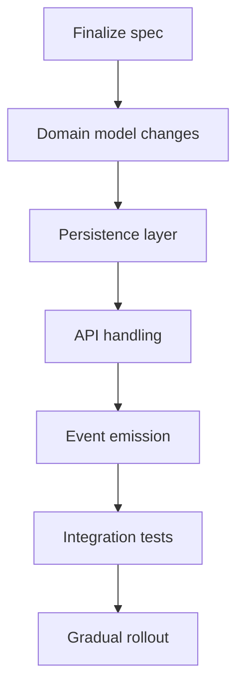

# Implementation Planning Skill

This skill guides you through creating comprehensive, spec-driven implementation plans for mainframe codebase changes before attempting implementation. It supports both Z Understand service integration and local workspace analysis.

## Important: Workspace Folder Structure

- **`.bobz/`** (hidden, gitignored) - Stores temporary/local files:
  - `local-settings.json` - Database location and user preferences (machine-specific)
- **`bobz/`** (visible, committed) - Persistent project files:
  - `implementation-plans/` - Generated implementation plan documents

## Prerequisites

Before starting, ensure:

- User has provided a clear change request or feature description
- Access to either:
  - Z Understand service (recommended for comprehensive analysis), OR
  - Local workspace with COBOL/PL/I source files
- Understanding of the affected system components

## Complete Workflow Overview

The implementation planning workflow has four phases:

1. **Phase 1: Local-First Analysis & Context Gathering** - Start with local analysis, then optionally enrich with Z Understand
2. **Phase 2: Requirements Analysis** - Define what needs to be implemented
3. **Phase 3: Implementation Design** - Create detailed implementation approach
4. **Phase 4: Plan Generation & Documentation** - Generate and save the implementation plan

---

## Phase 1: Local-First Analysis & Context Gathering

**Purpose**: Start with local analysis, gather system context, and optionally enrich the findings with Z Understand.

**CRITICAL**: This phase MUST start with local database validation. Do NOT begin by asking the user to choose between Z Understand service and local workspace analysis.

### Step 1.1: Validate Local Database Availability (MANDATORY FIRST STEP)

**Check for Existing Database First**:

1. Read `.bobz/local-settings.json` and check for a valid `databaseLocation` field
2. If a valid database exists, proceed directly to Step 1.2
3. If no database is found or the database location is invalid, ask the user whether they want to scan the relevant program or parent folder to generate a local database
4. Only if the user explicitly approves the scan, proceed with `scan_program`
5. If the user declines scanning, continue the workflow without local SQL analysis and ask whether they want to use Z Understand for further analysis

**Tool**: `scan_program` (only after explicit user approval and only if a valid database does not already exist)

**Parameters**:

- `uri`: Absolute folder URI (e.g., `file:///workspace/Cobol Programs`)

**Important Notes**:

- ALWAYS use parent folder URI unless user explicitly requests single file scan
- Tool will detect COBOL and PL/I files automatically
- If multiple languages found, tool will prompt user to select
- NEVER run this tool without explicit user approval
- Only run this tool if no valid database exists in `.bobz/local-settings.json`

**Example**:

```xml
<scan_program>
<uri>file:///workspace/Cobol Programs</uri>
</scan_program>
```

**After Scan Completes** (or if database already exists):

- Database location stored/confirmed in `.bobz/local-settings.json`
- Proceed to Step 1.2 (Perform Local SQL Analysis)

---

### Step 1.2: Perform Local SQL Analysis (MANDATORY WHEN LOCAL DATABASE IS AVAILABLE)

**CRITICAL RULE**: If a local database is available, you MUST use `execute_sql_query` for the initial local analysis.

**Tool**: `execute_sql_query`

**Required Usage**:

- Use SQL queries against the local database to identify affected programs, resources, dependencies, and relationships relevant to the requested change
- Use the database path from `.bobz/local-settings.json`
- Treat `execute_sql_query` as the baseline local analysis tool, not an optional supplement

**Supporting Tools**:

- `get_paragraphs` for paragraph structure
- `get_control_flow` for complexity and execution flow
- `BOB_TOOL_READ_FILE` for source review
- These tools supplement the local SQL analysis, but do NOT replace it

**After Local Analysis Completes**:

- Summarize the initial local findings
- Proceed to Step 1.3 (Clarify Change Request)
- Before generating the final implementation plan, you MUST ask the user whether they want Z Understand service to be used for deeper or broader follow-up analysis when local analysis was used
- Use a follow-up in this style:
  - Ask follow-up: "Local analysis is complete. Before I generate the final implementation plan, would you like me to also use Z Understand service for broader dependency and cross-program analysis?"
  - Option 1: "Yes, include Z Understand analysis before finalizing the plan"
  - Option 2: "No, continue with the local analysis results only"
  - Based on user choice:
    - Option 1: Proceed with the Z Understand follow-up steps in this workflow
    - Option 2: Continue directly to final implementation plan generation

---

### Step 1.3: Clarify Change Request

**Gather Missing Information**:

Review the user's initial request and identify what information is still needed. Only ask for information that wasn't provided in the original query.

**Potentially needed information** (ask only if not already provided):

- What change/feature needs to be implemented
- Which programs/components are affected
- Whether this is new feature, refactoring, or modernization
- Specific requirements or constraints

**Capture**:

- Change description
- Affected components list
- Change type (feature/refactor/modernization)

---

### Step 1.4: Gather System Context

**For Local-First Baseline Analysis**:

1. **Query the Local Database**
   - Tool: `execute_sql_query`
   - Use SQL queries to identify programs, resources, dependencies, and relationships relevant to the requested change
   - This is the required first analysis path whenever a local database is available

2. **Get Program Structure**
   - Tool: `get_paragraphs`
   - Parameters: `db_path` (from scan or local-settings.json), `program_names` (affected programs)
   - Retrieves paragraph structure to supplement SQL findings

3. **Analyze Complexity**
   - Tool: `get_control_flow`
   - Use when control-flow detail is needed beyond the SQL analysis

**Mandatory Z Understand Prompt Before Plan Generation**:

If local analysis was used, you MUST ask the user whether they want to use Z Understand service for deeper or broader analysis before generating the final implementation plan.

**Example Follow-up Request Style**:

- Ask follow-up: "Local analysis is complete. Before I generate the final implementation plan, would you like me to also use Z Understand service for broader dependency and cross-program analysis?"
- Option 1: "Yes, include Z Understand analysis before finalizing the plan"
- Option 2: "No, continue with the local analysis results only"
- Based on user choice:
  - Option 1: Proceed with the Z Understand follow-up steps in this workflow
  - Option 2: Continue directly to final implementation plan generation

If the user agrees:

1. **Sign In to Z Understand**
   - Tool: `sign_in_to_z_understand`
   - Confirm connection and continue with workspace alignment validation

2. **Validate Workspace Alignment** (Z Understand + Local Workspace)
   - Use `BOB_TOOL_LIST_FILES` to check whether the workspace contains COBOL/PL/I source files
   - Use `get_project_programs` to compare workspace program names with the Z Understand project
   - Sample 2-3 key programs using `BOB_TOOL_READ_FILE` to look for major structural differences
   - Document whether the workspace is fully aligned, partially aligned, or misaligned

3. **Gather Additional Z Understand Context**
   - Tool: `get_projects`
   - Tool: `get_project_programs`
   - Tool: `get_project_tables`
   - Tool: `get_project_variables`
   - Tool: `get_project_variable_usage_paragraphs`
   - Tool: `get_project_statement_types`
   - Tool: `get_project_resource_usage`
   - Tool: `get_project_paragraph`
   - Use the relevant Z Understand tools to deepen or validate the local SQL findings, not replace them

---

### Step 1.5: Validate Data Dictionary Coverage

**Purpose**: Ensure all affected programs have data dictionary entries to support implementation.

**When to Execute**: After identifying affected programs (Step 1.4) and before analyzing dependencies.

**Validation Process**:

1. **Check for Data Dictionary File**
   - Check AGENTS.md for data dictionary location (if AGENTS.md exists)
   - Default location: `bobz/DD.json` in workspace root
   - Use `BOB_TOOL_READ_FILE` to read DD.json if it exists
   - If no DD.json found, skip validation and proceed to Step 1.6

2. **Analyze Program Coverage**
   - For each affected program identified in Step 1.4:
     - Check if program has entries in DD.json
     - Look for entries where `scope` array contains the program name
     - Identify programs with NO data dictionary coverage

3. **Report Findings to User**

   **If All Programs Covered**:

   ```txt
   ✓ Data dictionary coverage verified:
   - All [N] affected programs have data dictionary entries
   - Programs can reference variable descriptions during implementation
   ```

   - Proceed to Step 1.6

   **If Some Programs Missing Coverage**:

   ```txt
   ⚠️ Data dictionary coverage check:
   - [N] affected programs identified
   - [M] programs have data dictionary entries
   - [X] programs missing data dictionary coverage:
     - [PROGRAM1.cbl]
     - [PROGRAM2.cbl]

   These programs will be documented as prerequisites requiring data dictionary generation before implementation.
   ```

   - Document as prerequisite task in implementation plan
   - Proceed to Step 1.6

4. **Document Prerequisites** (if data dictionary generation needed)
   - Add to implementation plan prerequisites section (Section 2 of template)
   - Include the new_task example showing how to trigger the subtask in Z-Code mode
   - Reference the template format for exact structure

**Important Notes**:

- Data dictionary entries provide business context for cryptic mainframe variable names
- Generating entries before implementation helps preserve context window for actual coding
- Each program's data dictionary entries are stored in the `scope` field
- Missing entries are automatically documented as prerequisites
- Data dictionary generation is a separate subtask from implementation

**After Validation Completes**:

- Document data dictionary status in plan metadata
- If generation needed, add to prerequisites section
- Proceed to Step 1.6 (Analyze Dependencies)

---

### Step 1.6: Analyze Dependencies

**For Local-First Baseline Analysis**:

- Tool: `execute_sql_query`
- Use SQL queries against the local database to identify:
  - Tables used by programs
  - Variables shared across programs
  - Include/copybook dependencies
  - Calling relationships and affected resources
- Use the database path from `.bobz/local-settings.json`
- **Can also use**: `get_control_flow` for detailed complexity analysis if needed
- **Can also use**: `get_paragraphs` to supplement SQL findings with program structure

**For Optional Z Understand Follow-Up**:

- Tool: `get_project_resource_usage`
- Parameters:
  - `resourceType`: "table", "variable", "include"
  - `program`: affected program name
- **Can also use**:
  - `get_project_variables`
  - `get_project_variable_usage_paragraphs`
  - `get_project_tables`
  - `get_project_statement_types`
  - `get_project_programs`
  - `get_project_paragraph`
- Use Z Understand findings to deepen or validate the dependency picture established by the local SQL analysis

---

## Phase 2: Requirements Analysis

**Purpose**: Define what needs to be implemented

### Step 2.1: Extract Requirements

**Parse user's change description to identify**:

- Functional requirements (what the system must do)
- Non-functional requirements (performance, compatibility, security)
- Business requirements (business value, user impact)

**Document in structured format**:

```txt
Functional Requirements:
- FR1: [Requirement description]
- FR2: [Requirement description]

Non-Functional Requirements:
- NFR1: [Performance requirement]
- NFR2: [Compatibility requirement]

Business Requirements:
- BR1: [Business value]
- BR2: [User impact]
```

---

### Step 2.2: Define Goals and Non-Goals

**Goals** (What MUST be implemented):

- List specific, measurable outcomes
- Tie to requirements
- Example: "Support partial policy cancellation for active personal auto policies"

**Non-Goals** (What is OUT OF SCOPE):

- Explicitly state what will NOT be changed
- Prevent scope creep
- Example: "No rewrite of billing engine in this phase"

---

### Step 2.3: Analyze Current State

**For Z Understand Path**:

1. **Variable Usage Analysis**
   - Tool: `get_project_variable_usage_paragraphs`
   - Parameters: `programName`, `variableName`
   - Identifies where key variables are used

2. **Statement Analysis**
   - Tool: `get_project_statement_types`
   - Lists available statement types
   - Helps understand program patterns

**For Local Workspace Path**:

1. **Control Flow Analysis**
   - Tool: `get_control_flow` (if not already done)
   - Analyzes program complexity
   - Identifies critical paths

2. **Source Code Review**
   - Tool: `BOB_TOOL_READ_FILE`
   - Read affected source files
   - Understand current implementation

---

### Step 2.4: Document Assumptions & Constraints

**Assumptions**:

- What are we assuming before coding begins?
- Example: "Policy status transitions are still owned by Policy service"

**Constraints**:

- Technical constraints (backward compatibility, no downtime)
- Business constraints (regulatory requirements)
- System constraints (performance limits)

---

### Step 2.5: Identify and Ask Open Questions

**Purpose**: Fill gaps in understanding by asking the user targeted questions

**Process**:

1. **Review gathered information** from previous steps
2. **Identify knowledge gaps** that could impact the implementation plan
3. **Formulate 2 open questions** (if needed) that address:
   - Technical uncertainties (e.g., integration points, data formats)
   - Business logic clarifications (e.g., edge cases, validation rules)
   - Design decisions (e.g., approach preferences, constraints)
   - Operational concerns (e.g., deployment windows, rollback procedures)

**Guidelines for Questions**:

- Ask only if information is truly missing or ambiguous
- Make questions specific and actionable
- Focus on information that will significantly impact the plan
- Prioritize questions that affect critical path or high-risk areas

**Tool**: `BOB_TOOL_ASK_FOLLOWUP_QUESTION`

**Example**:

```xml
<BOB_TOOL_ASK_FOLLOWUP_QUESTION>
<question>For the policy cancellation feature, should partial cancellations be allowed for all policy types, or only specific types like personal auto?</question>
<follow_up>
<suggest>All policy types (personal auto, commercial, homeowners)</suggest>
<suggest>Only personal auto policies initially</suggest>
<suggest>Personal auto and homeowners, but not commercial</suggest>
</follow_up>
</BOB_TOOL_ASK_FOLLOWUP_QUESTION>
```

**After receiving answers**:

- Incorporate responses into requirements and assumptions
- Update affected sections of the plan
- Proceed to Phase 3

---

## Phase 3: Implementation Design

**Purpose**: Create detailed implementation approach

### Step 3.1: Identify Workstreams

Break the change into logical workstreams (not just a to-do list).

**Example Workstreams**:

```txt
Workstream A: Domain Model Updates
- Introduce new state representation
- Add validation rules
- Extend lifecycle transition logic

Workstream B: API Contract Changes
- Update request schema
- Add new reason codes
- Preserve backward compatibility

Workstream C: Database Integration
- Generate adjustment events
- Handle scheduled changes
- Prevent duplicate generation

Workstream D: Notifications and Audit
- Emit new audit event type
- Trigger customer communication
- Update activity history
```

---

### Step 3.2: Identify Affected Components

**Based on change requirements, identify**:

- Programs that will be modified
- Database tables/files that will be modified
- APIs/interfaces that will be modified
- Copybooks/includes that will be modified

**Document for each component**:

- Component name and type
- Why it needs to change
- Nature of change (add, modify, delete)

**Note**: Detailed impact analysis (downstream consumers, cross-program dependencies, data flows) will be performed by a separate impact analysis skill. This step focuses on identifying the direct components that need modification to implement the change.

---

### Step 3.3: Define Execution Sequence

**Critical**: Show what must happen in what order.

**Format**:

```txt
1. Finalize spec and event contract
2. Add domain model changes behind flag
3. Update persistence layer
4. Add API handling
5. Add downstream event emission
6. Add billing processing
7. Enable integration tests
8. Roll out gradually
```

**Include**:

- What must happen first
- What can happen in parallel
- What is blocked by what

**Optional**: Create Mermaid diagram for complex sequences

---

### Step 3.4: Design Data Model Changes

**For each data change, document**:

- Schema changes (new fields, modified fields)
- Migration requirements
- Additive vs. breaking changes
- Rollback risk
- Backward compatibility

**Example**:

```txt
Table: POLICY_STATUS
- Add field: PARTIAL_CANCEL_DATE (nullable, additive)
- Add field: CANCEL_SCOPE (varchar, additive)
- Migration: ALTER TABLE (no data migration needed)
- Rollback: Safe (nullable fields)
```

---

### Step 3.5: Identify Risks & Mitigations

**For each risk, document**:

- Risk description
- Impact (High/Medium/Low)
- Mitigation strategy

**Example**:

```txt
Risk: Inconsistent state between policy and billing systems
Impact: High
Mitigation: Use idempotent event keys and reconciliation logging

Risk: Old clients send incomplete payloads
Impact: Medium
Mitigation: Make new field optional at API boundary, enforce internally
```

---

## Phase 4: Plan Generation & Documentation

**Purpose**: Generate and save the implementation plan

### Step 4.1: Generate Plan Document

**Use the 12-section template** (see Template Format below)

**Include**:

- All analysis results
- All design decisions
- All risk assessments
- All test strategies
- Mermaid diagrams where helpful

**Important**: Avoid double quotes ("") and parentheses () inside square brackets ([]) in Mermaid diagrams to prevent parsing errors.

**CRITICAL CONSTRAINT**: Implementation plans must NOT exceed 1000 lines. If the plan would be longer, break it into multiple phases or sub-plans and reference external documentation if necessary.

**Note**: The template excludes "System/Context Impact Analysis" as that will be handled by a separate impact analysis skill. This skill focuses on planning the implementation based on requirements.

### Step 4.2: Create Output Directory

**Directory Structure**:

```txt
bobz/
└── implementation-plans/
    └── [feature-name]-[timestamp]/
        └── implementation-plan.md
```

**Tool**: `BOB_TOOL_WRITE_FILE`

**Important Notes**:

- Use kebab-case for feature name
- Include ISO 8601 timestamp in directory name
- Create directory structure automatically via BOB_TOOL_WRITE_FILE

### Step 4.3: Save Implementation Plan

**Tool**: `BOB_TOOL_WRITE_FILE`

**Parameters**:

- `path`: `bobz/implementation-plans/[feature-name]-[timestamp]/implementation-plan.md`
- `content`: Complete implementation plan using template

**After Save Completes**:

- Confirm to user: "Implementation plan saved to [path]"
- Provide summary of key findings
- Suggest next steps (e.g., "Review plan with team before implementation")

---

## Implementation Plan Template Format

### Complete Template Structure

````markdown
# Implementation Plan: [Feature/Change Name]

**Created**: [ISO 8601 timestamp]
**Author**: [Author name or "IBM Bob Premium Package for Z AI Assistant"]
**Analysis Method**: [Z Understand | Local Workspace | Z Understand + Local Workspace]
**Workspace Alignment**: [Fully Aligned | Partially Aligned | Not Applicable | Misaligned]
**Data Dictionary Coverage**: [Complete | Partial | None]

---

## 1. Executive Summary

**Change Description**: [Brief 2-3 sentence description of what's being implemented]

**Business Value**: [Why this change matters]

**Key Risks**: [Top 2-3 risks identified]

**Workspace Notes**: [If using Z Understand + Local Workspace, note any alignment issues, missing files, or version differences]

**Prerequisites**: [If data dictionary generation or other tasks needed before implementation]

---

## 2. Prerequisites

### Data Dictionary Generation (if required)

**Programs Requiring Data Dictionary Entries**:

- `[PROGRAM1.cbl]`
- `[PROGRAM2.cbl]`

**Rationale**: Data dictionary entries provide business context for variable names and should be generated in a separate subtask to preserve context for actual implementation.

**Execution Method**: MUST be completed in a new subtask using Z-Code mode.

**How to Trigger Subtask**:

Use the `new_task` tool to create a subtask in Z-Code mode:

```xml
<new_task>
<mode_slug>code</mode_slug>
<task>Generate data dictionary entries for the following programs:
- [PROGRAM1.cbl]
- [PROGRAM2.cbl]

Use the data-dictionary-management skill to:
1. Scan the programs if not already scanned
2. Extract variables using get_variables tool
3. Generate business-meaningful descriptions
4. Save entries to DD.json

This is a prerequisite for the main implementation task.</task>
</new_task>
```

**Important**: The subtask MUST complete before proceeding with the main implementation to ensure variable context is available.

---

## 3. Requirements

### Functional Requirements

- **FR1**: [Requirement description]
- **FR2**: [Requirement description]

### Non-Functional Requirements

- **NFR1**: [Performance/compatibility/security requirement]
- **NFR2**: [Performance/compatibility/security requirement]

### Business Requirements

- **BR1**: [Business value or user impact]
- **BR2**: [Business value or user impact]

---

## 4. Goals and Non-Goals

### Goals

What MUST be implemented:

1. [Specific, measurable outcome]
2. [Specific, measurable outcome]

### Non-Goals

What is OUT OF SCOPE:

1. [What will NOT be changed]
2. [What will NOT be changed]

---

## 5. Current State Analysis

### System Context

**Programs Analyzed**: [Number] programs

**Key Programs**:

- `[PROGRAM1]`: [Brief description] [Workspace: Available/Missing]
- `[PROGRAM2]`: [Brief description] [Workspace: Available/Missing]

**Database Tables**:

- `[TABLE1]`: [Purpose]
- `[TABLE2]`: [Purpose]

**Workspace Alignment Status** (if using Z Understand + Local Workspace):

- **Total Programs in Z Understand**: [Number]
- **Programs Available in Workspace**: [Number]
- **Programs Missing from Workspace**: [Number]
- **Code Alignment**: [Fully Aligned/Minor Differences/Major Differences]
- **Missing Files**: [List any programs identified as impacted but not available in workspace]

### Key Findings

[Important discoveries from analysis]

### Assumptions

- [Assumption 1]
- [Assumption 2]
- [If applicable: Assumption about workspace alignment or missing files]

### Constraints

- [Constraint 1: Technical/business/system constraint]
- [Constraint 2: Technical/business/system constraint]
- [If applicable: Constraint about missing workspace files limiting local modifications]

---

## 6. Implementation Design

### Workstreams

#### Workstream A: [Name]

**Purpose**: [What this workstream accomplishes]

**Tasks**:

1. [Task description]
2. [Task description]

**Dependencies**: [What must be done first]

#### Workstream B: [Name]

**Purpose**: [What this workstream accomplishes]

**Tasks**:

1. [Task description]
2. [Task description]

**Dependencies**: [What must be done first]

### Execution Sequence


````

**Critical Path**:

1. [Step 1: What must happen first]
2. [Step 2: Next step]
3. [Step 3: Next step]

**Parallel Work Opportunities**:

- [Work that can happen in parallel]

---

## 7. Affected Components

### Programs

| Program Name | Change Type | Reason                     | Workspace Status |
| ------------ | ----------- | -------------------------- | ---------------- |
| [PROGRAM1]   | Modify      | [Why it needs to change]   | Available        |
| [PROGRAM2]   | Add         | [Why it needs to be added] | N/A              |

**Note**: If using Z Understand + Local Workspace, "Workspace Status" indicates whether the program file is available locally for modification. Programs marked "Missing" are identified in Z Understand but not present in the workspace.

### Database Tables/Files

| Table/File Name | Change Type | Reason                     |
| --------------- | ----------- | -------------------------- |
| [TABLE1]        | Modify      | [Why it needs to change]   |
| [TABLE2]        | Add         | [Why it needs to be added] |

### APIs/Interfaces

| API/Interface | Change Type | Reason                   |
| ------------- | ----------- | ------------------------ |
| [API1]        | Modify      | [Why it needs to change] |

### Copybooks/Includes

| Copybook Name | Change Type | Reason                   | Workspace Status |
| ------------- | ----------- | ------------------------ | ---------------- |
| [COPYBOOK1]   | Modify      | [Why it needs to change] | Available        |

---

## 8. Data Model Changes

### Database Schema Changes

#### [Table Name]

**Changes**:

- Add field: `[FIELD_NAME]` ([type], [nullable/not null], [additive/breaking])
- Modify field: `[FIELD_NAME]` ([old type] → [new type])

**Migration Requirements**:

- [Migration approach]

**Backward Compatibility**: [Yes | No | Partial]

- [Compatibility notes]

### Event Schema Changes

#### [Event Name]

**Version**: [Old version] → [New version]

**Changes**:

- [Change description]

**Consumer Impact**: [Description of impact on consumers]

---

## 9. Risks and Mitigations

| Risk                  | Likelihood     | Impact         | Mitigation            |
| --------------------- | -------------- | -------------- | --------------------- |
| [Risk 1: Description] | [High/Med/Low] | [High/Med/Low] | [Mitigation strategy] |
| [Risk 2: Description] | [High/Med/Low] | [High/Med/Low] | [Mitigation strategy] |

**Workspace-Related Risks** (if using Z Understand + Local Workspace):

| Risk                                      | Likelihood     | Impact         | Mitigation                                     |
| ----------------------------------------- | -------------- | -------------- | ---------------------------------------------- |
| Missing workspace files prevent local mod | [High/Med/Low] | [High/Med/Low] | [Document missing files, coordinate with team] |
| Version mismatch between Z Understand/WS  | [High/Med/Low] | [High/Med/Low] | [Validate alignment, update Z Understand]      |

### Critical Risks

**Risk**: [Description of critical risk]

- **Impact**: [What happens if this occurs]
- **Mitigation**: [How to prevent/handle]
- **Contingency**: [Backup plan]

---

## 10. Testing Strategy

### Unit Tests

**Coverage Target**: [Percentage]

**Key Test Cases**:

1. [Test case 1: What to test]
   - **Requirement**: [Traced back to requirement]
   - **Validation**: [What success looks like]

2. [Test case 2]

### Integration Tests

**Scope**: [What systems/components to test together]

**Key Test Cases**:

1. [Test case 1]
2. [Test case 2]

### Contract Tests

**Interfaces to Test**:

- [Interface 1]: [Test description]
- [Interface 2]: [Test description]

### End-to-End Tests

**Scenarios**:

1. [Scenario 1: Full workflow description]
2. [Scenario 2: Full workflow description]

### Regression Tests

**Existing Functionality to Validate**:

- [Functionality 1]: [How to verify it still works]
- [Functionality 2]: [How to verify it still works]

### Migration Tests

**If data migration required**:

- [Test 1: Migration validation]
- [Test 2: Rollback validation]

---

## 11. Rollout and Operational Plan

### Feature Flag Strategy

**Flag Name**: `[feature-flag-name]`

**Stages**:

1. **Dormant**: Code deployed, flag off
2. **Internal**: Enabled for test tenant
3. **Canary**: Enabled for 5% of production
4. **Gradual**: Increase to 25%, 50%, 100%

### Monitoring

**Key Metrics**:

- [Metric 1]: [What to monitor] - [Alert threshold]
- [Metric 2]: [What to monitor] - [Alert threshold]

**Dashboards**:

- [Dashboard 1]: [ URL/Description ]
- [Dashboard 2]: [ URL/Description ]

### Rollback Plan

**Trigger Conditions**:

- [Condition 1: When to rollback]
- [Condition 2: When to rollback]

**Rollback Steps**:

1. [Step 1: Action to take]
2. [Step 2: Action to take]

### Operational Readiness

**Documentation**:

- [ ] Runbook created
- [ ] Troubleshooting guide updated
- [ ] Monitoring alerts configured

**Training**:

- [ ] Operations team briefed
- [ ] Support team trained
- [ ] Documentation published

---

## Appendix A: Analysis Data

### Programs Analyzed

[List of all programs analyzed with brief descriptions]

### Key Variables/Data Structures

[Important variables or data structures identified during analysis]

### Control Flow Insights

[Key findings from control flow analysis]

### Cross-Program Dependencies

[Important dependencies discovered during analysis]

---

## Appendix B: Traceability Matrix

| Requirement ID | Requirement               | Implementation Workstream | Test Case             |
| -------------- | ------------------------- | ------------------------- | --------------------- |
| REQ-001        | [Requirement description] | [Workstream reference]    | [Test case reference] |
| REQ-002        | [Requirement description] | [Workstream reference]    | [Test case reference] |

---

**Last Updated**: [ISO 8601 timestamp]
**Next Review Date**: [Date]

```md
---

## Template Usage Guidelines

### Section Completion Priority

**Must Complete** (Critical sections):

1. Executive Summary
2. Requirements
3. Goals and Non-Goals
4. Implementation Design (Workstreams + Execution Sequence)
5. Affected Components
6. Risks and Mitigations

**Should Complete** (Important sections):

7. Current State Analysis
8. Data Model Changes
9. Testing Strategy

**Can Complete** (Optional sections):

10. Rollout and Operational Plan
11. Open Questions
12. Appendices

### Content Depth Guidelines

- **Executive Summary**: 1-2 paragraphs maximum
- **Requirements**: List format, 3-10 items per category
- **Workstreams**: 2-6 workstreams, 3-8 tasks each
- **Affected Components**: Tables with 5-20 components
- **Risks**: 3-10 risks with mitigations
- **Testing Strategy**: 2-5 test cases per category

### Traceability Requirements

- Every requirement must map to at least one workstream
- Every workstream must map to at least one test case
- Every risk must have a mitigation strategy
- Every affected component must have a reason for change

---

## Common Scenarios

### Scenario 1: New Feature Implementation

1. Prompt user for analysis approach (Z Understand or local)
2. Connect to chosen analysis method
3. Clarify feature requirements with user
4. Gather system context (programs, tables, dependencies)
5. Extract functional and business requirements
6. Define clear goals and non-goals
7. Identify workstreams for feature development
8. Map affected components
9. Design data model changes if needed
10. Identify risks and mitigations
11. Generate implementation plan with test strategy

### Scenario 2: Refactoring Existing Code

1. Prompt user for analysis approach
2. Connect to chosen analysis method
3. Clarify refactoring scope and objectives
4. Analyze current state (control flow, dependencies)
5. Document assumptions and constraints
6. Define refactoring goals (performance, maintainability)
7. Identify workstreams for refactoring
8. Map affected components
9. Assess backward compatibility requirements
10. Identify risks (regression, performance)
11. Generate plan with comprehensive regression testing

### Scenario 3: Modernization Project

1. Prompt user for analysis approach
2. Connect to chosen analysis method
3. Clarify modernization objectives
4. Gather comprehensive system context
5. Analyze current state and technical debt
6. Define modernization goals and non-goals
7. Identify workstreams (often parallel)
8. Map all affected components
9. Design migration strategy
10. Identify high-impact risks
11. Generate plan with phased rollout strategy

---

## Troubleshooting

### Issue: Z Understand Connection Fails

**Cause**: Network issues, authentication problems, or service unavailable

**Solution**:

- Verify network connectivity
- Check authentication credentials
- Offer to switch to local workspace analysis
- If user declines, end workflow gracefully

### Issue: No Programs Found in Local Scan

**Cause**: Incorrect directory path or no COBOL/PL/I files present

**Solution**:

- Verify the directory path with user
- Check for supported file extensions (.cbl, .cob, .pli)
- Ask user to provide correct directory path
- Re-run scan with corrected path

### Issue: Insufficient Information for Requirements

**Cause**: User's initial request lacks detail

**Solution**:

- Use Step 1.3 to gather missing information
- Ask specific questions about:
  - What needs to change
  - Which components are affected
  - Business objectives
  - Technical constraints
- Don't proceed until requirements are clear

### Issue: Complex Dependencies Identified

**Cause**: Change affects many interconnected components

**Solution**:

- Document all dependencies in Current State Analysis
- Break into smaller, manageable workstreams
- Identify critical path and parallel work opportunities
- Highlight high-risk dependencies in Risks section
- Recommend phased implementation approach

---

## Best Practices

### For Optimal Results

1. **Always Start with User Choice** - Never assume analysis method; always prompt user first
2. **Gather Complete Context** - Use all available tools to understand the system before planning
3. **Be Specific in Requirements** - Avoid vague requirements; make them measurable and testable
4. **Think in Workstreams** - Organize work logically, not just as a task list
5. **Identify Risks Early** - Surface risks during analysis, not after implementation starts

### For Efficiency

1. **Reuse Existing Database** - Check `bobz/local-settings.json` before scanning
2. **Combine Tool Calls** - Use Z Understand and local tools together when beneficial
3. **Focus on Affected Components** - Don't analyze the entire codebase if only a subset is affected
4. **Use Mermaid Diagrams** - Visual representations clarify complex sequences
5. **Template Sections Wisely** - Complete critical sections first, optional sections as time permits

### For Quality

1. **Trace Requirements** - Every requirement should map to workstreams and tests
2. **Document Assumptions** - Make implicit assumptions explicit
3. **Plan for Rollback** - Every change should have a rollback strategy
4. **Include Test Strategy** - Testing is not optional; plan it upfront
5. **Identify Open Questions** - Document unknowns rather than making assumptions

---

## Summary

This skill provides a comprehensive workflow for creating implementation plans:

1. **User-Driven Analysis Choice** - Always prompts user to choose between Z Understand or local analysis
2. **Comprehensive Context Gathering** - Uses appropriate tools based on chosen analysis method
3. **Structured Requirements Analysis** - Extracts and documents functional, non-functional, and business requirements
4. **Detailed Implementation Design** - Creates workstreams, execution sequences, and risk mitigations
5. **Professional Documentation** - Generates complete implementation plans using standardized template

By following this workflow, you create thorough, actionable implementation plans that reduce risk and improve project success rates.
```
