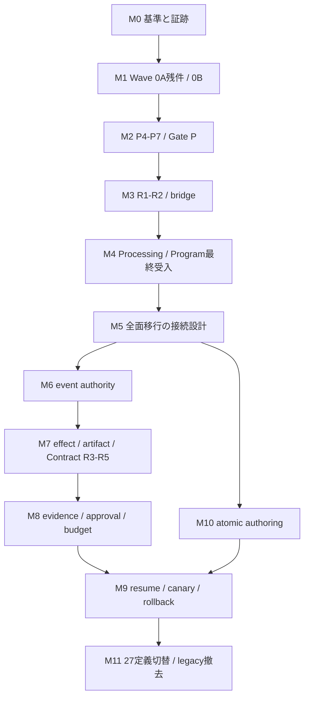

# V2移行 残件整理・統合 Implementation Plan

> **For agentic workers:** REQUIRED SUB-SKILL: Use superpowers:subagent-driven-development or superpowers:executing-plans to implement this plan task-by-task. Steps use checkbox (`- [ ]`) syntax for tracking. この文書は残件の棚卸しと実施計画であり、実装・統合・一般有効化の完了記録ではない。

**Goal:** Workflow Contract V2とReproducible Runtime V2について、現行mainの実装を再利用し、段階統合から製品実行・編集・既存runの継続・全定義切替までの残件と完了条件を一本化する。

**Architecture:** Contract V2はpackage／provider契約と単一immutable compilerを所有し、Runtime V2はevent／attempt／effect／projectionの永続化を所有する。まず現行の機能取捨選択Programをshadow上限で完了し、その後に両者の接続、Windows artifact境界、再開、activationを設計・検証する。authoringとrepository cutoverは実行・復旧の受入条件が揃ってから公開する。

**Tech Stack:** 既存TypeScript、Node.js 22、VS Code Extension API、node:test、JSON/YAML、AJV、SHA-256、GitHub Actions Ubuntu/Windows、3 VSIX。

**Spec:** [Contract V2](../specs/2026-07-17-workflow-contract-v2-design.md)、[generation directory追補](../specs/2026-07-24-workflow-contract-v2-generation-directory-amendment.md)、[Runtime V2](../specs/2026-07-17-workflow-reproducible-runtime-v2-design.md)、[機能取捨選択・逐次統合](../specs/2026-08-23-feature-selection-and-sequential-main-integration-design.md)、[リスク段階別実行境界](../specs/2026-08-31-wave0a-risk-tiered-approval-and-evidence-design.md)。後の追補が変更した範囲では、古い個別計画より追補を優先する。

## Global Constraints

- 調査基準は2026-09-28、local `main` HEAD `5b345a0aa4e58296d3fe55f4876cab151f9f24aa`。計画作成時は静的照合のみ。実行時に追加したremote／archive／CI／テスト／auditの確認結果は[基盤証跡](../../release-evidence/v2-migration-baseline-2026-09-28.md)を正本とし、計画と受入完了を区別する。
- 実行基準mainを `fc231038e3bc398da918488a7bd78ac46e663ad4` へ更新した。依存監査の保守PR #173は統合済みで、同じmainの3 workflowは成功（10 jobs成功、PR専用metrics 1件skip）。Wave 0A候補はこのmainを取り込んだが、候補のhosted CI／main受入とWave 0Bは未完了。詳細は基盤証跡の9/29追記を参照。
- 「実装あり」は受入完了を意味しない。M0の調査完了、M1のローカル差分完成、hosted CI／main統合の成功を別々に記録する。
- Contractの現行Programでは `WF2-P6-ENTRYPOINT_MAX_SHADOW`、`WF2-R2-INVOKE_PRODUCT_REACHABILITY_ZERO` を維持する。V2 package追加やworkspace設定だけで製品実行を有効化しない。
- V2 slotの失敗から同一slotのlegacy定義へfallbackしない。段階導入中は既存V1 command／API／保存schemaを保つ。
- `WF2-R3-WINDOWS-ADAPTER`、R3 artifact、R4、R5はconditional。mandatory Programの最終検証後に個別条件を満たして進める。`WF2-R6-ARCHIVED` は `rejected_current_snapshot` のままとし、旧実装を復活させない。
- package generationの証拠値は `sha256:<64hex>`、物理directoryは `sha256-<64hex>`。公開済みgenerationは不変とする。
- RuntimeのV1 event bytes/hash chainを保持し、V2 authoritative時はeventを正本にする。結果不明のnon-idempotent effectを自動再試行しない。未検証artifactを再利用しない。
- 旧archiveは参考証跡。branch／carrierの一括復元や旧compiler・重複registryの持込みを行わない。共有型・registry・永続化の編集担当は一人にする。
- 8/31追補を適用し、旧計画のhash転記・完全一致承認・transcript復元を再導入しない。実装開始時は当該セッションの依頼範囲を確認し、同じ範囲の修正・テストごとに再確認しない。
- 既存の未追跡 `.integration-xlsx-on-prereq/`、`docs/analysis/`、Premium改善計画は今回の変更対象外。自動cleanup・commit・PR作成はこの計画作成に含まない。

## Review Focus

1. V2の検証／登録だけでproviderやBobを呼んでしまう → M2/M3で呼出し・run作成・staging件数が0であることを証明。
2. 同じ公開digestでも異なるprovider登録世代のhandleを再利用する → M2でprivate environment、失効、lease lifetimeを検証。
3. Windowsのjunction／hard-link置換やpromotion途中のcrashで成果物が混ざる → M7で実Windowsと子process failpoint検証。
4. pointer更新後のresume、承認後の成果物変更、結果不明effectを自動継続する → M8/M9で世代固定・承認失効・in-doubt停止を検証。
5. 「Program完了」「Bob 2.x対応」「codec実装済み」をV2全面移行済みと誤認する → M0/M4/M11で別の完了証跡を持つ。

## 1. 現状と残件

### 1.1 結論

**V2移行は基盤実装の段階。現在の製品入口とrun保存はV1である。** ContractのF1–F7/P1–P3はmainに存在し、Runtimeのfoundation Task 1–3相当も存在する。先に必要なのはContract P4–P7と受入証跡の整理であり、基盤の作り直しではない。

| 領域 | 現HEADで確認した状態 | 残件／根拠 |
|---|---|---|
| Contract F1–F7 | source/testあり。一部は製品利用あり | `src/core/contractV2/`のcanonical/schema/YAML/predicate/provider/Bob。古いFoundation gate台帳と現在の統合証跡を照合する |
| Contract P1–P3 | package schema／loader／lockのsource/testあり | `packagePointer.ts`、`packageLoader.ts`、`workflowLock.ts`。製品のV2 compiler経路への接続は未実装 |
| Contract P4 | 未実装 | `contractV2/compiler.ts`、`compiledPlan.ts`、`compilerEnvironment.ts`とfocused testが未作成 |
| Contract P5–P7 | 未実装 | plan store／lease、entrypoint統合、compiled manifestとfocused testsが未作成 |
| Contract R1/R2 | 未実装 | plan provenanceとprovider invocation。現行Programでは統合しても製品から到達不能にする |
| Contract R3–R5 | conditional、現mainに実装なし | Windows adapterの新設計とproofが先。artifact transaction、compiled executor、Bob compiled runtimeを順次接続 |
| Contract R6 | 旧snapshot不採用 | 残存artifact分類、manual/review/checkpoint継続、Bob session復元を含む新しいresume/recovery設計が必要 |
| Contract A1–A5 | 未実装 | slot store／atomic save／V2 Builder／staging recovery／OS parity |
| Contract C1–C9 | 未実装 | inventory固定、converter、provider schema、27定義変換、legacy削除、cross-OS CI、最終受入 |
| Runtime foundation Task 1–3 | source/testあり | `canonicalJsonV1.ts`、`runStateV2.ts`、`runEventV2.ts`、`runEventCodecRegistry.ts`、4本の`reproducibleRuntime*`テスト |
| Runtime foundation Task 4–12 | 未実装 | projector、shadow verifier、event store/CAS、journal V2、commit coordinator、native run、import/rebuild、運用文書 |
| Runtime effects／artifacts | V2計画の実装なし | durable effect ledger、attempt workspace、artifact-set/v2、verified-only reuse。既存V1の仕組みは再利用候補 |
| Runtime provenance／approval／lineage | V2計画の実装なし | eventからのmanifest、approvalTargetDigest、immutable retry/fork、UI projection |
| Runtime budgets／cancellation／rollout | V2計画の実装なし | hard budget、cancel arbitration、故障注入、canary、authoritative、rollback |
| Bob 2.x互換 | 対応実装・9/20の検証記録あり | 実モデルagent/subagent、対話的resume、他2拡張の実機全工程、Windows以外の確認が残る |

表中の省略source pathは `extensions/workflow-register/` 基準。「未実装」は現mainに計画対象の実装がないという意味で、archiveにコードがないとの断定ではない。

### 1.2 古い台帳から修正すべき認識

- [7/17 Contract master](2026-07-17-workflow-contract-v2-master.md)はP1–P3をpendingとするが、[8/22 Carrier A証跡](../../release-evidence/workflow-carrier-a-merge-resolution-2026-08-22.md)と現sourceには実装がある。F/P1–P3を新規実装タスクとして数え直さない。
- [7/23 Foundation status](../../release-evidence/workflow-contract-v2-foundation-status-2026-07-23.md)は当時のbranch/gate状態。現在のマージやCI状態をそのまま表すものではなく、後続証跡と対応付ける。
- [現行Program index](../../../tools/main-consolidation/feature-integration-program-index.json)は静的な採否・依存関係であり、完了台帳ではない。selection ledger／status projectionは未作成。exact-head CI contractはM1候補に追加したが、main統合・受入は未完了。
- 基準mainでは3つのCI（`extensions-quality`、`workflow-contracts`、`code-consistency-review-scaffold`）にPR head明示checkout・SHA照合がない。M1候補では`three-extension-ui-contracts`も含む4 workflowのPR／push／dispatch検証を揃える。Wave 0Aの成功をローカル実装やマージメッセージだけから認定しない。
- `runStateCodec.ts`のcurrent schemaは `workflow-register/run-state/v1`。`FileRunStateStore.commitSnapshotOwned()`はjournal → run.json → V1 eventの経路であり、V2 codecの存在はshadow／authoritative導入を意味しない。
- [9/20 Bob互換証跡](../../release-evidence/bob-2x-compatibility-2026-09-20.md)では `>=2.0.0 <3.0.0` の正式版、標準task API 5件、`toSerializable`任意へ更新済み。古いF7の2.0.1完全一致／6件必須を復活させない。

### 1.3 移行対象の数

現HEADのtracked `WORKFLOW.md` は元計画の**27件**と一致する。

| 配置 | 件数 |
|---|---:|
| `.bob/workflows/` | 17 |
| `.bob/template-library/` | 1 |
| Bazaar／Consistency配布template | 3 |
| workflow-register samples | 4 |
| workflow-register test fixtures | 2 |
| 合計 | 27 |

この対象集合にV2の`current.json`／`workflow.yaml`／`workflow.lock.json`はまだない。C1で実行時のGit treeを再列挙して固定し、件数だけでなく各旧定義と新slotを一対一で照合する。既存runの保存形式移行はこの27件とは別の台帳にする。

## 2. 実施順と到達点

| 段階 | タスク | 到達点 | 次へ進む条件 |
|---|---|---|---|
| 基準の確定 | M0–M1 | 現HEADの基盤証跡、Wave 0A残件、selection ledger | 後続sliceの基準と受入条件が確定 |
| コンパイラ統合 | M2 | P4→P5→P6 shadow→P7→Gate P | 7群のfocused test、全gate、OS間manifest一致 |
| 安全な部分統合 | M3 | R1/R2とContribution bridge | V2製品実行の到達件数0、active Gate R |
| 現行Program完了 | M4 | Processing 9 slice＋FINAL-VALIDATION | exact-main、3 VSIX、同じartifactの実機UAT |
| 全面移行の契約確定 | M5 | Contract/Runtime接続、resume、activationの設計 | 重複責務・仕様衝突を解消 |
| 実行基盤完成 | M6–M8 | event authority、effect/artifact、evidence、budget | Runtime Gates A–D、conditional各gate |
| 作成・保存 | M10 | V2 authoringとatomic save | A1–A5、公開済みgeneration不変 |
| 限定導入と復旧 | M9 | 新resumeとshadow→canary受入 | M6–M8、M10、実機・故障注入・rollback合格 |
| 全面切替 | M11 | 27定義切替、legacy製品経路撤去 | Contract A01–A20＋Runtime Gate E |



M0–M4は現行採用済みProgramへの対応、M5–M11は全面移行に必要な後続計画。**M4完了だけではV2全面移行完了とはしない。** 後続段階は個別specを更新してから実装する。規模はM0小、M1中、M2–M4大、M5中、M6–M11大。日数は未計測のため断定せず、M1/M2で実測した実装・review・CI時間から見積りを更新する。

## 3. 実行タスク

### M0: 現HEADで基盤と証跡を再確定する

**Files:** 参照は1節のmaster/status/Carrier A/Bob互換証跡、`src/core/contractV2/`、`src/core/runtime/`。新規提案は `docs/release-evidence/v2-migration-baseline-2026-09-28.md`。旧日付の証跡は書換えず、後続記録へ対応付ける。

- [x] F1–F7/P1–P3とRuntime foundation Task 1–3のsource、test、導入commit、既存証跡、現HEADでの検証結果を別列で記録する。
- [x] 5節の基盤focused testとpolicyを実行し、失敗を「既存baseline」「新規回帰」「環境不備」に分類する。存在する実装を未着手へ戻さない。
- [x] `npm run audit:prod`を再実行する。9/20に記録された`fast-uri`／`js-yaml`のHigh 2件は履歴情報であり、現在の件数は再確認して依存更新タスクへ分離する。
- [x] activeなProgram証跡、CI、archive identity、現在のHEADとの関係を読み取りで照合する。古いPRのopen/closedやremoteのmain-onlyを推定しない。

**完了条件:** 再利用できる基盤・不足証跡・実装が必要な残件が区別され、次のsliceのbase SHAが明記される。

### M1: Wave 0Aの残りを閉じ、Wave 0Bの選択台帳を作る

**Files:** 既存 `tools/main-consolidation/featureIntegration{Risk,Program,Campaign}Policy.mjs`、対応tests、`.github/workflows/{extensions-quality,workflow-contracts,code-consistency-review-scaffold,three-extension-ui-contracts}.yml`、共通SHA検証scriptとtests、正規JSONのLF保持設定。後続出力はProgram indexに指定済みの `exact-head-ci-contract.json`、`feature-selection-source-universe.json`、`docs/release-evidence/feature-selection-ledger-2026-08-23.{json,md}`、`feature-integration-status.json`。

- [x] 8/31簡素化後の実装を起点にWave 0Aの未完了差分だけを確定する。旧8000行規模の計画を先頭から再実行しない。既存policyは実行許可を発行しないモデルとして扱う。
- [x] PR headと実checkout SHA不一致を拒否するCI検査を先に追加し、dispatchも含め4 workflowを揃える。ローカル検証は38件成功。hosted CI／main統合の失敗・未確認時は後続製品sliceへ進めない。
- [ ] Wave 0A成功証跡を照合した後、Wave 0Bでsource universeを `selected / conditional / rejected_current_snapshot / superseded` に一意分類する。
- [ ] missing/duplicate/unclassified source、inactive capabilityの誤混入、旧承認方式へのfallbackをnegative testで拒否する。Program indexは状態台帳に転用しない。

**完了条件:** Wave 0A成功とWave 0B完了が独立に記録され、20 mandatory sliceの順序と各受入条件を機械検証できる。

### M2: Contract P4–P7を4 sliceで実装しGate Pを閉じる

**Files:** 新規 `contractV2/{compiledPlan,compiler,compilerEnvironment,planStore,planLease,compiledPlanManifest}.ts`、対応 `workflowContractV2{Compiler,PlanStore,Entrypoints,Manifest}.test.js`、`scripts/compile-workflow-contract-v2-packages.js`。既存変更は `workflowRuntimeFactory.ts`、`workflowDiscovery.ts`、`workflowDefinitionLoader.ts`、`workflowRegistrationService.ts`、validation command、operation hub。詳細は[package/compiler計画 P4–P7](2026-07-17-workflow-contract-v2-package-compiler.md)。

**Interfaces:** `compileWorkflowPackage({rawPackage, environment}): WorkflowPackageCompileResult`、`createAuditedWorkflowCompilerEnvironment({purpose, providerCatalog, bobProfile}): WorkflowCompilerEnvironment`。`WorkflowPlanStore.getOrCompile()`は非lease、`acquire()`はruntime専用、`WorkflowPlanLease.release()`は冪等。既存計画の型を共有し、別compilerを増やさない。

- [ ] P4: pipeline順、unknown/no-op field拒否、frozen plan、同一内容から同一digest、公開digestが同じでもprivate environmentが異なるケースを先にREDにする。
- [ ] P5: registry再登録、package/pointer変更、同時compile、lease保持中の失効を検証し、private handleと公開evidenceを分離する。
- [ ] P6: validation／registration／hubを共通gatewayへ接続する。V2不正slotでlegacy fallbackなし、V2経路のprovider/Bob/run作成件数0をassertする。既存V1の実行回帰は別に維持する。
- [ ] P7: explicit collection/catalogからmanifestを生成する。挿入順、host path、localeに依存せず、Ubuntu/Windowsのbytes/digest一致をassertする。
- [ ] 各sliceでRED→実装→focused GREEN→関連回帰→review→対象ファイルだけcommit。P1–P7の7群と全gateでGate Pを記録する。

**完了条件:** 全入口で同じimmutable plan identityを得られ、V2はshadow上限。実行能力の完成はM7/M9まで持ち越す。

### M3: Gate Rを作り直し、R1/R2とContribution bridgeを統合する

**Files:** 新規 `contractV2/runPlanProvenance.ts`、`providerInvocation.ts`、対応focused tests。既存 `contractV2/providerRegistry.ts`、`core/actionRegistry.ts`、三拡張のprovider登録。Gate R inventory／active manifest／runnerの正確な配置はM1のsource universeからこのsliceの詳細計画に固定する。

- [ ] 順序を `GATE-R-ARCHIVE-INVENTORY → WF2-R1-PROVENANCE → WF2-R2-INVOKE → REG-BRIDGE-OWNER-VERSION-LIFECYCLE → REG-BRIDGE-DISCOVERY-EVIDENCE` の5 sliceに固定する。
- [ ] archive test inventoryとmain active test manifestを分ける。旧Gate Rの存在しないtest filenameをそのまま実行しない。R3–R5 inactive、R6 rejectedの混入を拒否する。
- [ ] R1でpackage/lock/plan/environment/provider/Bob identityとlease lifetime、R2で不正inputのdispatch 0、不正output/errorのcommit 0を検証する。
- [ ] public commandからV2 lease取得／dispatch／Bob／run directory／artifact stagingへ到達する経路がないことをstatic scanとspyの両方で検証する。
- [ ] owner/version重複登録はatomic reject、stale disposableは新登録を削除しない、3拡張activate/deactivate後の登録数が収束することを検証する。discovery evidenceはP4/P7と同じbytes/catalogを使う。

**完了条件:** R1/R2の内部契約が検証され、製品実行は未有効。bridgeのregistryとcompiler authorityが一つに揃う。

### M4: 現行ProgramのProcessingと最終受入を完了する

これはV2固有機能の追加分ではなく、現行Programでconditional R3以降へ進む前の必須依存である。詳細は[選別仕様 §7.3/§8/§12/§13](../specs/2026-08-23-feature-selection-and-sequential-main-integration-design.md)。

- [ ] `PROC-T13-LEDGER → T14-BOUNDED-DOC → T15-AGGREGATE → T16-INPUT-PROCESS → T17-DEADLINE → T17-PATH → T18-REPORT → T18-CCR-HANDOFF → T18-BZR-HANDOFF` を9 sliceで統合する。
- [ ] 13-category ledger、bounded Buffer input、document/workbook aggregate、absolute monotonic deadline、process-tree settlement、physical containmentを検証する。current Bazaarの公開上限とOOXML snapshot動作を維持する。
- [ ] reportはshadow比較後にcomplete-only handoffへ接続する。partial/cancelled/limit超過で既存の受理済み成果物が置換されないことを検証する。
- [ ] `FINAL-VALIDATION-CONTROL`後の固定product mainに対し、全gate→3 VSIXとhash→同一artifactの実機UAT→read-only topology auditを実施する。

**完了条件:** Wave 0Aに加え、M1のWave 0B 1件＋M2 4件＋M3 5件＋Processing 9件＋final control 1件＝20 mandatory sliceの証跡が揃う。任意のclosureは別枠。これはshadow段階のProgram完了である。

### M5: ContractとRuntimeをつなぐ仕様差分を確定する

**Files（新規提案）:** `docs/superpowers/specs/2026-09-28-v2-runtime-cutover-integration-design.md`。旧Runtime／Contract個別計画には、この追補への参照と変更範囲を追加する。

- [ ] compilation、provider schema/capability、effect intent/idempotency、artifact検証/promotion、run/event commitの責任表を固定する。既存Contract registryとRuntime計画のprovider V2を別registryとして実装しない。
- [ ] Contractのartifact transactionとRuntimeのartifact-set/v2に、同じpromotion・commit・recovery境界を割り当てる。二重journal／二重publishを禁止し、exact-byte commit順序とfailpoint表を定義する。
- [ ] Contract shadow上限とRuntime canary設定を別概念として明記する。旧Runtime planのcanary設定だけでContract製品実行を解禁できないようにする。
- [ ] V1 run importとV1 workflow importerを区別する。前者はevent履歴保存の対象、後者は最終製品に残さない。Runtime案のlegacy provider adapterも最終cutoverの撤去対象を決める。
- [ ] resume/restart/retry、manual/review/checkpoint、Bob session、artifact残存分類、実行途中run、rollback時の読取専用動作をcase tableにする。再開は旧R6 snapshotから切り離して設計する。

**完了条件:** 新specで所有interface、状態遷移、受入case、activation条件が確定。新API名・型の決定はこの追補に集約し、未確定のまま実装へ配らない。

### M6: Runtimeのevent authorityを実装する

**Files:** 新規 `core/runtime/{runProjector,runProjectionSerializer,executionManifestProjector,runShadowVerifier,runtimeDiagnostics,runEventStore,runEventHead,runStateJournalV2,runProjectionStore,runCommitCoordinator,legacyRunImporter}.ts`。既存runtime factory/store/commandsの接続。詳細は[foundation/authority Task 4–12](2026-07-17-workflow-reproducible-runtime-v2-foundation-authority.md)。

**Interfaces:** 既存codecを消費し、pure `RunProjector.initial/apply/replay`、leaseとhead/sequenceを要求する`RunEventStore.appendWithCas`、`RunCommitCoordinator`のjournal→event→projectionを提供する。signatureはM5と元planで固定する。

- [ ] `reproducibleRuntimeReplay/Shadow/EventStore/JournalV2/CommitCoordinator`各testで、同じeventから同じprojection bytes、lease expiry/CAS conflict時のpublish 0、crash前後のbytes一致を検証する。
- [ ] `NativeV2/LegacyRebuild`でV1 prefix不変、import二重実行、future schema、corrupt middle event、torn tail、rebuild中断を検証する。
- [ ] 最初はread-only shadow。限定canaryのwriter切替はM5の条件に従い、V2 authoritativeでrun.jsonを直接変更する経路を拒否する。

**完了条件:** Runtime Gates A/B。V2状態をV1 storeに渡して継続する経路がなく、projectionをeventだけから再構築できる。

### M7: effect／artifactとconditional Contract実行を接続する

**Files:** Runtimeの `core/effects/`、`core/artifacts/{attemptWorkspace,safeArtifactPath,artifactSetV2,artifactSetVerifier,artifactPromotion}.ts`、provider境界。Contractの `contractV2/{artifactTransaction,compiledPlanRuntime}.ts`、Bob factory/runner。詳細は[attempt/effects/artifacts](2026-07-17-workflow-reproducible-runtime-v2-attempt-effects-artifacts.md)と[Contract R3–R5](2026-07-17-workflow-contract-v2-runtime.md)。

- [ ] 新Windows adapter specを先に確定する。junction/reparse/mount escape/hard-link置換/identity drift、no-overwrite、same-volume promotion、flush順序を実Windowsで検証し、conditional GOの証跡にする。
- [ ] effect intentをdispatch前に永続化し、stable key、重複call、concurrent retry/forkで副作用が一度だけになることを検証する。non-idempotent post-dispatch crashはin-doubtで停止する。
- [ ] staging/hash mismatch/wrong owner/missing verificationをreuseから除外する。artifact-set commitとpromotion途中のcrashをM5で定めた共通境界から復旧する。
- [ ] Windows adapter→R3→R4→R5を各条件確認後に直列統合する。R4はplan lease取得後のsource再読込0、R5は実task capability不一致時のdispatch 0を検証する。

**完了条件:** Runtime Gate CとContract各conditional gate。統合後も一般実行はshadow上限を維持し、activationはM9へ分離する。

### M8: provenance／approval／lineage／hard budgetを完成する

**Files:** `core/runtime/executionManifestV1.ts`、`executionIdentityCapture.ts`、`evidenceSanitizer.ts`、`core/approvals/`、`core/lineage/`、`core/budgets/`、`core/cancellation/`、provider usage/process controller。詳細は[provenance/approval/lineage](2026-07-17-workflow-reproducible-runtime-v2-provenance-approval-lineage.md)と[budgets/cancellation](2026-07-17-workflow-reproducible-runtime-v2-budgets-cancellation.md)。

- [ ] execution manifestをeventから投影し、plan/input/provider/effect/artifact/budget/approval/lineageのdigestを辿れるようにする。
- [ ] `reproducibleRuntimeApproval/Evidence/Lineage`でapproval対象の任意要素変更→失効、retry→新attempt、fork→child run、parent bytes不変を検証する。
- [ ] `reproducibleRuntimeRunControl/ProcessCancellation`でoutput bytes、AI calls、input/output/total tokens、timeout、cancel競合を検証する。能力不足providerは呼出し前に拒否する。
- [ ] M4のdocument/input Processing Budgetとrun/effect予算を対応付ける。計上単位を混ぜず、重複予約・二重計上・pause/retryによる上限resetを防ぐ。

**完了条件:** Runtime Gate D。Bob/UI stateは再構築可能なprojectionになり、承認と予算が実際の対象／attemptに結び付く。

### M9: 新しいresume／限定canary／rollbackを受け入れる

**Files:** M5で決めたresume/recovery実装、`workflowRunCommands.ts`、`workflowRuntimeFactory.ts`、`core/runtime/{faultController,bobSyncProjection,runtimeAuthorityRollout}.ts`、`scripts/reproducible-runtime-extension-host.test.js`、運用文書。詳細は[failure/rollout](2026-07-17-workflow-reproducible-runtime-v2-failure-rollout.md)。

- [ ] pointerが変わっても既存runは元generation/planへ固定する。必要generation不足やcorruptionを最新定義へのfallbackで隠さない。
- [ ] manual/review/checkpoint継続、artifact残存、Bob中断、Extension Host restart、multi-rootを新resume試験へ含める。旧R6コードの存在を合格根拠にしない。
- [ ] fault suiteでjournal/event/projection/effect/artifact/lease/CAS/cancelの境界を子processで中断し、expected recovery classと二重作用0を検証する。
- [ ] M10で用意した検証可能な単一workflowからcanaryを開始する。実モデルagent/subagent、権限継承、UI resume、Bazaar/Consistency全工程を同じVSIXで確認する。
- [ ] rollbackは新規admissionを停止し、既存V2 event/generation/artifactを保持して対応readerを残す。V2 runをV1として再開しない。最終cutover後にlegacy fallbackを残す設計にしない。

**完了条件:** Runtime Gate Eと限定activation受入。shadow/canaryの観測期間・対象数・停止閾値はM5の実機計画で固定し、未測定のままauthoritativeへ進めない。

### M10: Atomic authoringを完成する

**Files:** 新規 `contractV2/{slotStore,atomicPointer,packageSave,packageSaveFaults,authoringModel,generationRecovery}.ts`、lock refresh command。既存authoring loader/model/serializer、Builder、create/edit command。詳細は[atomic authoring A1–A5](2026-07-17-workflow-contract-v2-atomic-authoring.md)。

- [ ] slot/pointer、staged save、V2 Builder round-trip、cleanup、OS parityをA1→A2→A3→A4→A5で実装する。compiler/registryを別実装にしない。
- [ ] `workflowContractV2SlotStore/AtomicSave/Authoring/GenerationCleanup/AuthoringParity`で全save failpoint、旧pointer保持、新generationのみpublish、live lease/owner不一致のcleanup拒否を検証する。
- [ ] `sha256-<64hex>`の物理名とcanonical evidenceを分離し、Windows/POSIXで同じevidenceを生成する。

**完了条件:** 編集・preview・validation・saveが同じcompilerを使い、保存失敗で既存の実行可能generationを壊さない。M5後、M6–M8とファイル所有を分けて準備できるが、共有FS/schema変更とmain統合は直列にする。

### M11: 27定義を切り替えて移行完了を宣言する

**Files:** `scripts/check-workflow-contract-v2-inventory.js`、一時converter、`docs/workflows/workflow-contract-v2-{migration-evidence,collections}.json`、27 slots、三拡張provider contracts、legacy production paths、`.github/workflows/workflow-contracts.yml`、`docs/workflows/workflow-contract-v2-acceptance.md`。詳細は[repository cutover C1–C9](2026-07-17-workflow-contract-v2-repository-cutover.md)。

- [ ] C1でcurrent Git treeと27件の旧定義hashを固定。対象追加があればspec/inventoryを更新してから進める。
- [ ] C2 converterとC3 provider/schemaを先に検証し、unknown/no-opはrejectする。移行中断時のpointer/evidence journalを復旧可能にする。
- [ ] C4 root 17件→C5 library/companion 4件→C6 sample/fixture 6件を変換する。旧field採否、15 post-commit human gates、ID/参照/成果物、挙動を一対一で照合する。
- [ ] C7でlegacy parser/compiler/production dual-reader/fallbackを削除。旧run履歴のread-only保持とworkflow定義のhard cutoverを混同しない。
- [ ] C8でUbuntu/Windows manifest byte比較をCIへ追加。C9でContract A01–A20、Runtime Gates A–E、3拡張回帰、VSIX、実機、運用runbookを同じ候補で受け入れ、一時converterを撤去する。

**完了条件:** active定義V2 27件／legacy 0件、単一compiler、V2の保存・実行・再開、event replay、effect重複防止、verified-only reuse、rollbackの証跡が揃う。実装完了とリリース可否を別欄で記録する。

## 4. 関連計画との調整

- 同日作成済みのローカル未追跡文書 `2026-09-28-premium-informed-three-extension-improvements.md`（元checkoutのみ、今回の成果物には含めない）T8はM5/M9/M11へ接続する。T1のassessment、T2/T4のbinding、T3のgenerationはContract output/artifactとRuntime effectへ写す。T1–T7全体をV2基盤の必須前提にはしない。
- Premium T7の限定並列・DAG表現を、現在のContract lexical step semanticsが対応済みとは扱わない。必要になった段階で専用の仕様差分を作る。
- Bob 2.x対応の残る実機項目はM9にまとめ、9/20に済んだSemVer/probe/snapshotの基礎回帰を作り直さない。
- 実装時のparallel化は読取り監査、fixture準備、独立reviewを優先する。現行Programのslice統合は `ONE_ACTIVE_SLICE`。M10とRuntimeの準備を分ける場合も共有型・schema・provider・FS adapterの同時編集は避ける。

## 5. 検証コマンドと証跡

以下は検証に使うコマンド一覧であり、一覧自体は成功記録ではない。実行済みの範囲・結果・未実行項目は[基盤証跡](../../release-evidence/v2-migration-baseline-2026-09-28.md)を参照する。PowerShellでは必要に応じ`npm.cmd`を使う。

基盤の再確認（working directory: `extensions/workflow-register`）:

```powershell
npm.cmd run compile
node --test test/workflowContractV2CanonicalJson.test.js test/workflowContractV2Diagnostics.test.js test/workflowContractV2JsonSchema.test.js test/workflowContractV2Yaml.test.js test/workflowContractV2Predicate.test.js test/workflowContractV2ProviderRegistry.test.js test/workflowContractV2BobProfile.test.js test/workflowContractV2PackageSchema.test.js test/workflowContractV2PackageLoader.test.js test/workflowContractV2Lock.test.js
node --test test/reproducibleRuntimePhase4Characterization.test.js test/reproducibleRuntimeReplay.test.js test/reproducibleRuntimeCorruption.test.js test/reproducibleRuntimeFixtureLineEndings.test.js
```

各実装sliceは追加testをREDで確認した後、focused GREENと関連回帰を実行する。phase統合では次を実行し、三拡張に触れるphaseでは各extensionのpackage scriptに従って同じ範囲を検証する。

```powershell
npm.cmd run dependency:policy
npm.cmd run architecture:policy
npm.cmd run source:policy
npm.cmd run schema:policy
npm.cmd run unused:report
npm.cmd run audit:prod
npm.cmd test
npm.cmd run package
npm.cmd run package:policy
git diff --check
```

Gate Pは既存P1–P3と新規P4–P7の7 test groups。Gate RはM3で作るactive manifestを正本とし、将来test名を先に列挙した旧commandを合格根拠にしない。workflow-registerの現VSIX上限は1,200,000 bytesで、9/20証跡は1,193,624 bytes。追加機能のpackage余裕が小さいため、初期sliceから追跡し、上限を黙って引き上げない。

証跡にはbase/head/tree、変更対象、RED/GREENコマンド、件数・skip理由、CI job URLとSHA、独立review所見、VSIX hash、実機OS/Bob版、activation状態を残す。過去ログを現HEADの証拠として再利用しない。

## 6. この計画の自己点検

- [x] Contract F/P/R/A/C、Runtime 5 phase、Bob 2.x実機残件を対応付けた。
- [x] source/testの存在と製品接続、現在の受入完了を区別した。
- [x] 7月のpending表を8月のCarrier A／選別仕様／9月のBob互換実装と照合した。
- [x] 27定義とProgramの20 mandatory sliceを別集計にした。
- [x] R3–R5 conditional、R6旧snapshot不採用、shadow上限、8/31の簡素化を反映した。
- [x] RuntimeとContractのprovider/artifact/activationの衝突解消を、実装前のM5へ明示した。
- [x] 製品コードの変更や未実行テストの成功を主張していない。

**次の実行単位:** M0の基盤証跡を起点に、M1のCI候補・既存baselineの依存audit解消・Wave 0A受入を閉じる。続いてWave 0Bを完了した後、最初の製品機能としてM2/P4単一compilerを一つのreview可能なsliceで実装する。
