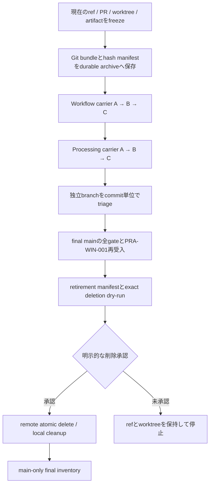

# Main一本化とbranch retirementの設計

- Status: approved for implementation
- Approved: 2026-08-21
- Date: 2026-08-21
- Repository: `katamor1/bob_builtin_analyze`
- Control-plane branch: `codex/main-consolidation-control-plane`
- Design baseline: `origin/main` `44027562fe201d47f8f4cf08241ffe29384e9902`

## 1. 目的

現在の二つの大規模stack、独立branch、XLSX/OOXML修正履歴を、内容を失わずreview可能な単位で`main`へ統合する。その後、exact SHA、open PR、worktree、artifact、実機証跡を照合したうえで、不要になったlocal/remote branchとworktreeを安全にretireする。

最終状態は次のとおりとする。

- default branch、remote head、通常作業branchは`main`だけである。
- open PRは0件である。
- 登録worktreeはrepository rootの`main` checkoutだけである。
- root checkoutは`main == origin/main`かつcleanである。
- 非祖先となる旧履歴は検証済みGit bundleとref manifestから復元できる。
- 旧・新VSIX、fixture、実機証跡はtemp外のdurable archiveでhash付き保全される。
- cleanup前の履歴対応表、carrier patch、CI、実機受入、削除結果が`main`上のrelease evidenceから追跡できる。

本設計は統合とretirementの制御面を定義する。各stackの製品要件を変更したり、既に受入済みのOOXML安全境界を以前の実装へ戻したりするものではない。

## 2. 2026-08-21時点の観測状態

設計開始時のread-only観測値は次のとおりである。実行時には同じ取得処理を再実行し、値が変わっていれば新しいmanifestを生成してreviewをやり直す。

| 対象 | 観測値 |
| --- | --- |
| `origin/main` | `44027562fe201d47f8f4cf08241ffe29384e9902` |
| primary checkout | local `main` `7aaab7d0b8d163495ab48222f20cc99d95ffab7c`、`origin/main`より1 commit behind |
| primary checkoutの未追跡物 | `.integration-xlsx-on-prereq/`。別cloneのため勝手に変更・削除しない |
| open PR | 20件（Workflow Contract v2が14件、Processing Budgetが6件） |
| remote heads | 31本（`main` 1本とnon-main 30本） |
| 既存登録worktree | root、`fix-bazaar-minimal-xlsx`、`harden-ooxml-snapshot-input` |
| 本設計用worktree | `.worktrees/main-consolidation-control-plane`を`origin/main`から追加 |
| Workflow stack全体 | common base `56ba084d07f1641fa0454fe1da024f14fe99fd37`からleaf `a18c09b10fa51702d312e34940a694ad971a48cc`、net 247 paths |
| Processing stack全体 | common base `8793804f2f99fd1d545cb496064bcbdc7df4bf40`からleaf `2d8a570fa1c0646fd662346744449b1abc1142b2`、net 344 paths |
| stack間のnet overlap | 7 paths。すべて`extensions/workflow-register`配下 |

stack間で重なる7 pathsは次のとおりである。

- `extensions/workflow-register/package.json`
- `extensions/workflow-register/src/core/actionRegistry.ts`
- `extensions/workflow-register/src/extension.ts`
- `extensions/workflow-register/src/workflowAdapter.ts`
- `extensions/workflow-register/src/workflowRegisterService.ts`
- `extensions/workflow-register/src/workflowRuntimeFactory.ts`
- `extensions/workflow-register/test/registrationWiring.test.js`

### 2.1 受入済みOOXML基準点

PR #165と#167はmerge済みで、`origin/main`のOOXML共通安全化を正本とする。2026-08-21の実機受入済みartifactは次のとおりである。

- VSIX: `bob-bazaar-review-0.3.0.vsix`
- SHA-256: `4E0A9961FA1CD50882CAA89D3EEECC9BCFC8A31871A5ECA6262A37D99700A1DC`
- Size: `3,758,108` bytes
- Package entries: `1,822`
- Result: `PRA-WIN-001 = pass`、残り23 caseは`not_run`
- Evidence root: `C:\Users\stell\AppData\Local\Temp\bob-review-ooxml-final-44027562\bazaar-core`

Processing stackはBazaarのDOCX/XLSX抽出コードにも変更を持つ。このためcarrier適用時は、`ooxmlArchive.ts`による同一FileHandle snapshot、BigInt identity、local/central/descriptor検証、bounded inflate、CRC、Buffer parser input、missing-both XLSXの限定normalizationを保持する。古いpath入力、展開後だけの上限検査、または検証前parser importへ戻してはならない。

## 3. 非目標と安全境界

この作業では次を行わない。

- 20件のstacked PRをそのまま順番にrebaseしてmergeしない。
- 各stackのleafを一つの巨大PRとして直接`main`へmergeしない。
- conflict解消で`ours`または`theirs`を一括採用しない。
- branch名のprefix、glob、merged表示だけを根拠に削除しない。
- open PRのhead/base、未分類の独立branch、dirty worktreeを削除しない。
- atomic deleteが利用できない場合にsequential deleteへfallbackしない。
- tempにある実機証跡やVSIXをdurable archiveへ移す前にcleanupしない。
- primary checkoutの未追跡cloneを、所有者と内容を確認せず移動・削除しない。

統合作業と削除作業は別の認可境界とする。carrierの作成・review・mergeが完了しても、branch、worktree、clone、artifactの削除は自動では開始しない。exact dry-runを提示し、対象ごとの明示承認を得てから実行する。

## 4. 全体アーキテクチャ



制御面の記録は`codex/main-consolidation-control-plane`で開始し、最終的に`main`へmergeする。大容量のbundleとVSIXはrepositoryへcommitせず、次のdurable archiveへ置く。

```text
C:\Users\stell\source\archives\bob_builtin_analyze\2026-08-21-main-consolidation\
```

archiveには最低限、次を含める。

- `pre-consolidation.bundle`（作成時点の`--all` refsを含む）
- `bundle-heads.txt`と`bundle-verify.txt`
- `remote-heads-before.txt`
- `local-branches-before.txt`
- `worktrees-before.txt`
- `open-prs-before.json`
- `carrier-patches/`配下の6 patchと各SHA-256
- 旧VSIX `CE335C40F2D2A003B932134C02A2875E3996C6C7409863B9CF14956DCA7C0D85`
- 受入済みVSIX `4E0A9961FA1CD50882CAA89D3EEECC9BCFC8A31871A5ECA6262A37D99700A1DC`
- 受入済み`operator-result.json`、`PRA-WIN-001-evidence.json`、fixture manifest
- archive全体の相対path、size、SHA-256 manifest

bundleは`git bundle verify`と`git bundle list-heads`を成功させ、別の空directoryで必要なrefをfetchできることまで確認する。archive manifestは`main`のrelease evidenceへcommitし、絶対pathに加えてhashと復元手順を残す。

## 5. Carrier PR設計

各carrierは、元stackの境界間diffを固定し、最新`main`へ適用する。patchは次の形で作り、patch自体とfrom/to SHAをarchiveへ記録する。

```text
git diff --binary --full-index --output=<carrier.patch> <from-sha> <to-sha>
git apply --check --3way --index <carrier.patch>
git apply --3way --index <carrier.patch>
```

shellで生成した未記録diffやcopy-and-pasteは使用しない。競合がある場合はpatch適用を停止し、base、carrier側、現行`main`側の三者を読んで解決する。解決後の差分は元patchとの差を別evidenceとして記録する。

### 5.1 Workflow Contract v2

| Carrier | Frozen range | 置換するopen PR | Net scale |
| --- | --- | --- | --- |
| Workflow A | `56ba084d07f1641fa0454fe1da024f14fe99fd37..683e794eb4a39eea7bc3630bedbd2a557f4af8af` | #143, #148, #149, #151 | 196 commits / 105 paths |
| Workflow B | `683e794eb4a39eea7bc3630bedbd2a557f4af8af..e860d1ebbafe7068fc6871b16c9586a11b4fe19d` | #153, #154, #155, #157 | 112 commits / 67 paths |
| Workflow C | `e860d1ebbafe7068fc6871b16c9586a11b4fe19d..a18c09b10fa51702d312e34940a694ad971a48cc` | #158, #160, #161, #162, #163, #164 | 217 commits / 91 paths |

Workflow Aを最新`origin/main`から作成し、merge後の新しい`origin/main`からWorkflow Bを作成する。同様にCまで進める。未merge carrierを長いstackとして先行作成しない。

### 5.2 Processing Budget

| Carrier | Frozen range | 置換するopen PR / prerequisite | Net scale |
| --- | --- | --- | --- |
| Processing A | `8793804f2f99fd1d545cb496064bcbdc7df4bf40..4d0fb728763db9d13c87d000790a88c45900733e` | `codex/three-extension-p1-release-gates`, #145, #146 | 125 commits / 202 paths |
| Processing B | `4d0fb728763db9d13c87d000790a88c45900733e..49f39e1a6ec35e5db98e9ef698d4ce43369c9760` | #147, #150 | 115 commits / 50 paths |
| Processing C | `49f39e1a6ec35e5db98e9ef698d4ce43369c9760..2d8a570fa1c0646fd662346744449b1abc1142b2` | #152, #159 | 341 commits / 135 paths |

Processing AはWorkflow Cまでmergeした最新`main`から開始する。これによりstack間で重なる7 pathsを一つずつ明示的に調停できる。

### 5.3 CarrierのPR契約

各carrier PRは次を必須とする。

1. from/to exact SHAとpatch SHA-256をPR本文へ記載する。
2. 置換対象PRとprerequisite branchを列挙する。
3. conflict解消path、採用した意味、捨てた旧実装を列挙する。
4. 元rangeのpath inventoryと、最終carrier diffのpath inventoryを比較する。
5. intentionally omitted pathは理由と代替実装を記録する。
6. exact PR headでLinux/Windows required checksを成功させる。
7. independent reviewでCritical 0 / Important 0を確認する。
8. merge後に`origin/main`のexact merge SHAをevidenceへ追加する。
9. 対象の旧PRへcarrier PR/merge SHAをcommentし、旧PRをcloseする。branch削除はまだ行わない。

## 6. Conflictと正本の規則

競合時の優先順位は「新しい方を常に採る」ではなく、現在の検証済み契約を守りながら新機能を統合することである。

### 6.1 OOXMLとrule authoring

Processing stackの次の旧変更は、現行`main`のsnapshot設計へ移植する。

- processing budgetとcancel/deadlineの伝播
- DOCX/XLSX/PDFのaggregate cap
- process controlとreport handoff

一方、次の現行`main`契約は置換禁止とする。

- pathではなく検証済みBufferをparserへ渡す
- 一つのFileHandleからread前後BigInt statとSHAを照合する
- ZIP32、entry名、local/central header、descriptor、range/overlapを検証する
- stored/deflateをparser前に長さ、入力全消費、CRC、bounded inflateで検証する
- 通常DOCX/XLSXで再圧縮しない
- missing-both XLSXだけ最小stylesheetをメモリ追加する
- parser/直接`fflate`をmalformed inputの検証前にloadしない
- GUIは元例外を一度だけ診断へ記録し、画面には固定汎用文言だけを出し、queueを継続する
- fixture generatorとsource別selector/locatorの固定期待値を維持する

`documentExtractor.ts`、`docxExtractor.ts`、`xlsxExtractor.ts`、`ooxmlArchive.ts`、`ooxmlPreflight.ts`、`ruleAuthoringGui.ts`と関連testはProcessing A/Cの必須手動review pathとする。

### 6.2 Workflow overlap

stack間で重なる7 pathsは、Workflow C merge後のruntime契約をbaselineとし、Processing側のbudget/cancel機能だけを加える。command registration、provider envelope、compiled plan、run provenance、recovery semanticsをProcessing側の古いsnapshotへ戻さない。

### 6.3 Lockfile、生成物、文書

- lockfileは対応するmanifest変更から再生成し、無関係な依存更新を混ぜない。
- ignored `out/`を根拠にtestを実行せず、必ず`compile → test → package`の順にする。
- generated artifactをsource差分として手作業で移植しない。
- current docsは最終runtimeと一致させ、historical plan/specは書き換えずsupersession noteで扱う。

## 7. 独立branchのtriage

carrierで自動的に置換されないbranchは、削除前にcommit単位で分類する。

対象には少なくとも次を含む。

- `codex/contract-v2-design` `7d8225a2547095ae587c4a4ff1ca9a43b2ec08d9`
- `codex/operator-ux-closure` `b9773edf61882c3092e63d73997d2b35c2352b0f`
- `codex/reproducible-runtime-v2-design-20260717` `f7f65b0d42df953cfe46b64b0d7a9dcec652ee2c`
- `codex/workflow-contract-v2-r5-pre-r4-merge` `6c9684f2a11b14adc2a8d3a600c09d47c865f133`
- local `codex/fix-bazaar-minimal-xlsx` `20aa78d8038f9a874fc7af2e6d4f996fd9ad4488`

各branch/commitには次のいずれか一つだけを設定する。

| Disposition | 意味 | 完了条件 |
| --- | --- | --- |
| `fold_into_carrier` | carrierまたは後続fixへ必要な固有変更を移す | 移植commit/PR、path、testの対応が記録されmainへmerge済み |
| `superseded_archive` | main/carrierに同等以上の内容があり製品変更は不要 | patch-id、range-diff、tree/path比較とbundle復元確認を記録 |
| `independent_pr` | carrierと独立した有効変更 | 独立PRをreview・mergeし、その後にretirement対象へ移す |

`git cherry`だけで同等性を断定しない。patch-id、`git range-diff`、tree diff、変更path、test契約を組み合わせる。空diffでも履歴名やevidenceが必要ならbundleへ残す。

次のcheckpoint/refはcarrierへ包含される候補だが、fresh auditで包含を証明するまでは削除allowlistへ入れない。

- `codex/contract-v2-f5-rebased`
- `codex/contract-v2-f6-rebased`
- `codex/workflow-contract-v2-r5-rebased`
- `codex/three-extension-p1-release-gates`
- remote `codex/fix-bazaar-minimal-xlsx`
- remote `codex/harden-ooxml-snapshot-input`

## 8. 検証戦略

### 8.1 Carrierごとのgate

すべてのcarrierで次を実行する。

1. clean worktree、最新`origin/main`、expected base SHAを確認する。
2. patch SHAと適用前後のpath inventoryを確認する。
3. `compile`を先に実行する。
4. changed surfaceのfocused testsを実行する。
5. touched package/extensionのfull testsを実行する。
6. dependency、architecture、source、unused、artifact policyを実行する。
7. production auditを実行する。
8. package、package policy、smoke、metricsを実行する。
9. `git diff --check`を実行する。
10. Linux/Windows CIをexact PR headで確認する。

Workflow carrierは`extensions/workflow-register`の全gateを必須とする。Processing carrierは`packages/processing-budget-runtime`、`extensions/workflow-register`、`extensions/bob-bazaar-review`、`extensions/bob-code-consistency-review`の変更対象gateを必須とする。

### 8.2 Final main gate

6 carrierと全`independent_pr`がmergeされた後、fresh cloneのexact `origin/main`で次を行う。

- root fixture generator tests
- three extensionsとshared packageのcompile、focused、full tests
- dependency/architecture/source/unused/artifact policies
- production audits
- VSIX package/policy/smoke/metrics
- packaged/current compiled module hash照合
- `git diff --check`
- Linux/Windows required checksのexact head照合

Processing stackがdocument extractionへ触れるため、2026-08-21の`PRA-WIN-001` passはbaseline evidenceとして保全するが、最終mainの受入結果として流用しない。final mainから新VSIXを作り、同一SHAの成果物をTrusted Workspaceへ導入し、DOCX/XLSX/PDF、Rules/Verification、PDF locator、原本bytes不変を再確認する。全条件を満たした新しい`PRA-WIN-001 = pass`をretirementの前提とする。

## 9. PRとevidenceの収束

各carrier merge後、置換された旧PRへ次を残す。

- replacement carrier PR番号
- carrier merge SHA
- 元head SHA
- patch/range evidenceへのpath
- 固有変更が失われていないことの判定

その後、旧PRをcloseする。open PRのhead/baseをbranch削除対象へ入れない。6 carrierと必要な独立PRがmergeされ、置換PRがcloseされた時点でproduct変更のopen PRが0件であることを確認する。この後に作るretirement execution PRだけが、remote main batch実行中に許可される唯一のopen PRである。

repositoryへ残す新しいevidenceは、既存の2026-07-16 recordを上書きせず、少なくとも次に分ける。

- `docs/release-evidence/main-consolidation-reconciliation-2026-08-21.json`
- `docs/release-evidence/main-consolidation-reconciliation-2026-08-21.md`
- `docs/release-evidence/main-consolidation-validation-2026-08-21.json`
- `docs/release-evidence/main-consolidation-validation-2026-08-21.md`
- `docs/release-evidence/main-consolidation-retirement-2026-08-21.json`
- `docs/release-evidence/main-consolidation-retirement-2026-08-21.md`

final validation済みmainから`codex/main-consolidation-retirement`を作り、reconciliation manifestとdry-run evidenceをdraft PRでreviewする。apply時に許可するopen PRはこの1件だけとし、そのhead branch自身はmain deletion batchへ含めない。

## 10. Retirement設計

既存の`tools/branch-retirement`を再利用し、新しいexact allowlistとevidence schemaを追加する。既存の2026-07-16 map/evidenceはhistorical recordとして変更しない。

retirement manifestは各remote branchについて次を持つ。

- branch名とfresh remote SHA
- disposition
- replacement PR/merge SHA
- archive bundleとbundle内ref
- open PR head/baseではないこと
- protected/default branchではないこと
- mainへ到達した変更または意図的archive判定
- deletable/blockedと理由

delete policyは次をfail-closedで再確認する。

1. repository/default branch/remote URLが期待値と一致する。
2. execution worktreeがcleanである。
3. current `origin/main`がvalidation済みmain SHAと完全一致する。
4. target全件のremote SHAがmanifestと一致する。
5. open PRはreview済みretirement execution PRの1件だけであり、そのhead/base SHAがmanifestと一致する。
6. targetに`main`、protected branch、execution branch、open PRのhead/baseがない。
7. archive bundle、artifact、evidenceのSHA検証が成功する。
8. targetがexact allowlistだけから生成される。

remote branchは、各refへ`--force-with-lease=refs/heads/<branch>:<sha>`を付けた一つの`git push --atomic`で削除する。1件でもlease mismatch、API failure、atomic unsupportedがあれば0件削除で停止する。sequential fallbackは実装しない。

apply前に、生成されたexact argv、target branch/SHA、保持branch、local worktree/branch/clone候補を人間が読めるdry-runとして提示する。このdry-runに対する明示承認がない限りapplyしない。

remote main batchのexecution branchはbatchから除外する。post-delete evidenceをそのbranchから`main`へmergeした後、merge済みhead SHAをleaseに使ってexecution branchだけを削除する。

## 11. Local worktree、branch、cloneのcleanup

remote retirementとpost-evidence mergeが完了してから、local cleanupの別dry-runを作る。各対象について次を確認する。

- resolved absolute path
- registered worktreeかstandalone cloneか
- clean/dirty/untracked状態
- branchとHEAD SHA
- HEADがfinal mainへ到達済みか、bundleへ保全済みか
- linked processやロックがないか
- 削除後の復元手順

登録worktreeはcleanであることを確認して`git worktree remove <exact-path>`を使う。branchは`git merge-base --is-ancestor`とarchive mappingを確認してからexact名で削除する。primary rootや広いdirectoryへrecursive deleteを実行しない。

`.integration-xlsx-on-prereq/`、外部clean clone、tempのscenario/artifact directoryはstandalone clone/evidence storeとして別分類する。durable archiveへのcopyとhash照合が終わり、exact pathごとの明示承認を得るまで保持する。

## 12. 実行フェーズと停止点

1. Control plane設計をreview・mergeする。
2. pre-consolidation archiveとmachine-readable inventoryを作る。
3. Workflow A/B/Cを順番にreview・mergeする。
4. Processing A/B/Cを順番にreview・mergeする。
5. 独立branchをtriageし、必要な独立PRをmergeする。
6. 旧PRへreplacement evidenceを残してcloseし、product変更のopen PR 0を確認する。
7. final mainの全gateと新VSIX/PRA-WIN-001を完了する。
8. retirement reconciliationとexact dry-runを作り、reviewする。
9. **削除対象とargvを提示して明示承認を待つ。**
10. 承認後だけremote atomic deleteを行い、post-delete evidenceをmainへmergeする。
11. execution branchをexact leaseで削除する。
12. local cleanup dry-runを提示し、**local削除の明示承認を別に待つ。**
13. 承認後だけworktree/local branch/standalone clone/temp evidenceを整理する。
14. final inventoryを取得する。

途中でmain/head movement、未分類diff、CI failure、実機failure、archive verification failureがあれば、そのフェーズで停止する。後続のcleanupへ進まない。

## 13. 受入条件

### Integration acceptance

- 6 carrier rangeすべてにfrom/to/patch hashと元PR mappingがある。
- 各carrierが最新main起点でmergeされ、Linux/Windows exact-head CIが成功している。
- independent branch全件に一意のdispositionと証拠がある。
- 現行OOXML snapshot/GUI/fixture安全契約が維持される。
- final mainの全gateと新しい`PRA-WIN-001`がpassする。
- product変更のopen PRが0件であり、remote削除中に許可されるopen PRはretirement execution PRだけである。

### Archive acceptance

- bundle verify/list-headsと復元probeが成功する。
- old/new VSIX、fixture、operator result、evidenceのSHAがmanifestと一致する。
- archive manifestと復元手順がmainへ到達している。

### Retirement acceptance

- exact dry-runへの明示承認が記録される。
- remote deletionはforce-with-lease付きatomic batchであり、fallbackがない。
- target branchが0本、default branchが`main`、open PRが0件である。
- post-delete evidenceがmainへmergeされる。
- local cleanupも別の明示承認後に実行される。

### Final topology acceptance

- `git ls-remote --heads origin`は`refs/heads/main`だけを返す。
- local branchは`main`だけである。
- `git worktree list`はrepository rootの`main` checkoutだけを返す。
- root checkoutはcleanで、`main == origin/main`である。
- Git bundle、artifact archive、release evidenceから旧履歴と受入成果物を復元・照合できる。

## 14. 採用しなかった案

### 20件のstacked PRを順にrebase/mergeする

レビュー境界は細かいが、古いbaseへのrebaseを20回繰り返し、同じ競合とCIを何度も解く。途中のbase変更でPR相互の意味がずれやすく、最終収束までopen PR/branch数も減りにくい。

### 二つのleafを巨大PRとしてmergeする

操作数は少ないが、247/344 pathの変更を一度にreviewすることになり、stack境界、失われた差分、OOXML競合の検証が困難になる。

### branchを先にbundle化して全削除し、後から必要変更を取り出す

復元自体は可能でも、PR lineageとmain到達性を確認する前に共同作業refを消す。open PRとreview contextを破壊するため採用しない。

3+3 carrier方式は、元stackの意味ある境界を残しながら、最新mainへ逐次統合し、各段でexact CIと独立reviewを要求できるため採用する。
