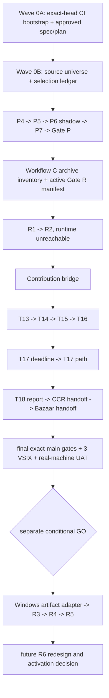

# 機能取捨選択とmain逐次統合の回復設計

> **Current scope note:** 機能取捨選択、逐次PR、exact-head CI、main-only完了という製品・統合目標は引き続き参照する。承認、provider transcript、実行証跡の方式は `docs/superpowers/specs/2026-08-31-wave0a-risk-tiered-approval-and-evidence-design.md` が置換する。

- Status: written spec review pending
- In-chat design baseline approved: 2026-08-23
- Date: 2026-08-23
- Repository: `katamor1/bob_builtin_analyze`
- Recovery baseline: `main == origin/main == c59db06ecb32eb7a57beeb3e932acdd5b4774de5`
- Design branch: `codex/feature-integration-selection-design`
- Amends: `docs/superpowers/specs/2026-08-21-main-consolidation-and-branch-retirement-design.md`

## 1. 目的と決定

Workflow Contract v2とProcessing Budgetの未統合履歴から、現在も必要な機能だけを選び、現行`main`の契約へ一つずつ再構成して統合する。旧branch、旧stack、旧carrier patchは復元可能な証拠として保持するが、merge単位または実装の正本にはしない。

採用する方式は「capability slice reconstruction」である。

- 各sliceを直前slice統合後のexact `origin/main`から作る。
- remoteに存在するnon-main branchとopen PRは常に最大1件とする。
- 各sliceのmerge、post-merge検証、temporary branch削除が完了してremoteが`main`一本へ戻るまで、次sliceを開始しない。
- 現行`main`のWorkflow A、OOXML snapshot、GUI診断を正本とし、archive側の古い実装で置換しない。
- 条件付き機能は条件を満たすまで統合しない。archiveに残すことを未完了とは扱わない。
- 不採用機能は理由と復元証拠をledgerへ残し、branchを再作成しない。

本設計のmandatory programは、Workflow B、Workflow CのR1/R2、安全なContribution bridge、Processing safety/integrity slicesを統合し、最終実機受入とmain-only topologyを証明するところまでである。Workflow CのR3-R5は条件付きside path、archive済みR6 snapshotは不採用であり、mandatory programの完了条件には含めない。

## 2. 回復baseline

2026-08-23の設計作業開始前に、次をread-onlyで再確認した。

| 対象 | 回復baseline |
| --- | --- |
| local `main` / `origin/main` / live remote `main` | `c59db06ecb32eb7a57beeb3e932acdd5b4774de5` |
| live remote heads | `main`の1本だけ |
| open PR | 0件 |
| local branch / registered worktree | `main`の1本 / rootの1件 |
| root status | `?? .integration-xlsx-on-prereq/`だけ。保全対象の別cloneとして変更しない |
| Workflow A | PR #170でmerge済み、evidence PR #171までmerge済み |
| Workflow B/C、Processing A/B/C | mainへ未統合。archiveだけが復元権威 |

Workflow Aのcarrier headは`b728061be3d5365e0ff7adb89fd328bfc2450001`、merge commitは`36b54145bf2e365f8e56282ab18f6cbc900012d9`である。evidence headは`f062402b7f5216b3c82436717afd782a4a5e28d9`、そのmerge commitが現在の`c59db06e...`である。既存のWorkflow A JSONに残る`carrier_merged_pending_evidence_pr`はその時点の履歴であり、上書きせず、新ledgerでPR #171完了を加法的に記録する。

`c59db06e...`は回復判断のproduct baselineであり、将来の全sliceが直接このcommitをbaseにするという意味ではない。Wave 0A/Bをmainへmergeした後、その時点のexact mainを最初のproduct sliceのexecution baseとして取得する。`c59db06e...`からexecution baseまでの差分が、承認済みのspec、ledger、policy、CI gateだけであり、製品runtimeを変更していないことをpreflight evidenceで証明する。

本spec用のlocal branch/worktreeは、上記baseline確認後に許可された一時的な例外として追加した。remoteは引き続き`main`一本である。このspecと後続planのreviewが完了したら、同じ逐次PR protocolへ入り、merge後にlocal branch/worktreeも削除してbaseline topologyへ戻す。

## 3. 証拠の権威とarchive

判断の優先順位を次のとおり固定する。

1. 最新`main`のsource、tests、public contract、受入済み安全境界
2. `main`へmerge済みのrelease evidenceとexact commit
3. 検証済みexternal archive内のbundle、patch、manifest
4. closed legacy PRのmetadataとreview記録
5. historical plan、progress記録、generated output

下位の証拠で上位の実装を置換してはならない。特にarchive patchは要件、テスト候補、source provenanceの証拠であり、そのまま適用する権威ではない。

### 3.1 Immutable archive roots

| Archive | 用途 | 現行検証値 |
| --- | --- | --- |
| `C:\Users\stell\source\archives\bob_builtin_analyze\2026-08-21-main-consolidation` | pre-consolidation objects、6 carrier patches、旧/受入済みartifact | `archive-manifest.json` SHA-256 `36E477EE9B752EBF7F07A208C166FEC24E14A89BF7BA6A7921CF6BDF708C9F31` |
| `C:\Users\stell\source\archives\bob_builtin_analyze\2026-08-22-local-worktree-cleanup` | cleanup前local refs | manifest SHA-256 `AD742F4DBD2112C5674DA2E3E0EE2046645849E4B3BF3674596DF3B868C8BDFF` |
| `C:\Users\stell\source\archives\bob_builtin_analyze\2026-08-22-remote-main-unification` | remote ref、closed PR、atomic deletion結果 | manifest SHA-256 `BCDB61AAD397EF4C6463EAA789D5D278B9D1BCAD34015BC472C1DFC97773E476` |

remote cleanup execution resultのSHA-256は`3BA79A5536D18DC0FC9EC15FFE41CA6CD37C527F5DD30F02ABA4EA399C6FAED7`、remote recovery bundleのSHA-256は`06A338F28879218A8CBAE247A3B4C5B951F152CD46CACA4D81B7B07504CFBF1F`である。final archive roots内の5 bundleは2026-08-23に`git bundle verify`で再確認した。既存archiveは上書き、追記、rename、cleanupしない。

追加のtrust-chain identityは次である。

- original repository bundle: `55DB2865E7795D9192E75BFB3DBAADC47D28366128C241EDDA512AEF4CA599A1`
- carrier manifest: `AC5F4E94602E355828A6596BE8AB9107F4F34677F0014D97F92EB960FFA539B4`
- local cleanup bundle: `E0E6FD92F1D7504C3271C01B0EAE3542D3562A9214B8164957E19B56AC48DC40`
- remote cleanup execution plan: `9E36B465AFBBA6826556E4D7347CA1C7CB805BDB6280C77CCEB15F6479046C8D`

source objectを使用するattemptでは、original repository bundleとremote recovery bundleの双方に期待headが存在することを確認する。一方だけにしか存在しないobjectは、差異を説明して新しいreviewを受けるまで使用しない。

### 3.2 Remaining carrier provenance

| Evidence carrier | Frozen range | Old PRs / prerequisite | Patch SHA-256 |
| --- | --- | --- | --- |
| Workflow B | `683e794e...e860d1eb` | #153, #154, #155, #157 | `59eca51331f3c580a63435021e03c05780ffbe6b65db76949cb0d4bff8c428c7` |
| Workflow C | `e860d1eb...a18c09b1` | #158, #160-#164 | `2852e9e0e535bbb63165ae01538dd271bd888afe0b7f7dcbca53d193ef24912f` |
| Processing A | `8793804f...4d0fb728` | prerequisite、#145、#146 | `6913ddddcffb150eb207aee99bdbbad158b4ed05e9c3ca8714693d31f6122536` |
| Processing B | `4d0fb728...49f39e1a` | #147、#150 | `edd675378aa15650b5648308ae1f7621fa830844699ad4d06660463c9d2cb10b` |
| Processing C | `49f39e1a...2d8a570f` | #152、#159 | `294c11760ed94bdddec8f37f6f9517f42f7e9c6442ad23df6041ff9f470bbab5` |

各attemptは必要なobjectだけをbundleからdisposable bare cloneまたはlocal-only `refs/archive/<attempt>/<source>`へ復元する。これらのrefをremoteへpushせず、旧branchを再作成せず、旧PRをreopenしない。attempt終了時にはlocal-only refも削除する。

本spec内の8桁SHA表記は読みやすさのための表示aliasである。selection ledger、attempt evidence、PR本文、merge gateでは必ずexact 40桁SHAを保存・照合する。

## 4. 旧設計に対するamendment

`2026-08-21-main-consolidation-and-branch-retirement-design.md`はhistorical recordとして変更しない。本specは次だけを加法的にsupersedeする。

| 旧設計 | 新しい規則 |
| --- | --- |
| §4の6 carrier直列flow | feature selection ledgerとcapability slice flowへ置換 |
| §5のcarrierをmerge単位とする規則 | carrierはprovenance evidence。新PRは選択したcapability単位で現行mainへ再構成 |
| §5.2のWorkflow C全体後にProcessingを開始 | Gate P、R1/R2、Contribution bridge後にProcessingを開始。R3以降は条件付きside path |
| §7のlive branch triage | 旧refsは既にarchive-only retirement済み。今後はledgerの採否とarchive evidenceで追跡 |
| §8の「6 carrier完了」gate | mandatory selected slicesの完了gateへ置換 |
| §9-§11の旧PR closeと一括retirement | 完了済みhistorical operation。今後はsliceごとにtemporary branchを即時retire |

旧設計の目的、非破壊archive、明示的な正本規則、OOXML不変条件、fail-closed検証、fresh artifact実機受入は維持する。`tools/main-consolidation/consolidation-map.json`と既存evidence schemaを現在のtopologyに合わせて改変せず、新しいselection ledger/schema/policyを別に追加する。

## 5. 検討した方式

| 方式 | 判断 | 理由 |
| --- | --- | --- |
| 5 carrier patchの一括適用 | 不採用 | 全patchが現行mainへclean applyできず、必要/不要機能を分離できず、現行OOXMLとGUI契約を後退させ得る |
| 旧branch/PR復元とcherry-pick | 不採用 | closed PR、旧base、draft時点の不完全gate、現在と異なるAPI/GUIへ依存する |
| archiveからcapability単位で再構成 | 採用 | feature selection、依存閉包、現行安全境界、個別rollbackを同時に成立させられる |

## 6. Source universe、selection ledger、execution evidence

Wave 0で、静的な採否と実行後にしか確定しない事実を分離して追加する。

- `tools/main-consolidation/feature-selection-source-universe.json`
- `docs/release-evidence/feature-selection-ledger-2026-08-23.json`
- `docs/release-evidence/feature-selection-ledger-2026-08-23.md`
- source universe/selection ledgerのschema、policy、tests

### 6.1 Canonical source universe

source universeは、5 remaining carrier ranges、Workflow P4-R6の旧head、Processing prerequisite/T13-T18の旧head、closed PR mappingから決定的に生成する。各source rangeについてexact 40桁from/to SHA、sorted commit manifestとそのSHA-256、sorted changed-path manifestとそのSHA-256、sorted source-test manifestとそのSHA-256、old PR、候補capability IDを持つ。

raw commit/path/testはexact一つのsource trancheへ割り当て、そのtrancheをsymbol/contract/test単位の`sourceItemId`へ分解する。各`sourceItemId`はexact一つのcapabilityまたはexplicit remainderをprimary ownerとする。他capabilityが同じpath/APIを利用する場合は非所有の`consumedBy`として記録し、重複ownershipにしない。T17/T18のsubset、Contribution prerequisite、mixed-purpose commitはreviewed semantic inventoryを必須とする。自動validatorはsource range、commit、path、test、sourceItemId、capability ID、remainderの未割当、多重primary ownership、未承認overlapを拒否し、semantic boundaryの妥当性は独立reviewで補完する。

Contribution source range`8793804f2f99fd1d545cb496064bcbdc7df4bf40..3e2dd68d4a0a880e7fa7ed065f5a1be2bd25a0ca`は、selected bridge behaviorと`REG-P1-PREREQUISITE-REMAINDER`へ完全分類する。Processing Aへ暗黙に包含しない。

### 6.2 Static selection ledger

selection ledgerは将来変わらないdecision recordであり、少なくとも次を持つ。

- schema version、repository、baseline main、observed remote/open-PR topology
- source universe digestとimmutable archive manifest/bundle/patch identities
- capability id、discriminated `sourceOrigin`、disposition、rationale
- `hardDependsOn`、`sequenceAfter`、`goConditionRequirement`、`approvalRequirement`、`maxAuthorizedActivation`
- target surfaces、preserved invariants、explicit omissions/remainder
- RED/focused/full/CI/UAT acceptance evidence requirements

Markdown ledgerはJSONから決定的に生成し、手編集しない。policy testは再生成bytesとの差分を拒否する。JSONとMarkdownで採否またはdependencyが異なる状態を許可しない。

`disposition`は各capabilityに一つだけ設定する。

| Disposition | 意味 |
| --- | --- |
| `selected` | mandatory programで依存順に統合する |
| `conditional` | 明示されたGO条件を満たし、別途承認された場合だけ統合する |
| `rejected_current_snapshot` | archive実装は統合しない。将来は新ID、新spec、新reviewが必要 |
| `superseded` | 現行mainまたは別selected sliceが同等以上を所有し、重複実装を入れない |

ledgerへ将来のimplementation head、merge SHA、post-merge main、UAT結果を書かない。これらをplaceholder、`null`、予測値として入れることも禁止する。ledger policyはsource universeに対するmissing/duplicate capability、依存なしの選択、証拠のSHA不一致、conditional capabilityの無承認activationを拒否する。

`sourceOrigin`は次のdiscriminated unionだけを許す。`archive`はarchive manifest identity、exact 40桁from/to SHA、旧PR、`sourceItemId`を持つ。`current_main`はexact baseline SHAと既存evidence IDを持つ。`new_design`は`requiredSpecIdentity`と、そのspecが承認済みcommit blobとして存在するまでimplementation sourceを持たないというpolicyを持つ。`WF2-R3-WINDOWS-ADAPTER`は`sourceOrigin.kind=new_design`、`requiredSpecIdentity=WF2-R3-WINDOWS-ADAPTER-DESIGN@1`とする。このIDを宣言する別specのpath、blob OID、review/approval evidenceがdynamic recordへ結合されるまでattemptを開始しない。archive rangeを持たない機能へ架空のsource SHAを割り当てない。

`hardDependsOn`はcapability IDだけ、`sequenceAfter`はcapabilityまたはgate IDだけを参照する。`goConditionRequirement`は必要なhash付きevidence kind/ID、`approvalRequirement`は必要な明示承認の種類、`maxAuthorizedActivation`は許される最大状態を静的に定義する。実際の`approvalRecord`と`observedActivationStatus=inactive|shadow|canary|active`はdynamic execution evidenceだけに記録する。既にmainへ統合済みのWorkflow Aは`BASE-WF2-A`、F7 Bob profile/probeは`BASE-WF2-F7-BOB-PROFILE`、OOXML snapshot/GUI/PRA-WIN-001基準は`BASE-OOXML-SNAPSHOT`、P4-P7完了gateは`GATE-WF2-P`としてexact evidenceへ解決する。自由記述の「F7」「Gate P」「Windows対応済み」をdependencyとして認めない。

### 6.3 Dynamic execution evidence

実行状態はledgerとは別のappend-only recordで管理する。campaign rootは`C:\Users\stell\source\archives\bob_builtin_analyze\2026-08-23-feature-integration-campaign`とし、Wave 0 execution時にexclusive-createする。既存rootがあれば内容をmerge/overwriteせず、expected manifestとの一致を検証できなければ停止する。各attemptは一意な子directoryとdetached SHA-256 manifestを持ち、completed recordを上書きしない。

各attemptのexternal recordは、capability ID、base/source SHA、implementation head/tree、conflict/omission、test/CI/review、`approvalRecord`、`observedActivationStatus`、PR/merge/post-main、branch deletion、rollback/revertを記録する。状態は`planned`、`in_progress`、`merged`、`validated`、`not_applicable`を区別し、`implemented`、`reviewed`、`merged`、`active`を同義に扱わない。

次sliceまたは専用docs-only publication PRは、完了済みの先行slice recordとSHA-256をmain上のstatus projectionへ取り込める。ただし、そのpublication PR自身の将来head/merge/delete結果をcommit内へ書かない。campaign最後は、全product/UAT recordを含むclosure PRをmergeした後、そのclosure PRのexact merge、CI、branch deletion、final topologyだけをexternal final-attestation recordへ保存する。

dynamic recordは`productMainSha`、`productTreeSha`、build対象source/lockfileの`productPayloadManifestSha256`、`preMergeEvidenceBlobOid`、後続publicationの`evidenceHeadSha`を区別する。UATは`productMainSha`から生成したartifactへ結合する。後続docs-only evidence mergeでは、product payload manifestが不変で差分がallowlisted evidence/docs pathだけであることを証明し、証拠をcommitしたことだけを理由にproduct UATを循環再実行しない。main上のstatic ledger、JSONから決定的生成してdrift検証するMarkdown、最新status projection、external final attestationの四者をtrust chainとし、自己参照する「main上だけで自分自身のmergeを証明する」要件を置かない。

## 7. 機能の採否

### 7.1 Workflow Contract v2

| Capability | Source provenance | Disposition | Dependency / sequence | 統合境界 |
| --- | --- | --- | --- | --- |
| `WF2-P4-COMPILER` | `683e794e...e0766f94` | `selected` | `BASE-WF2-A` | sole immutable compiler。alternate compiler/provider lookupを作らない |
| `WF2-P5-PLANSTORE` | `e0766f94...45260e0b` | `selected` | `WF2-P4-COMPILER` | private environment別cache、runtime-only lease |
| `WF2-P6-ENTRYPOINT` | `45260e0b...95d245ce` | `selected` | `WF2-P4-COMPILER`、`WF2-P5-PLANSTORE` | validation/registration/`Bob 操作ハブ`の共通gateway。v2 executionはshadow/fail-closed |
| `WF2-P7-MANIFEST` | `95d245ce...e860d1eb` | `selected` | `WF2-P4-COMPILER`、`WF2-P5-PLANSTORE`、`WF2-P6-ENTRYPOINT` | explicit collection/catalogからcross-platform deterministic manifest |
| `WF2-R1-PROVENANCE` | `e860d1eb...66e005fa` | `selected` | `WF2-P7-MANIFEST`; `sequenceAfter=GATE-WF2-P` | exact plan/package/lock/environment/provider/Bob provenanceとlease lifetime |
| `WF2-R2-INVOKE` | `66e005fa...7bad4e42` | `selected` | `WF2-R1-PROVENANCE` | private dispatch bridge、bounded input/output/error。R3前はproduct pathから到達不能 |
| `WF2-R3-WINDOWS-ADAPTER` | `new_design:WF2-R3-WINDOWS-ADAPTER-DESIGN@1` | `conditional` | `WF2-R2-INVOKE` | 新spec、Windows adversarial proof、security review、明示GOが必要 |
| `WF2-R3-ARTIFACT-TX` | `7bad4e42...e0a4b1b2` | `conditional` | `WF2-R2-INVOKE`、`WF2-R3-WINDOWS-ADAPTER` | Linux-only implementationを部分統合しない |
| `WF2-R4-EXECUTOR` | `e0a4b1b2...266f13f8` | `conditional` | `WF2-R3-ARTIFACT-TX` | source再parseなしのcompiled execution。既定shadow |
| `WF2-R5-BOB` | `266f13f8...de65647c` | `conditional` | `WF2-R4-EXECUTOR`、`BASE-WF2-F7-BOB-PROFILE` | exact handle/leaseとBob task probe。実機Bob GO後も既定shadow |
| `WF2-R6-ARCHIVED` | `de65647c...a18c09b1` | `rejected_current_snapshot` | なし | current sourceを移植しない。recovery/resumeは別設計 |

P4-R5を段階統合しても、Contract v2 runtimeはextension内部の固定policyでshadowとする。workspace設定、command引数、環境変数、package追加で有効化できない。validation、compiler、manifest evidenceは許可するが、一般利用向けrun directory作成、provider dispatch、Bob execution、artifact stagingは別activation設計まで禁止する。shadow中にv2 slotが失敗しても同一slotのlegacy workflowへfallbackしない。既存v1 command、公開API、保存schema、`Bob 操作ハブ`動作は維持する。

R3 Windows adapterはarchive rangeを持たない新しいconditional capabilityであり、別spec、security review、Windows実機proof、明示承認recordを要求する。Windowsでreparse point、junction、mount escape、hard-link substitution、identity driftを拒否し、no-overwrite creation、same-volume atomic promotion、flush順序、failure injectionを実証できるまでGOにしない。R3/R4/R5は各々独立した`goConditionRequirement`と`approvalRequirement`を持ち、実行時recordがactual approval IDを結合する。前段がmerge済みという事実だけで自動選択しない。R6 archive snapshotにはartifact residual classification、manual/review/checkpoint continuation、Bob session restore、完全なrestart matrixがないため不採用とする。

### 7.2 Contribution bridge

| Capability | Source provenance | Disposition | Hard dependency / sequence | 統合境界 |
| --- | --- | --- | --- | --- |
| `REG-BRIDGE-OWNER-VERSION-LIFECYCLE` | `8793804f...3e2dd68d`のreviewed registry/lifecycle inventory | `selected` | `WF2-P6-ENTRYPOINT`; `sequenceAfter=WF2-R2-INVOKE` | strict owner/version/lifecycleとatomic registration behaviorを既存Contract v2 registryへ一本化する |
| `REG-BRIDGE-DISCOVERY-EVIDENCE` | 同rangeのreviewed discovery/catalog/report inventory | `selected` | `WF2-P4-COMPILER`、`WF2-P7-MANIFEST`、`REG-BRIDGE-OWNER-VERSION-LIFECYCLE` | immutable-byte discovery/catalog/report evidenceをP4/P7へ接続する |
| `REG-P1-PREREQUISITE-REMAINDER` | 同rangeの全remaining commit/path/semantic inventory | `superseded` | なし | legacy compiler、duplicate registry、adapter、stale gate/payloadを移植しない |

owner/version/lifecycleとdiscovery/evidenceは別PRにする。最初のPRは、一つの`ActionRegistry`が一つのowned registryだけを持つこと、duplicate owner/versionのatomic rejection、stale disposableが再登録を削除しないこと、三拡張のactivate/deactivateで登録数が収束することを受入条件とする。次のPRは、P4/P7と同じimmutable bytes/catalogを使い、同じinputからUbuntu/Windowsで同じevidenceを生成し、legacy compilerを呼ばないことを受入条件とする。

Wave 0 source universeは上記二機能のexact source commits、paths、symbols/contracts、testsとremainderを一意に列挙し、未割当0を証明する。legacy compiler、manual provider catalog、二つ目のprovider registry、長期legacy adapterを導入しない。旧dynamic workflow-contract gateを採らない場合、その関連fileとgateをremainderで明示的に除外する。採るimmutable evidence mechanicsは現行Contract v2 schema/compilerへ接続し、旧compilerを正本として残さない。

### 7.3 Processing Budget

| Capability | Source provenance | Disposition | Dependency / sequence | 統合境界 |
| --- | --- | --- | --- | --- |
| `PROC-T13-LEDGER` | `3e2dd68d...bd29233d` | `selected` | `sequenceAfter=REG-BRIDGE-DISCOVERY-EVIDENCE` | canonical 13-category profileとatomic budget ledger |
| `PROC-T14-BOUNDED-DOC` | `bd29233d...4d0fb728` | `selected` | `PROC-T13-LEDGER`、`BASE-OOXML-SNAPSHOT` | 現行Buffer snapshotをshared境界へ接続し、Code Consistencyをbounded Buffer inputへ移行 |
| `PROC-T15-AGGREGATE` | `4d0fb728...7fc7a371` | `selected` | `PROC-T14-BOUNDED-DOC` | workbook/document local/operation cap、pre-parser cancellation |
| `PROC-T16-INPUT-PROCESS` | `7fc7a371...49f39e1a` | `selected` | `PROC-T13-LEDGER`、`PROC-T15-AGGREGATE` | stdout/stderr、diff、excerpt、Bob input、artifact、total operation budget |
| `PROC-T17-DEADLINE` | `49f39e1a...7ea786af`のdeadline subset | `selected` | `PROC-T14-BOUNDED-DOC`、`PROC-T16-INPUT-PROCESS` | absolute monotonic deadline、authenticated first cause、process-tree settlement |
| `PROC-T17-PATH` | 同rangeのpath subset | `selected` | `PROC-T17-DEADLINE` | portable/physical containment、Windows/UNC/junction/日本語/空白/multi-root |
| `PROC-T18-REPORT` | `7ea786af...2d8a570f`のschema/runtime subset | `selected` | `PROC-T13-LEDGER`から`PROC-T17-PATH`の全selected IDs | strict deterministic reportとsemantic validation |
| `PROC-T18-CCR-HANDOFF` | 同rangeのCCR subset | `selected` | `PROC-T18-REPORT` | verified snapshotとcomplete-only handoff/rollback |
| `PROC-T18-BZR-HANDOFF` | 同rangeのBazaar subset | `selected` | `PROC-T18-REPORT` | GUI/run failure persistence、complete-only atomic replacement |

T18はreport schema、Code Consistency handoff、Bazaar handoffの3 PRへ分ける。archiveにある旧Bazaar DOCX/XLSX implementation、path parser input、現行GUIを機械的に分割した`ruleAuthoringGuiBase`、旧Workflow A複製は`superseded`とする。

T13の13 categoryは`single_document_bytes`、`total_document_bytes`、`document_count`、`sheets_per_workbook`、`total_sheets`、`rows_per_sheet`、`total_rows`、`changed_files`、`raw_diff_bytes`、`document_excerpt_bytes`、`bob_input_bytes`、`managed_artifact_bytes`、`total_operation_input_bytes`で固定する。current Bazaarの公開上限は明示profile overrideとして維持し、別のproduct decisionなしにarchive defaultへ変更しない。

T18 reportは少なくともschema version、producer、operation id、input SHA-256、outcome、coverage status、13-category ledger、bounded issuesを持つclosed deterministic recordとする。`success`、issue 0、全reservation finalizedの場合だけ`complete`を許可する。report sliceではshadow比較だけを行い、既存successとreport completeの差異を分類し終えるまでCCR/Bazaarのblocking handoffを有効化しない。

## 8. 統合waveと依存順



Mandatory pathは次の順である。

1. Wave 0A: 本spec/planとともに、`extensions-quality`、`workflow-contracts`、`code-consistency-review-scaffold`を明示的なPR head checkoutとSHA照合へ変更する。既に対応済みの`three-extension-ui-contracts`と同じexact-head境界へ揃える。
2. Wave 0B: canonical source universe、machine-readable selection ledger、validator、recovery evidenceを統合する。
3. P4、P5、P6、P7を各1 PRで統合し、Gate Pを完了する。
4. 旧Gate Rを廃止し、archive test inventoryとactive Gate R manifest/runnerを追加する。
5. R1、R2を各1 PRで統合する。runtime/product activationは行わない。
6. Contribution bridgeのlifecycleとevidence mechanicsをContract v2へ統合する。
7. T13、T14、T15、T16、T17 deadline、T17 pathを各1 PRで統合する。
8. T18 report、CCR handoff、Bazaar handoffを各1 PRで統合する。
9. final mainの全gate、3 VSIX、実機受入、final topology auditを完了する。

R3-R5はmandatory pathと並行実装しない。mandatory pathのfinal UATとmain-only auditが完了した後、各GO条件と別の明示承認を得た場合だけ新しいcampaignとして直列で進める。GOしない場合はledgerの`conditional`状態とarchive evidenceを残して終了し、mandatory programを未完了扱いしない。conditional campaignを実行した場合は、R3-R5後にfinal gates、3 VSIX、該当するreal-machine UAT、main-only auditを再実行する。R6はこのdependency graphに含めない。

## 9. Slice reconstruction protocol

各sliceは次の手順で作る。

1. live remoteが`main`だけ、open PRが0件、local/root boundaryが期待値どおりであることを確認する。
2. `main == origin/main == git ls-remote origin main`をexact SHAで確認する。
3. archive manifest、bundle、該当patch SHAとsource objectを検証する。
4. 必要なsource refだけをlocal-onlyで復元し、source range、tests、public/internal contract、対象pathを抽出する。
5. current mainとの3-way semantic comparisonを行い、採用behavior、除外behavior、既存main側の優先契約をledgerへ固定する。
6. latest mainから一意なisolated worktree/branchを作る。旧patch全体の`git apply`や旧commitの無差別cherry-pickは行わない。
7. current mainで失敗するcompatibility/acceptance testを先に追加し、REDを記録する。
8. 選択機能だけを現行interfaceへ再実装し、focused GREEN、full regression、policy、packageを実行する。
9. source inventoryとfinal diffを比較し、intentionally omitted file/behaviorと代替を記録する。
10. exact-head CI、独立review、merge、post-merge main検証、temporary ref cleanupを完了する。

一括`ours`/`theirs`、generated payloadの手動copy、無関係なlockfile更新、stale ignored `out/`によるtestは許可しない。mainがbase SHAから移動した場合はattemptを保全して停止し、新しいmainから再構成する。

## 10. 維持する安全境界

### 10.1 OOXMLとGUI

Processing integrationは次の現行契約を置換してはならない。

- parserへpathではなく検証済みsnapshot `Buffer`を渡す。
- 一つのFileHandleからread前後BigInt stat、device、inode、size、mtime、SHA-256を照合する。
- ZIP32、暗号化、entry名、duplicate、local/central header、descriptor、range、overlapをparser前に検証する。
- stored/deflateを長さ、入力全消費、CRC、bounded inflateで検証する。
- 通常DOCX/XLSXは元snapshotをそのまま使用し、再圧縮しない。
- `styles.xml`と`sharedStrings.xml`を両方欠くXLSXだけ最小stylesheetをメモリ追加する。
- malformed input検証前にparserまたはextension-owned `fflate`をloadしない。
- extraction後にも原本fingerprintを再確認する。
- GUIは元例外を境界ごとに一度記録し、画面には固定汎用文言だけを出し、queueを継続する。
- Rules/Verification selector/locator、PDF page locator、fixture generator、原本bytes不変を維持する。

T14では、上記current-main behaviorをparity-preservingに`packages/processing-budget-runtime`のinternal OOXML moduleへ移し、そこをstable snapshot、ZIP preflight、entry verification、missing-both normalizationの唯一のownerにする。これはarchive側implementationへの置換ではなく、current mainのsource/testsを起点とする所有移設である。

product adapterが使用できるshared internal APIは`withValidatedOoxmlParserInput<T>(request, parse): Promise<T>`だけとする。requestはfile path、expected fingerprint、document kind、structural limits、budget/cancellation contextを持ち、shared ownerは一つのhandleからsnapshotを作成・検証した後にだけ`parse({ documentKind, parserInput, normalization })`を呼ぶ。callback完了後、shared owner自身が元handle/path identity、size、mtime、SHA-256を再確認し、差替えを検出した場合はparser結果を破棄して失敗させる。これによりpost-extraction fingerprintはBazaarとCode Consistencyの双方で省略できない。

低水準の`prepareOoxmlParserInput`とopaque verification token/`verifySourceUnchanged`はshared module内部またはmigration parity testだけから到達可能とし、製品adapterへexportしない。BazaarとCode ConsistencyのDOCX/XLSX adapterは必ずcallback APIを使用する。DOCX/XLSXのrow/text/locator extractorとユーザー向けwarningは各extensionが所有し、shared moduleへ移さない。architecture/source policyはparserへのpath入力、低水準prepare APIの直接利用、callback外への検証token持出し、post-callback verification bypassを拒否する。

移設PRは、元snapshot `Buffer` object identity、全adversarial ZIP結果、normalization bytes、dynamic `fflate` load count、parser import timing、post-fingerprint、fixture output/locator、GUI error behaviorが移設前後で一致するparity gateを先に通す。parityが成立するまでBazaar ownerを削除せず、成立後は旧ownerをthin adapterだけにしてduplicate implementationをsource/architecture policyで拒否する。archive側のBazaar extraction replacementは採らない。

### 10.2 Workflow

- executable planのcompilerはP4だけとする。
- provider truthはowned Contract v2 registryだけとし、manual catalogやlegacy mirrorへfallbackしない。
- P5以外にplan cache/lease ownerを作らない。
- P6 consumersは同じhandleとsorted diagnosticsを使用する。
- shadow中のv2 compile/runtime failureをlegacy executionへfallbackさせない。
- current v1 command、public API、persistence、GUI/authoring compositionを非互換変更しない。
- R1/R2はprovenance/invocation boundaryを提供するが、R3前にartifact/result successをcommitできない。
- R4/R5/R6がない状態を「v2 runtime complete」または「active」と表示しない。

### 10.3 Processing

- budget消費はshared atomic ledgerを唯一の正本とする。
- local limit、aggregate limit、operation totalを別々に記録し、二重計上を防ぐ。
- stdoutとstderr、diff/excerpt/Bob input/artifactを独立limitとして扱う。
- timeout/cancel/errorのfirst causeを認証して固定し、後続cleanup failureで上書きしない。
- Windowsではprocess tree、Linuxではprocess groupをsettleし、return後の子process残留を0にする。
- path policyはlexical pathだけでなくphysical identity/reparse boundaryを検証する。
- incomplete、partial、invalid reportをconsumerへhandoffせず、従来の有効状態をatomicに保持する。
- PDFはOOXML扱いにせず、固定引数・shellなしの`pdftotext`、事前/事後fingerprint、bounded stdout/stderr、absolute deadline、physical containmentで保護し、既存page locatorと`requires_ocr` semanticsを維持する。

## 11. PR状態機械とmain-only protocol

各sliceは次の状態だけを通る。

```text
READY -> LOCAL -> PR_ACTIVE -> MERGED -> POST_MERGE_VERIFIED -> MAIN_ONLY -> VERIFIED
```

| State | 必須状態 |
| --- | --- |
| `READY` | remote heads=`main`、open PR=0、exact mainとarchiveが検証済み |
| `LOCAL` | latest main起点のlocal branch/worktreeだけを追加。remoteはmain-only |
| `PR_ACTIVE` | remote=`main + temporary head`、open PRはその1件、base=`main` |
| `MERGED` | exact reviewed headがmerge commitへ入った。temporary remote headはまだ残す |
| `POST_MERGE_VERIFIED` | parent/treeとexact merged mainのpost-merge CI/evidenceを検証。temporary headは保持 |
| `MAIN_ONLY` | verified temporary headをexact lease付きatomic deleteし、open PR=0、remote main-only |
| `VERIFIED` | local worktree/branch/archive refsのcleanupとfinal attempt evidenceが完了 |

`VERIFIED`以外から次sliceへ進まない。先行stack branch、並行evidence branch、複数open PRを作らない。

temporary branchの初回pushはremote不存在をexpected valueとするcreate-only leaseを使う。規範形は`git push --atomic --force-with-lease=refs/heads/<branch>: origin <H>:refs/heads/<branch>`であり、既存refへ上書きしない。修正pushも観測済みremote old headをexplicit leaseにする。

PRはmerge commit方式だけを使用し、merge直前にbase main、head SHA、live main、mergeability、review、全CI run/jobのSHAを再照合する。規範コマンドは`gh pr merge <number> --merge --match-head-commit <H>`である。`gh pr checks`だけを証拠にせず、Actions run/jobがexact head SHAであることを確認する。`--admin`、`--auto`、暗黙branch delete、squash、rebase mergeを使用しない。

merge後はfirst parentがpre-merge main、second parentがreviewed head、merge treeがhead treeと一致することを確認し、exact merged mainのrequired post-merge runsを成功させて`POST_MERGE_VERIFIED`へ進む。その後だけ、`git push --atomic --force-with-lease=refs/heads/<branch>:<H> origin :refs/heads/<branch>`相当のexact deletionを行う。atomic unsupportedまたはlease mismatch時はfallbackせず停止する。

### 11.1 Failure and rollback

- pre-merge failure: mainは変更しない。修正する場合は同じPRのnew exact headで全gate/reviewをやり直す。
- attempt中止: head、patch、logsを新しいappend-only attempt archiveへ保全し、PR close、exact lease deleteで`READY`へ戻す。
- merge command timeout: PR state、main SHA、head SHAをqueryして結果が確定するまでretryしない。
- post-merge product failure: mainをreset/force-pushしない。元headとfailure evidenceをbundle/hash保全し、元temporary remote branchをexact leaseで削除してremote non-main refを0へ戻した後、専用revert branch/PRを同じ1-PR protocolでreview/CI/mergeする。revert完了まで次featureを開始しない。
- temporary branch削除だけの失敗: productをrevertせず、ref identityを再確認してcleanupを完了するまで停止する。

各attemptは既存archiveとは別のexclusive-create directoryへ、base/source refs、derived patch、採用/除外、final diff、head/tree、tests、CI、review、PR/merge/delete結果を保存する。commit内manifestに将来の自分自身のmerge SHAを書かず、pre-merge blob OIDを外部post-merge recordで結合する。

## 12. Verification gates

全sliceで`compile -> focused tests -> full tests -> policy -> package -> exact-head CI -> independent review -> merge -> exact-main post-merge verification`の順序を守る。

### 12.1 Workflow B Gate P

- P1-P3の現行package schema/loader/lock testsと、P4 compiler、P5 plan store、P6 entrypoints、P7 manifestの7 focused groupsを実行する。
- `extensions/workflow-register`のcompile、full test、dependency、architecture、source、schema、unused、production audit、package、package policyを実行する。
- explicit fixture collectionのmanifestをUbuntu/Windowsで生成し、bytesとdigestの一致を確認する。
- v1 validation、registration、`Bob 操作ハブ`、Bob、authoringの回帰がないことを確認する。

### 12.2 Workflow C Gate R

旧planが参照する`workflowContractV2Runtime.test.js`と`workflowContractV2BobRuntime.test.js`はarchive headに存在しないため、旧Gate R commandを使用しない。代わりに、archive test provenance inventoryとactive suite manifestを分離する。

archive inventoryはbundle内のWorkflow C source/test pathsをR1-R6へ一意に分類するが、mainのtest runnerから実行しない。R3-R5は`expected_inactive_conditional`、R6は`expected_absent_rejected`として、accidental source/export/test activationをnegative scanで拒否する。active suite manifestはmainへ統合済みcapabilityだけを列挙し、R1 PRではR1、R2 PRではR1/R2を実行対象とする。将来R3-R5を個別GOした場合だけ、そのPRでactive manifestへ該当familyを追加する。R6 current snapshotはactive manifestへ追加しない。

inventory/manifestが分類するtest familiesは次である。

- run provenance / lease
- provider invocation
- artifact transaction / attempt / recovery
- compiled run / continuation
- Bob compiled execution / routing concurrency
- resume / restart / retry

validatorはarchive inventoryのmissing/duplicate/unclassified source test、active manifestのmissing file/duplicate capability、inactive/rejected capabilityの混入を拒否する。runnerはUbuntu/Windowsで同じactive manifestを実行し、その後workflow-register full testと全policy/packageを実行する。R3以降ではWindows artifact adapterと実Windows adversarial testsがmerge blockerである。

R1/R2 PRはstatic reachability policyでpublic command/product entrypointからruntime lease取得、provider dispatch、Bob task、run-directory作成、artifact stagingへのactive pathがないことを証明する。runtime wiring testでも同じ境界へspyを置き、validation、registration、`Bob 操作ハブ`、authoring、legacy v1実行時の各call countが0であることを確認する。単なるUI非表示や設定defaultを「到達不能」の証拠にしない。

### 12.3 Processing gates

- T13で`packages/processing-budget-runtime`を追加し、Linuxでは`npm ci`、`npm test`、`npm pack --dry-run --json`、Windowsでは対応する`npm.cmd` commandsをrequired matrixにする。
- shared packageの`contracts:check`、`compile`、`typecheck:consumers`、`test`を維持する。
- T14-T16はbounded file/archive/DOCX/XLSX/PDF、ZIP bomb/CRC/identity replacement、aggregate、UTF-8 boundary、stdout+1/stderr、diff/excerpt/Bob/artifact budgetをfocused testにする。
- T14のfocused gateは通常OOXMLで元`Buffer` identityを保ち再圧縮0、missing-both XLSXだけnormalization、parserとextension-owned `fflate`の遅延load、post-extraction fingerprint、Rules/Verificationとlocator、原本bytes不変を明示的に確認する。
- GUI gateは3 catch境界の元例外を各境界で一度だけhost logへ送り、固定pathless表示文言、queue継続、内部例外/path非露出を確認する。
- T17はLinux process group、Windows process tree、timeout/cancel、junction/UNC/日本語/空白/multi-rootを実OSで検証する。
- T18はreport schema/semantic validator、partial coverage拒否、atomic handoff/rollbackを検証する。
- 変更対象のworkflow-register、Bazaar、Code Consistencyでfull test、policy、audit、packageを実行する。

### 12.4 Exact-head CI

必須hosted jobsは次である。

- `extensions-quality`: Linux 3 extensions、Windows 3 extensions、real-machine environment contracts
- `workflow-contracts`
- `three-extension-ui-contracts`
- `code-consistency-review-scaffold` when Code Consistency changes
- `processing-budget-runtime`: Ubuntu、Windows after T13

PR synthetic merge refの成功をexact-head成功として扱わない。各jobは明示的なPR head checkoutと`git rev-parse HEAD == expected head SHA`を検証する。branch protection/ruleset APIに依存せず、merge operatorがrun/job集合とSHAをfail-closedで照合する。

Wave 0Aはbootstrap PRであるため、同じPRで3 workflow files自身を変更し、それぞれのpath filterを確実に発火させる。modified workflowは`pull_request.head.sha`をcheckoutして期待SHAと一致しなければjobを失敗させる。既にexact-head対応済みの`three-extension-ui-contracts`も同じheadで成功させる。PR eventのrun/jobにmissing、skipped、別SHAが一つでもあればmergeしない。merge後は各workflowの`workflow_dispatch`をexact main refで実行し、post-merge SHAを照合する。synthetic merge-ref runが併存しても補助証拠にしか使わない。

Wave 0Aで全required workflowへ必須の`workflow_dispatch.inputs.expectedHeadSha`を追加する。Wave 0B以降、path filterによりrequired workflowがPR eventで起動しない場合、temporary branch/refを指定してそのworkflowを手動dispatchし、`expectedHeadSha=<PR head H>`を渡す。workflowは入力SHAそのものをcheckoutし、`git rev-parse HEAD == expectedHeadSha`をassertする。PR eventまたはmanual dispatchのどちらを使っても、required jobのmissing/skipped、別SHA、別headへの再実行は失敗であり、head更新後は旧runを再利用しない。Wave 0A自身はworkflow file変更でpath filterを発火させ、merge後のexact-main dispatchをbootstrap完了証拠とする。Wave 0B以降はこの境界を全sliceとdocs-only closure PRの通常gateとして使用する。

独立reviewはexact final headに対してCritical 0、Important 0を要求する。headが変わったら以前のreviewとCIを無効化して全件再実行する。

## 13. Final UAT and completion

mandatory selected slicesの統合後、fresh cloneの同一exact mainから次の3 VSIXを生成し、SHA-256、byte size、entry countを記録する。

- `workflow-register-0.1.0.vsix`
- `bob-bazaar-review-0.3.0.vsix`
- `bob-code-consistency-review-0.1.0.vsix`

同一成果物をTrusted Workspaceの隔離IBM Bob profileへ導入し、次を受入する。

- Workflow B: package/lock/plan/manifest決定性、既存v1導線の非回帰、v2 runtime非活性
- Workflow C R1/R2: provenance/invocation boundaryがproduct executionから到達不能であること
- Processing: 実DOCX/XLSX/PDF、Rules/Verification、PDF locator、原本bytes不変、上限超過、partial handoff拒否
- 実Git/Bazaar: timeout/cancel後の子process残留0
- Bazaar invocation: `bzr --no-aliases`とShift-JIS診断の既存処理を維持する
- multi-root、日本語/空白path、UNC、junction/escape拒否
- console: uncaught、unhandled、CSP、dangling callback 0
- extension host log: `readFiles(...).then is not a function` 0件。別failureでは元例外が診断可能
- evidence: exact main、3 VSIX hashes、fixture hashes、test/CI/UAT結果が同じrecordへ結合される

既存`PRA-WIN-001`は`44027562...`のbaseline evidenceとして保全するが、新mainの証拠として流用せず再実行する。`PRA-WIN-002`から`008`はproject rule authoring全体のrelease readinessを宣言するときの別gateであり、本mandatory programだけの完了条件には含めない。

mandatory program完了時は次をすべて満たす。

- source universeの全source itemがexact一つのledger disposition/remainderへ割当済みである。
- 最新status projectionとexternal final attestationが、全`selected` capabilityの`validated`状態とproduct/UAT evidenceを証明する。
- 全`conditional` capabilityは静的ledgerで未統合条件付きとして残り、または別承認campaignのstatus/attestationで`validated`である。
- `WF2-R6-ARCHIVED`と全`superseded` behaviorはmainへ混入していない。
- exact final mainのlocal/full/hosted/UAT gatesが成功している。
- remote headsは`main`だけ、open PRは0件である。
- local branchは`main`だけ、registered worktreeはrootだけ、local-only `refs/archive/**`は0件である。
- `main == origin/main == live remote main`である。
- root statusは保全対象`?? .integration-xlsx-on-prereq/`だけで、そのnested clone identity/bytesは変更されていない。
- selected/rejected/conditional/supersededの全判断とarchive復元手順がmain上のstatic ledgerから追跡できる。
- closure PR後のexternal final attestationがclosure merge SHA、exact-main CI、branch deletion、final topologyを結合し、そのSHA-256がdurable campaign indexへ保存されている。

## 14. Stop conditions

次のいずれか一つでそのsliceを停止し、後続へ進まない。

- main、archive manifest、bundle、patch、source object、expected pathのdrift
- missing/extra path、説明されないsemantic omission、無関係なlockfile/generated差分
- duplicate compiler、registry、plan cache、OOXML preflight/parser境界の発生
- current OOXML/GUI/v1 Workflow contractの回帰
- conditional capabilityの無承認統合またはactivation
- compile、focused/full test、policy、audit、package、exact-head CI、independent reviewの失敗
- Windows/Linuxの一方だけで成立するmandatory implementation
- PR head/base/mainの移動、merge方式/parent/treeの不一致
- atomic branch delete、post-merge exact-main validation、final UATの未完了

停止は失敗の隠蔽ではない。attempt evidenceを保全し、mainを既知の状態へ戻し、dynamic execution recordへ結果を記録してから再設計または新attemptを行う。static selection ledgerの採否は、別の設計承認なしに実行失敗へ合わせて書き換えない。

## 15. 非目標

- archiveにある全機能をmainへ入れること
- remoteへ旧branchを復元すること、closed PRをreopenすること
- carrier patchを一括適用して旧treeを再現すること
- Contract v2 runtimeを本programだけで一般有効化すること
- archive済みR6を完成品として扱うこと
- current OOXML安全化をshared runtime化の名目で置換すること
- 公開command、設定名、保存schema、既存VSIX versionを暗黙に変更すること
- historical spec、plan、evidence、archiveを現在形へ書き換えること
- final review/UAT前に「統合済み」「release ready」と宣言すること

## 16. Implementation planの分割

本specは一つのprogram architectureとして扱うが、全sliceを一つの巨大implementation planへ固定しない。base、path、test名、CI構成は各mergeで変わるため、次のplan境界を使用する。

1. Program indexとWave 0A: approved spec/plan、exact-head CI bootstrap
2. Wave 0B: source universe、static selection ledger、validators、recovery evidence
3. Workflow B: P4-P7とGate P
4. Workflow C safe prefix: archive inventory/active Gate R、R1/R2、Contribution bridge
5. Processing foundation: T13-T15
6. Processing control: T16、T17 deadline/path
7. Processing integrity: T18 report、CCR/Bazaar handoff
8. Final validation: fresh clone、3 VSIX、real-machine UAT、main-only cleanup

最初にProgram indexとWave 0の詳細planだけを現在のexact mainに対して作る。後続planは直前planの最終sliceが`VERIFIED`となったexact mainを再監査してから作成・承認する。これにより、将来のpath/testを推測してstale planを作らず、program全体の目的とstop boundaryはProgram indexで失わない。

本specの承認後、`superpowers:writing-plans`でProgram indexとWave 0 planを作成する。一度に複数sliceをparallel化せず、各sliceの`VERIFIED`を次sliceの開始条件として固定する。
