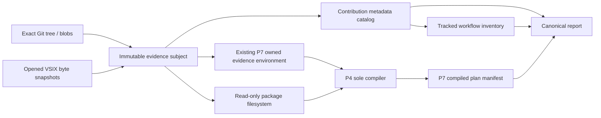

# REG-BRIDGE-DISCOVERY-EVIDENCE 詳細設計

日付: 2026-10-20（Asia/Tokyo）
状態: 書面レビュー用。製品コード・依存関係・CI・進捗projectionは未変更。
設計対象: Program ordinal 10 / 20。設計承認は実装計画の作成だけを許可する。

## 1. 目的・根拠・開始点

同じ固定Git tree・VSIXバイト・P4/P7のowned compiler catalogから、Ubuntu/Windowsで同じdiscovery/catalog/report証拠を生成する。mutable checkoutや再読込したpackage.jsonを証拠の正本にせず、入力・payload・compiler結果の対応を追跡できるようにする。

技術上の根拠は`docs/superpowers/specs/2026-08-23-feature-selection-and-sequential-main-integration-design.md` §5、§12と、固定selection ledgerの`REG-BRIDGE-DISCOVERY-EVIDENCE`行である。実行承認方式は`2026-08-31-wave0a-risk-tiered-approval-and-evidence-design.md`、slice順序は検証済みstatic program indexに従う。

- 現在main: `3d3d25c296dc798c7eb2fd786625775bca1152f0`（Owner metadata PR #195）。正式進捗9/20、11 completion references。
- 直前Owner source: C=`87ad6b85b10051f15f2942b286cb9cdfee852ec2`、source M1=`4f76cbf7a303e8c7b3a0b73055bfa247cc0f1895`。このidentityと既存recordは変更しない。
- hard dependencies: P4 compiler、P7 manifest、Owner/version/lifecycleがVERIFIED。
- 今回owned scope: `REG-BRIDGE-DISCOVERY-EVIDENCE`と`REG-P1-PREREQUISITE-REMAINDER`の分類closure。
- 実行前にsource baseを再確認する。現在の設計worktreeではbaselineの製品treeを維持し、書面だけをコミットする。

ユーザーの「続きを実施」は既存Programの次sliceの準備を進める指示と解釈する。新しい機能要望、V2 runtime有効化、既存CI免除の拡張とは解釈しない。

## 2. 現状と不足

現行`contributionManifest.ts`はowner/version・registry range・宣言ID・相対pathをdescriptor-onlyで検証し、データをdetach/freezeする。実ファイルやVSIXを読み、hashを確認する機能はない。3拡張のmanifestにはworkflow_templates/schemasの既存フィールドがあるが、現在はいずれも空である。

`WorkflowProviderRegistry.snapshotContributions()`はowner付き登録metadataを返す。P4のbranded provider snapshotは別の型で、private dispatch bindingを持つ。両者をJSON catalogで置換・再生成しない。

P7は`createWorkflowContractV2EvidenceEnvironment`で正規のActionRegistryへcompile-only declarationを登録し、非leaseableなowned snapshotをP4へ渡す。P7のcanonical source JSON、明示collections、単一compiler・manifest encoderを維持する。

`workflowDiscovery.ts`はVS Code workspaceのlive discoveryであり、本設計の入力にはしない。archive由来のcontribution catalog/report/VSIX validator本体はmainに未導入である。source universeの`consumedBy`は共有関係を表すだけで、ZIP engine全体が導入済みである証明には使わない。

## 3. 選択肢と採用判断

**A: build用snapshotとroot tools（採用案）。** `tools/workflow-evidence/`で一度取得した入力を共有する。runtime manifestの既存契約を保ち、分類用claimsは別文書にする。既存P4/P7のAPIとowned authorityを再利用でき、ZIP/report engineをVSIXへ追加せず容量増加を抑えられる。

**B: runtime coreへcatalog/reportを公開する。** 型の共有は容易だが、新public API、runtime到達性、混在versionのmanifest互換、配布容量の追加検証が必要になる。今回の目的である生成証拠には不要なため採用しない。

旧dynamic gate、旧six-kind compiler、旧catalog/report discriminator、固定package/provider inventoryやglobal command allowlistは移植しない。既存recompressorはimport時にmainを実行するため、そのprivate ZIP readerを直接importせず、selected archive engineの検証mechanicsを単一のbuild用validatorへ適応する。圧縮処理のownerや79固定対象は変更しない。

## 4. 共有snapshotとauthorityの境界

新しいcontribution metadata catalogは証拠用DTOであり、P4 provider catalogではない。`contract_version`からV2 schema/dispatchを推測したり、V1 action IDをV2 provider contractに変換したりしない。P4が使うprovider truthは従来のowned registry snapshotだけである。

build用APIは次の責務に分ける。型名はJSDoc/closed runtime validatorsで定義し、product public APIへ追加しない。

| API | 入力と結果 | authority |
|---|---|---|
| `captureWorkflowEvidenceSubject(request)` | `{commitSha, vsixSubjects, providerCatalogPath, collectionsPath}`からGit tree/blob table・VSIX bytesを捕捉し、opaque subject tokenを返す | private copied bytesだけを保持。JSONからhydrate不可 |
| `buildWorkflowContributionCatalog(subject)` | package/manifest/claims/declared payloadを同じsubjectから検証し、frozen catalogを返す | declarationの証拠。登録・実行権限なし |
| `discoverTrackedWorkflows(subject, catalog)` | NUL-safe tracked pathsを分類し、全candidateのcoverageを返す | live fs/search・caller-supplied workflow列挙を使わない |
| `compileWorkflowEvidence(subject, discovery)` | 同じsubjectのP7 control bytesと明示collectionsからP4/P7結果を作る | evidence purpose。lease/dispatch不可 |
| `createWorkflowContractReport(subject, catalog, discovery, compiled)` | 上記のsubject identityを照合し、canonical reportを返す | 入力不一致や未検証compileを成功へ変換しない |

subject tokenのstateはmodule-private WeakMapに置く。Buffer/Uint8Arrayを入口で一度copyし、外へ返す場合もcopyする。package/manifestはstrict UTF-8/JSON decodeを各payload一度だけ行う。accessor、Proxy、非plain record、sparse array、alias/cycleやprototype keyを検証前のgetter呼出しなしで拒否する。

### Git subject

commitを40桁SHAへ一度解決し、そのtreeを固定する。`git ls-tree -rz --full-tree`と`git cat-file --batch`から必要なtracked blobを取る。`ls-files`をdiscoveryの正本にしてreportだけ別treeを読む方式は採らない。作業中のファイル置換・未追跡ファイルは捕捉済みsubjectを変えない。

Git pathはNUL区切りを維持する。POSIX上のliteral backslashをseparatorへ書き換えない。選択対象のnonportable path、NFC違い、case alias、symlink mode、親escape、二重ownershipは固定codeで拒否する。共通sortはUTF-16 code-unit順とし、locale/OS/path separatorに依存させない。

全treeのpath metadataを取得しても、contentはmanifest、claims、宣言asset、分類対象workflowと明示collections/controlに限定する。untracked/protected領域をfilesystemで探索しない。

### VSIX subject

各VSIXは開く前・open後・read後のregular-file identity/sizeとpath identityを照合し、size+1までのbounded readで一度捕捉する。再開、差替え、hard-link/reparse alias、増減、部分readを拒否する。実VSIXの証拠は元archiveのexact SHA256とbyte数を持つ。host pathやmtimeはcanonical出力へ入れず、外部の実行receiptだけに置く。

## 5. 宣言・catalog・discovery

### runtime manifestと分類claims

`workflow-contributions/v1`のroot fields・registry negotiation・handler契約は維持する。既存のworkflow_templates/schemasへ、実際に同じVSIXへ入る所有assetを宣言する。payloadを持たない架空の宣言は追加しない。

新しい`contracts/workflow-discovery-claims.json`はbuild専用の`workflow-discovery-claims/v1`とする。closed fieldsは`schemaVersion`、`owner`、`scopes`、`exclusions`、`externalCommands`、`mirrors`。ownerはpackageとruntime manifestのid/versionに一致させる。

- scopesはowner root内の相対prefixとrole（template/sample/fixture）の組。固定19件等の手作業catalogにはしない。重複・複数一致を拒否する。
- exclusionsはowner内のliteral tracked pathと固定reason code。不存在・対象外・claimとの重複は拒否する。
- externalCommandsはcommand IDと対象workflow scopeを組にし、global allowlistへ広げない。
- mirrorsは所有元asset pathとtracked mirror pathを明示し、捕捉したGit blobとVSIX entryのexact bytesを比較する。directory走査や再読込をしない。

package.jsonのpublisher/name/versionとcontributes.commandsは同じVSIX snapshotから導出する。commandの重複・owner不一致・ambiguous contributionを拒否する。provider IDとVS Code command IDが等しいとは仮定しない。

externalCommandsはscope内の宣言証拠に限定し、外部hostでの存在確認・実行許可・provider解決成功を意味しない。owned commandの存在証拠は、そのownerのVSIX package.jsonから得られるものだけとする。

### catalog

新discriminatorは`workflow-discovery-catalog/v1`。sourceTreeSha、各owner/version、元VSIX・package・runtime manifest・claimsのexact byte digest、宣言assetのpath/byte数/digest、byte-derived commands/declarationsを含める。arrayはdeterministicにsortし、各namespaceとowner/versionのcollision、registry range不整合、宣言外payload参照、missing/wrong-type assetを拒否する。

raw archive/payload digest、`semanticCatalogDigest`、full `catalogDigest`を区別する。semantic digestはowner/version・package/manifest/claims/asset byte digest・commands/declarationsのcanonical subsetから計算し、archiveのmetadata行は含めない。full catalogとsubjectのdigestは元VSIXのarchive identityを含む。従ってtimestamp/entry順序だけが異なるVSIXでもsemantic digestは一致し得るが、full digestは変化する。Ubuntu/Windowsの正式比較には同じhashのVSIXそのものを渡す。

catalogDigest/discoveryDigest/compiledManifestDigestはreport側、reportDigestは出版receipt側へ記録し、自分自身のcanonical bytesへ自分のdigestを埋め込まない。

### tracked discovery

contribution manifestから導出したowner root内を、Git tree上の`.bob/workflows/**/WORKFLOW.md`、`workflow.yaml`、`current.json`等の既存構造に従って分類する。候補は一つのscope、正当なexclusion、又はunclassified diagnosticのいずれか一つになる。missing/duplicate/ambiguous/unclassifiedを正常coverageに含めない。

既存V1 WORKFLOW.mdはbyte inventory/mirror証拠として維持し、`inventory_only`と明示する。V1文書を旧compilerへ渡したり、V2 compiled/validatedと表示したりしない。V2 packageについても、P7の明示collectionsに含まれたpublished packageだけがcompile対象であり、discoverした全fixtureを自動compileしない。negative fixtureと未選択候補の存在は個別classificationとして可視化する。

## 6. P4/P7の再利用

P7のcanonical provider source JSONとcollections JSONを同じGit subjectから取得する。既存`createWorkflowContractV2EvidenceEnvironment`の内部処理を、canonical bytesを受けるshared functionへ最小抽出し、従来のbounded filesystem wrapperはその関数へ委譲する。既存CLIのarguments/explicit collections/拒否条件は維持する。

これはP7で既に承認されたprovider declaration inputであり、新しいmanual provider lookupではない。新CLIはraw catalog DTO、callback lookup、runtime registryのJSON hydration、追加allowlistを受け付けない。source JSONのexact digestとowned catalog/environment digestをreportへ結び、compilerへ渡すsnapshotは従来と同じ登録・検証経路からだけ生成する。

捕捉済みtreeを`WorkflowPackageFileSystem`へ適合させるread-only adapterを設け、P1 loader/rootのfactoryを通してRawWorkflowPackageを取得する。identityはcaptured blob/tableに固定し、authoring用flush/renameは実装しない。P4 `compileWorkflowPackage`とP7 `create/encodeCompiledWorkflowPlanManifest`だけを使用し、並行compilerを作らない。

P7の既存filesystem入力とcapture入力について、同じfixture/control bytesからmanifest bytes、package/lock/environment/plan digestが一致することをparity試験にする。evidence environment/handleからruntime leaseを取得できず、dispatch/Bob/run directory/artifact stagingの五効果が0であることも実行spyで確認する。

## 7. ZIP・資源・診断の境界

ZIP validatorはcentral/local header、filename/flags/method/size/CRC、entry range/descriptor/gap、EOCD、総entry数を照合する。暗号化、unsupported method、ZIP64、重複entry、local/central不一致、overlap、壊れたdescriptor、非regular asset、path alias/escape、unexpected tailは拒否する。disk展開とarchive内code実行はしない。

| 境界 | 上限 |
|---|---:|
| VSIX archive | 64 MiB/個、64個、入力合計256 MiB |
| ZIP | 10,000 entries/個、uncompressed 8 MiB/entry、32 MiB/archive、全体256 MiB |
| Git tree metadata | 32 MiB、200,000 rows |
| 捕捉対象blob/control | 8 MiB/個、合計256 MiB |
| workflow候補・宣言 | 各20,000件 |
| report/catalog/discoveryの各canonical出力 | 8 MiB |
| diagnostic表示 | 256 UTF-8 bytes/件、4,096件 |

P1/P4/P7のpackage数・path depth・prompt/schema・総byte制限はそのまま適用し、上表を理由に引き上げない。上限超過、サロゲート/UTF-8不正、host path混入、malformed inputは固定codeを返し、部分成功や巨大な例外全文を出力しない。出力上限はJSON escaping後の実byte数でも検査する。

## 8. CLI・report・出版

root toolsに`discover-tracked-workflows.mjs`と`generate-workflow-contract-report.mjs`を置く。後者はsubjectを一度作り、共通pure discovery/catalog/report関数を使う。前者にも同じ関数を使い、二つのdiscovery実装を作らない。import時にはCLIを起動しない。

入力は`--commit <40桁SHA>`、`--subjects <canonical JSON path>`、既存P7の`--provider-catalog`と`--collections` control pathsである。commit objectを検証しtreeを導出するため、branch tipやbare treeの曖昧解決はしない。subjects JSONはbounded arrayの`{path, expectedSha256, expectedBytes}`だけを持ち、捕捉したVSIXと照合する。CLIのpathはsource locatorであってevidence identityではない。workflow手入力一覧・manual catalog・legacy compiler/schema選択は受け付けない。

reportは`workflow-discovery-report/v1`。source tree、subject/catalog/discovery/compiled-manifest digest、owner/asset/command/workflow coverage、V1 inventory-onlyとV2 compile結果、bounded diagnosticsをclosed schemaで保持する。host absolute path、OS名、現在時刻、checkout root、任意のstackはportable artifactへ入れない。commit/CI/VSIX locator/OS情報は別receiptへ置く。

`--output-directory`は新しい専用directoryを指定する。全検証と全byte生成の後、同volumeのprivate stagingにcatalog.json/discovery.json/report.json/compiled-plan-manifest.jsonを書き、一回のno-overwrite directory promotionで公開する。既存出力の置換・逐次file更新はしない。`--check`は既存artifactのexact bytesを比較するだけとする。失敗したowned stagingとproofは自動削除せず、receiptに残す。

catalog/report schemaはroot tools内へ置き、CLI/validator engineをVSIXへ同梱しない。toolsは現行compilerのcompile済みoutを利用するため、build-before-runは明示する。VSIXからroot toolsを参照するproduct importやinstalled commandは追加しない。

## 9. 実装scopeとsource traceability

予定する新規領域は`tools/workflow-evidence/{lib,schemas,test}`と二つのentrypoint、3拡張のbuild用claims、必要な宣言asset dataである。既存変更はP7 evidence environmentのbytes共有境界、source/architecture/CI契約へのliteral test/path追加、root statusの後続completion受入に限定する。runtime public API、version、engine、dependencies/lockfiles、既存79圧縮対象、容量上限1,200,000 bytesを維持する。容量を早期実測し、固定圧縮対象を変える必要が生じた場合は具体的検証案に対する別承認が必要になる。

selected 27件の出典は全てcontribution-prerequisite `8793804f2f99fd1d545cb496064bcbdc7df4bf40..3e2dd68d4a0a880e7fa7ed065f5a1be2bd25a0ca`、archive manifest `36e477ee9b752ebf7f07a208c166fec24e14a89bf7ba6a7921cf6bdf708c9f31`、carrier patch `6913ddddcffb150eb207aee99bdbbad158b4ed05e9c3ca8714693d31f6122536`に束縛する。

| family | source ID suffix（全て`source-`を前置） | 今回の対応 |
|---|---|---|
| claims/contracts | 0bd231a3c17b7b56bbbbda21, a3b4ca6a0b1e4db038b83ee2, f894324f170cd6b0e3e013d0, 42a51209abb3930bdea6ba64, 94c75d7f2b39527bdd46537b | 3拡張claims、既存asset宣言、closed claims schema/validatorへ適応 |
| discovery/catalog/commands | c9f9168d602096cc4dd38962, b70d9366a8f58c57853ffb5c, 5337bde73cf849b77a4ec168 | captured Git inventory、byte-derived metadata catalog/commands |
| byte primitives/mirrors | 7b4478e568123faa4d57384b, 108b6d1a970be1f538f3602d, e97fb940447f8795f030dd5a | exact digest、bounded diagnostic、immutable mirror比較 |
| VSIX | ae53a107be8a2a34e41640fa, ecd28ff2184f030296cb7e8f | root tools内の単一typed/JSDoc facadeとZIP validator |
| capture/report/schemas | 6ed53a774d194de006046976, 2d2e01542f2b8de11ef04afb, 1913ba4170b45960fbe64027, bbf2ca2bcc7c77ab957b9da0 | subject snapshot、P4/P7適応report、現行discriminatorのclosed evidence schema |
| test families | 00e1139e1829c12246ddfc93, 12d9b78e71be42e5711771f4, 26b6488e607378d4c655a690, 3b47ba9ceb1a183e4b4b72b6, 773145e87b6df693130cda15, 81dbd3422d5271c2937c1f2d, b07af6a4536e3f305f2cbd96, b0d34954e5c18ba7b31098a5, ded09201e927f84b96d1ea91, f10cf7e3aac8376a0cd86693 | 下記matrixにbehaviorを対応。旧fixed-count/旧compiler assertionsは復活させない |

exact origin blob OID、symbol、対応先path/testを27行のsource coverage artifactに保存し、未割当0を検査する。歴史的`REG-P1-PREREQUISITE-REMAINDER`の全source IDについて、既存selected ownerへの共有参照とsuperseded/rejected理由を維持して分類closureを作る。source-eb7aeef897a4f48ed72d6900の旧dynamic orchestration、旧catalog/report namespace、削除済みfallbackは導入しない。

Ownerの57-delta source admissionとその元baselineを変更しない。Discovery専用literal deltaを別admissionとして積み、Gate Rのcurrent expected sourceをそこから導出する。root toolsもliteral対象集合と実ファイルの一致を検査する。wildcard許可、forbidden root縮小、R3–R6・public runtime到達性の許可で通さない。

## 10. 受入試験

1. 各behaviorをRED→GREENで導入する。shared subject不在、再読込差替え、caller Buffer変異が観測可能な失敗を先に確認する。
2. package/manifest/claims/assetから導出したexact digestとowner/commandの一致。package UTF-8 decode一度、invalid bytesを失わない。
3. hostile descriptor/Proxy、alias、array bounds、duplicate owner/ID/version、range不整合、missing/wrong-type payload、NFC/case/path逃避。
4. ZIP CRC/descriptor/local-central/overlap/gap/EOCD/ZIP64/duplicate/limits全negative。元archiveと非対象payload不変。
5. Git NUL path、POSIX literal backslash、未追跡差替え、tree/blob不一致、symlink、scope重複、classification欠落、mirror改変。
6. catalog/discovery/reportが同じopaque subjectを使い、異なるsubjectやJSON再hydrateを拒否する。
7. 現P7 filesystem経路とcapture adapterのcompile/manifest parity。V1はinventory-only、negative fixture/未選択V2はcompile済みにしない。
8. retained inputを複数回・順序を変えて生成し、canonical bytes/digest一致。実Ubuntu/Windowsで同じfixtureとVSIXを用い、その出力bytesを比較する。
9. 256-byte diagnostics、unpaired surrogate、大量escape、出力8MiB超過、遅延失敗のall-or-nothing/no-overwrite。host pathの漏出なし。
10. runtime source/entrypointへのimport追加なし、V2五効果0、R3–R5 inactive、R6 absent、既存V1 API/registration/Bob操作ハブの回帰なし。

新root-tools suiteを既存4 workflowのexact-head契約に追加する。必要なpath filterは追加だけとし、Ubuntu/Windowsのfixture artifact比較を実jobで行う。root必須試験、3拡張のaffected full suite、dependency/architecture/source/schema/unused/prod audit、4生成器、Gate R15、3 VSIX/policy、same hashed VSIXによるinstalled native activation/cleanupを計画へ明記する。

レビューはsource全体をfresh contextで一度、必要なCritical/Importantを一回のTDD fix passで処理し、別metadataは一度独立reviewする。per-task reviewや同じtreeの広範な再試験を重ねない。新しい変更・失敗・未解決事項がある場合だけ必要な検証を追加する。

## 11. CI・統合・完了

Owner sliceのCI免除は今回へ継承しない。Discoveryのcandidate C_Dと通常merge source D1で、exact-head契約の4 workflow・required jobs・実checkout SHA・Ubuntu/Windows比較成功を要求する。path-filter未起動分は同じSHA/nonceでdispatchする。起動前失敗、403、未実行は成功へ変えず、必要なら完成候補と実失敗を提示して今回固有の例外だけを確認する。実行済みコード失敗にはCI免除を適用しない。

source D1の受入後、別metadata D2を作る。新completionはD1をsource subjectとし、C_D/tree/parents/review/local/CI/VSIX/installed/cross-platform output/全外部byte bindingを保持する。metadata D2を製品source subjectに使わない。

旧11 referencesをprefixのまま保持して12件、static20不変、ordinal10だけVERIFIED、正式10/20（50%）、nextはPROC-T13-LEDGERとなる。WORKFLOW-C-SAFE-PREFIXのboundary terminalは必要な全gateとremainder分類が揃って初めてVERIFIEDとする。conditional R3–R5やProcessingを同時に開始しない。

V2 runtimeはinactiveのまま。GUI/live Bob model・Program全体の最終三拡張UAT・main-only topology cleanupを今回の局所proofから完了扱いしない。既存のsource-map診断位置minorも今回の証拠生成へ便乗して修正しない。

worktree/profile/branch/証拠は保持し、自動cleanupしない。保護対象8件のprimary statusを開始・終了で比較し、指定された3領域の内容を読まない。

## 12. 書面レビューの判定点

本設計が承認されたら、27 source itemsとremainderの対応、shared capture、catalog/discovery、P4/P7 parity、publication、容量/品質/実CI/installed proof、source/metadataの順で実装計画を作成する。計画の書面レビューと実行方法の承認後にTDD実装へ入る。

今回のreview対象は、build用root toolsへの配置、runtime manifestとoffline claimsの分離、二種類のcatalogのauthority分離、既存P7 canonical provider inputの再利用、V1 inventory-only、fixed snapshotからの決定的証拠生成、CI免除の非継承である。
