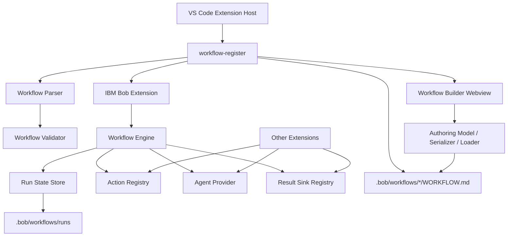

# workflow-register 基本設計書

## 1. 目的

`workflow-register` は、VS Code / IBM Bob 環境で `.bob/workflows/*/WORKFLOW.md` に定義されたワークフローを検出し、IBM Bob の Workflow UI へ登録・実行・再開できるようにする拡張機能である。

本拡張は、個別拡張機能が持つ処理、たとえば `bob-bazaar-review` や `bob-code-consistency-review` の前処理・レビュー結果保存・成果物生成などを、Bob のワークフローとして組み合わせるための共通基盤を提供する。

## 2. 背景と課題

IBM Bob 上でレビューや設計作業を定型化する場合、次の課題がある。

- ワークフロー定義をプロジェクトごとに配置したい。
- Bob の UI へ動的にワークフローを登録したい。
- コマンド実行、AI 実行、人間の確認、成果物保存を一連の step として扱いたい。
- 実行途中で中断した場合に、前段の成果物を再利用して途中から再開したい。
- ワークフロー定義の誤りを実行前に検出したい。
- GUI で `WORKFLOW.md` を作成・編集し、YAML front matter と Markdown body の両方を扱いたい。
- 他拡張が action provider / agent provider / result sink を後付けできるようにしたい。

`workflow-register` はこれらを解決するため、ワークフロー定義形式、登録処理、実行エンジン、検証、診断、GUI Builder、AI 補助、実行状態管理をまとめて提供する。

## 3. スコープ

### 3.1 対象範囲

- `.bob/workflows/*/WORKFLOW.md` の探索と読み込み。
- `schemaVersion: workflow-register/v1` 形式の解析。
- legacy 形式の互換読み込み。
- IBM Bob Workflow UI への登録。
- Bob task API を利用した step 実行。
- standalone 実行用の workflow engine。
- `command` / `agent` / `manual` / `result` step の実行。
- workflow state と run state の管理。
- result handoff によるチャット成果物の外部処理。
- ワークフロー定義の検証と VS Code Diagnostics 表示。
- テンプレート作成、AI 設計、AI 改善、診断説明。
- Webview GUI Builder による新規 `WORKFLOW.md` 作成。
- Webview GUI Builder による既存 `workflow-register/v1` の編集。
- `requires` / `preflight` / `completion` / `guardrails.requireApproval` / Markdown body の GUI 編集。

### 3.2 対象外

- IBM Bob 本体の UI 実装。
- 個別業務処理の実装。
- 任意 shell command の直接実行。
- ワークスペース外への成果物保存。
- 長期ジョブスケジューリング。
- 複数ユーザー間の実行状態同期。
- legacy workflow の GUI 編集。
- YAML コメントや field 順序の完全保持。

## 4. 利用者と利用シーン

| 利用者 | 主な用途 |
| --- | --- |
| 開発者 | `.bob/workflows` にワークフローを定義し、Bob 上から実行する。 |
| レビュー担当者 | Bob Workflow UI からレビュー手順を開始し、途中成果物を確認しながら進める。 |
| 拡張機能開発者 | `registerActionProvider` などを使い、独自処理を workflow step へ接続する。 |
| ワークフロー設計者 | テンプレート、GUI Builder、AI 補助を使って `WORKFLOW.md` を作成・改善する。 |
| 保守担当者 | 既存 `WORKFLOW.md` を GUI で編集し、Preview / Diagnostics / Diff で安全に保存する。 |

## 5. 全体構成

## 6. 主要コンポーネント

| コンポーネント | 主な責務 | 主なファイル |
| --- | --- | --- |
| Extension Entry | VS Code command 登録、Bob 連携、workflow provider API 公開 | `src/extension.ts` |
| Authoring Entry | core activation に設計支援・検証・GUI Builder command を追加 | `src/extensionWithAuthoring.ts` |
| Parser | Markdown front matter と body を workflow model へ変換 | `src/core/parser.ts` |
| Schema | `workflow-register/v1` の構造定義 | `src/core/workflowSchema.ts` |
| Validator | workflow 定義の構造・参照整合性を検証 | `src/core/workflowValidator.ts` |
| Engine | workflow step 実行、再開、再試行、preflight、artifact 出力 | `src/core/engine.ts` |
| Run State Store | run state を `.bob/workflows/runs` に保存 | `src/core/runStateStore.ts` |
| Action Registry | command step 用 provider の登録と実行 | `src/core/actionRegistry.ts` |
| Result Sink Registry | result / artifact の保存先を抽象化 | `src/core/resultSinkRegistry.ts` |
| Result Handoff | assistant 成果物を action provider へ渡す | `src/resultHandoff.ts` |
| Input Resolver | workflow inputs の不足値を解決 | `src/core/inputResolver.ts` |
| Workspace Roots | `.bob` を持つ workflow root 候補を解決 | `src/core/workspaceRoots.ts` |
| AI Authoring | ワークフロー設計・改善・診断説明の補助 | `src/commands/*Ai.ts`, `src/core/workflowAiProviderFactory.ts` |
| GUI Builder Panel | WebviewPanel、preview、diff、save、backup、reload | `src/webview/workflowBuilderPanel.ts` |
| GUI Builder HTML/CSS/Script | Webview shell、style、client script、Markdown body editor | `src/webview/workflowBuilder*.ts` |
| Authoring Model | GUI 編集用の中間モデル | `src/core/workflowAuthoringModel.ts` |
| Authoring Defaults | テンプレートから GUI 初期モデルを作成 | `src/core/workflowAuthoringDefaults.ts` |
| Authoring Loader | 既存 `WORKFLOW.md` を GUI モデルへ変換 | `src/core/workflowAuthoringLoader.ts` |
| Authoring Serializer | GUI モデルを `WORKFLOW.md` へ変換 | `src/core/workflowAuthoringSerializer.ts` |
| Reference Analysis | GUI 編集中の step / artifact 参照チェック | `src/core/workflowAuthoringReferenceAnalysis.ts` |

## 7. ワークフロー定義モデル

ワークフローは `WORKFLOW.md` の YAML front matter と Markdown body で定義する。新規定義では `schemaVersion: workflow-register/v1` を推奨する。

主な要素は次のとおり。

| 要素 | 説明 |
| --- | --- |
| `name` | 安定識別子。フォルダ名と一致させることを推奨する。 |
| `description` | Bob UI と診断で使う説明。 |
| `title` / `label` / `menuLabel` | UI 表示名。 |
| `workspaceRequired` | Bob UI 上で workspace env を要求するか。 |
| `inputs` | 実行前入力定義。 |
| `requires` | workspace、Bob、必須ファイルなどの実行条件。 |
| `preflight` | 実行前に行う確認。 |
| `guardrails` | command 実行の許可・禁止・承認ルール。 |
| `artifacts` | step 結果から保存する成果物。 |
| `completion` | 完了時の summary / artifacts / visualization。 |
| `steps` | 実行 step の列。 |
| Markdown body | Bob へ渡す説明、手順、運用補足。GUI の `Markdown Body` タブで編集できる。 |

## 8. ステップ種別

| 種別 | 説明 |
| --- | --- |
| `command` | action provider を呼び出す。戻り値は `resultKey` に保存できる。 |
| `agent` | agent provider または Bob task の subagent にプロンプトを渡す。 |
| `manual` | 人間の確認完了を待つ。 |
| `result` | state / literal / agent 結果を result sink に渡す。 |

`includeState` は前段 step の `resultKey` を参照する。GUI Builder では参照切れ、前方参照、`artifact.producedBy` の不整合を即時警告する。

## 9. GUI Builder

GUI Builder は次の command で起動する。

| Command ID | 用途 |
| --- | --- |
| `workflowRegister.openWorkflowBuilder` | テンプレートから新しい `WORKFLOW.md` を GUI で作成する。 |
| `workflowRegister.editWorkflowInBuilder` | 既存 `workflow-register/v1` の `WORKFLOW.md` を GUI で編集する。 |

主なタブは次の通り。

- `Step detail`
- `Inputs`
- `Requires`
- `Preflight`
- `Artifacts`
- `Guardrails`
- `Completion`
- `Markdown Body`
- `Preview / Diagnostics`

保存前には `serializeAuthoringModelToMarkdown()` で Markdown を生成し、`validateWorkflowText()` で検証する。既存編集時は `Show Diff` で差分を確認でき、保存時は backup を作成してから上書きする。

## 10. 実行方式

### 10.1 Bob UI 経由の実行

1. 拡張機能が `onStartupFinished` などで起動する。
2. `.bob/workflows/*/WORKFLOW.md` を探索する。
3. workflow 定義を解析し、Bob の source API へ登録する。
4. Bob の Workflow UI から workflow が開始される。
5. `getSteps()` で返した step 定義に沿って実行する。
6. command step は action provider を呼び出す。
7. agent step は Bob task の `startSubagent` を使う。
8. manual step は `completeCurrentStep` まで hold する。
9. result handoff が必要な場合、最新 assistant 成果物を action provider へ渡す。

### 10.2 Command Palette 経由の standalone 実行

`workflowRegister.runWorkflow` は `WorkflowEngine` を使い、workflow 定義を直接実行する。この経路では `FileRunStateStore` に run state を保存し、`resumeRun` / `retryCurrentStep` を利用できる。

## 11. 実行状態と再開

実行状態は `.bob/workflows/runs/<runId>/run.json` に保存する。

保存対象は次の情報である。

- run ID
- workflow ID / name / schema version / definition hash
- 入力値
- state
- 各 step の状態
- current step
- error
- created / updated timestamp

Bob UI 経由の手動 step はメモリ上の active step と Bob task のメッセージを使う。standalone 実行は run state を使って再開・再試行できる。

## 12. 他拡張との連携

`workflow-register` は activation return value として次の API を公開する。

| API | 用途 |
| --- | --- |
| `registerActionProvider(provider)` | `command` step の provider を追加する。 |
| `registerAgentProvider(provider)` | standalone engine の agent 実行を差し替える。 |
| `registerResultSink(type, handler)` | `result.sinks[].type` で参照できる sink を追加する。 |
| `listWorkflows()` | 読み込み済み workflow 定義を取得する。 |
| `runWorkflow(workflowId, inputs)` | workflow をプログラムから実行する。 |

## 13. セキュリティと安全設計

- 任意 shell 実行は標準機能として提供しない。
- command step は action provider 経由で実行する。
- guardrails により許可・禁止 command を検査する。
- `guardrails.requireApproval` は人間承認が必要な条件を表現する。
- `file` result sink は workspace root 外への書き込みを拒否する。
- result command sink は既定で許可リスト制にする。
- `.bob/workflows` 配下のワークフローのみを登録対象にする。
- GUI 編集では保存前 validation と backup を必須経路にする。

## 14. 運用と診断

主な運用コマンドは次のとおり。

- `workflowRegister.reload`
- `workflowRegister.inspect`
- `workflowRegister.runWorkflow`
- `workflowRegister.inspectRuns`
- `workflowRegister.resumeRun`
- `workflowRegister.retryCurrentStep`
- `workflowRegister.inspectRunDiagnostics`
- `workflowRegister.validateCurrentWorkflow`
- `workflowRegister.validateWorkspaceWorkflows`
- `workflowRegister.createWorkflowFromTemplate`
- `workflowRegister.openWorkflowBuilder`
- `workflowRegister.editWorkflowInBuilder`
- `workflowRegister.completeCurrentStep`

`WORKFLOW.md` は保存時と active editor 変更時に検証され、VS Code Diagnostics に反映される。

## 15. テスト方針

- parser の v1 / legacy 解析を検証する。
- schema validation を検証する。
- workflow engine の run / resume / retry を検証する。
- result handoff の assistant 成果物渡しを検証する。
- workflow template と provider registration の契約を検証する。
- workspace root 探索と multi-root 動作を検証する。
- GUI authoring serializer / loader / reference analysis を検証する。
- Webview 分割 module と Markdown Body editor の出力を検証する。

## 16. 今後の拡張方針

- Bob UI 経由実行の永続 resume 強化。
- active step の永続化。
- result handoff の再試行 UI 強化。
- action provider / result sink の権限モデル拡張。
- workflow definition migration の支援。
- workflow 実行ログの可視化。
- GUI Builder と AI 改善結果の部分適用連携。
