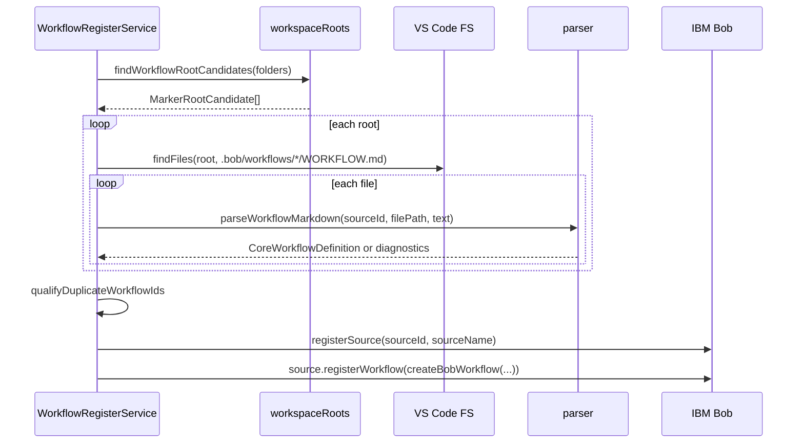
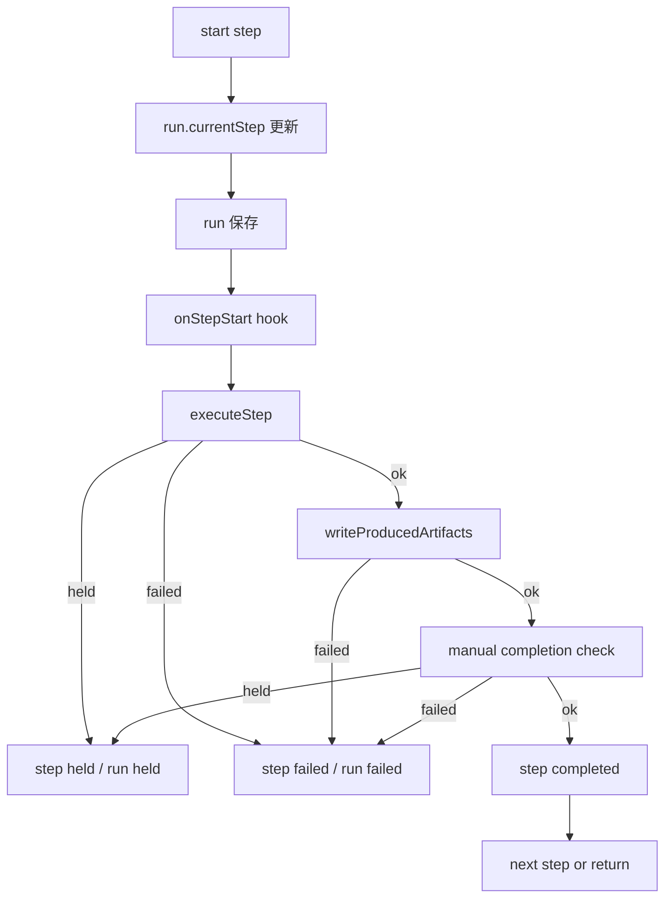

# workflow-register 詳細設計書

## 1. 文書の位置づけ

本書は `extensions/workflow-register` 拡張機能の詳細設計を定義する。基本設計で示した責務を、実装モジュール、主要データ構造、処理シーケンス、エラー処理、GUI Builder、再開仕様、テスト観点に分解する。

## 2. 実装構成

```text
extensions/workflow-register/
  package.json
  src/
    extensionWithAuthoring.ts
    extension.ts
    agentStep.ts
    resultHandoff.ts
    commands/
      createWorkflow.ts
      designWorkflowWithAi.ts
      editWorkflowInBuilder.ts
      explainWorkflowDiagnostics.ts
      improveWorkflowWithAi.ts
      inspectRunDiagnostics.ts
      openWorkflowBuilder.ts
      validateWorkflow.ts
      workflowDiagnostics.ts
    core/
      actionRegistry.ts
      agentProvider.ts
      engine.ts
      guardrails.ts
      inputCollector.ts
      inputResolver.ts
      model.ts
      parser.ts
      resultSinkRegistry.ts
      runStateStore.ts
      workflowAiProvider.ts
      workflowAiProviderFactory.ts
      workflowAuthoringDefaults.ts
      workflowAuthoringLoader.ts
      workflowAuthoringModel.ts
      workflowAuthoringReferenceAnalysis.ts
      workflowAuthoringSerializer.ts
      workflowSchema.ts
      workflowTemplates.ts
      workflowValidator.ts
      workspaceRoots.ts
    webview/
      README.md
      workflowBuilderBodyScript.ts
      workflowBuilderClientScript.ts
      workflowBuilderHtml.ts
      workflowBuilderPanel.ts
      workflowBuilderStyles.ts
  test/
    *.test.js
```

## 3. 起動設計

### 3.1 VS Code activation

`package.json` の `main` は `./out/extensionWithAuthoring.js` である。activation event は `onStartupFinished` と各 command の `onCommand` を指定する。

起動時の処理は次の通り。

1. `extensionWithAuthoring.activate(context)` を呼ぶ。
2. `activateCore(context)` を呼び、core API を作る。
3. authoring / validation / diagnostics / GUI Builder 系 command を追加登録する。
4. 既に開いている `WORKFLOW.md` を diagnostics 対象にする。
5. core 側では `WorkflowRegisterService` を生成し、`reload` を非同期で実行する。
6. Bob 拡張の遅延起動に備えて retry timer を設定する。

### 3.2 command entry

| Command ID | 主な用途 |
| --- | --- |
| `workflowRegister.reload` | `.bob/workflows/*/WORKFLOW.md` を再読み込みする。 |
| `workflowRegister.inspect` | 登録状態と diagnostics を Markdown で表示する。 |
| `workflowRegister.runWorkflow` | standalone engine で workflow を実行する。 |
| `workflowRegister.inspectRuns` | 保存済み run state を一覧表示する。 |
| `workflowRegister.resumeRun` | held run を再開する。 |
| `workflowRegister.retryCurrentStep` | current step を再試行する。 |
| `workflowRegister.inspectRunDiagnostics` | run state の診断を表示する。 |
| `workflowRegister.validateCurrentWorkflow` | active editor の workflow を検証する。 |
| `workflowRegister.validateWorkspaceWorkflows` | workspace 内 workflow を一括検証する。 |
| `workflowRegister.createWorkflowFromTemplate` | template から `WORKFLOW.md` を作成する。 |
| `workflowRegister.openWorkflowBuilder` | Webview GUI で新規 workflow を作成する。 |
| `workflowRegister.editWorkflowInBuilder` | 既存 `workflow-register/v1` workflow を Webview GUI で編集する。 |
| `workflowRegister.designWorkflowWithAi` | AI provider で新規 workflow draft を作る。 |
| `workflowRegister.improveWorkflowWithAi` | AI provider で改善案を作り、preview / diff / backup 後に適用する。 |
| `workflowRegister.explainWorkflowDiagnostics` | diagnostics を自然言語で説明する。 |
| `workflowRegister.completeCurrentStep` | Bob UI 経由の current manual step を完了する。 |

## 4. 公開 API 設計

`activate` の戻り値として `WorkflowRegisterApi` を公開する。

```ts
export interface WorkflowRegisterApi {
  registerActionProvider: (provider: ActionProvider) => void
  registerAgentProvider: (provider: AgentProvider) => void
  registerResultSink: (type: string, handler: Parameters<ResultSinkRegistry["register"]>[1]) => void
  listWorkflows: () => CoreWorkflowDefinition[]
  runWorkflow: (workflowId?: string, inputs?: Record<string, unknown>) => Promise<unknown>
}
```

## 5. Workflow 定義探索設計

探索対象は次の glob に限定する。

```text
**/.bob/workflows/*/WORKFLOW.md
```

`workspaceRoots.ts` は `.bob` を持つ root 候補を解決する。direct candidate、child candidate、fallback candidate の順で解決し、multi-root workspace で `.bob` と作業 root が異なる構成を扱う。

## 6. Workflow 読み込み設計

### 6.1 読み込みシーケンス



同じ logical workflow ID が複数 root から見つかった場合は、`workflowRoot` の basename と SHA-1 hash を使って一意化する。

## 7. Parser / Schema / Validator 詳細

### 7.1 Parser

`parseWorkflowMarkdown()` は Markdown 先頭の YAML front matter を抽出し、`schemaVersion: workflow-register/v1` なら v1 parser、そうでなければ legacy parser を使う。

v1 では `workflowV1Schema` を AJV で検証し、`CoreWorkflowDefinition` へ normalize する。Markdown body は `prompt` 未指定時の workflow prompt として扱う。

### 7.2 Schema

主な制約は次の通り。

- `name` と `description` は必須。
- `name` は英数字で始まり、英数字、`.`、`_`、`-` のみを許可する。
- `stepCompletion` は `auto` または `manual`。
- `stepMessage` は `full` / `current` / `silent` / `step`。
- input `type` は `string` / `number` / `boolean` / `select`。
- step `type` は `command` / `agent` / `manual` / `result`。
- `command` step では `action` を必須とする。
- `result` step では `result` を必須とする。
- `guardrails.requireApproval[]` は `id` / `when` / `message` を持てる。

### 7.3 Validator

`workflowValidator.ts` は parser の構造検証に加え、次を検査する。

| 項目 | エラー条件 |
| --- | --- |
| Todo | `todoRequired` が true なのに Todo が無い。 |
| Step ID | 同一 workflow 内で重複する。 |
| Todo と Step | `todoAsSteps` なのに対応する step が無い。 |
| State 参照 | `includeState` が存在しない `resultKey` を参照する。 |
| Result source | `source: state` の `stateKey` が存在しない。 |
| Result sink | command / file sink の必須値が無い。 |
| Artifact | `producedBy` が存在しない step を参照する。 |
| Inputs | `select` に `options` が無い。 |
| requiredWhen | 存在しない input を参照する。 |
| Guardrails | allowed と denied に同一 command がある。 |

## 8. GUI Builder 詳細

### 8.1 Authoring model

`WorkflowAuthoringModel` は GUI 編集用の中間モデルである。実行用の `CoreWorkflowDefinition` とは異なり、GUI で編集しやすい配列形式の `inputs`、`steps`、`artifacts` と、Markdown body、`unknownFrontMatter` を保持する。

```text
WORKFLOW.md
  -> parseWorkflowMarkdown
  -> workflowToAuthoringModel
  -> Webview form state
  -> serializeAuthoringModelToMarkdown
  -> validateWorkflowText
  -> Show Diff / backup / overwrite
```

### 8.2 新規作成

`openWorkflowBuilder.ts` は Webview を開き、`workflowAuthoringDefaults.ts` の template から初期 model を生成する。対応 template は `simple-agent`、`command-then-agent`、`manual-checklist`、`input-driven-agent`、`preflight-files`、`artifact-output`、`guarded-command`、`review-workflow` である。

### 8.3 既存編集

`editWorkflowInBuilder.ts` は active editor または file picker で `WORKFLOW.md` を選び、`loadAuthoringModelFromMarkdown()` で GUI model を作る。

- 対象は `schemaVersion: workflow-register/v1` のみ。
- legacy workflow は GUI 編集対象外。
- GUI 管理外 front matter は `unknownFrontMatter` として保持する。
- Markdown body は `model.body` として保持する。

### 8.4 Webview modules

| file | role |
| --- | --- |
| `workflowBuilderPanel.ts` | WebviewPanel 作成、preview / diff / save、backup、reload。 |
| `workflowBuilderHtml.ts` | HTML shell、CSP、nonce、initial state 埋め込み。 |
| `workflowBuilderStyles.ts` | Webview CSS。 |
| `workflowBuilderClientScript.ts` | form state、tab、step 操作、reference warning、details section 編集。 |
| `workflowBuilderBodyScript.ts` | `Markdown Body` タブを追加し、`model.body` を編集する補助 script。 |

### 8.5 Preview / Diff / Save

Webview client は `preview` / `diff` / `save` / `resetTemplate` message を extension host へ送る。

保存時は次の順で処理する。

1. `serializeAuthoringModelToMarkdown()` で Markdown を生成する。
2. `validateWorkflowText()` を実行する。
3. error があれば保存しない。
4. 既存ファイルがある場合は `WORKFLOW.backup-<timestamp>.md` を作る。
5. `WORKFLOW.md` を書き込む。
6. `workflowRegister.reload` を実行する。

### 8.6 YAML 表記安定化

`workflowAuthoringSerializer.ts` は `js-yaml.dump()` 後に `requires.bob.minVersion` と `guardrails.requireApproval[].when` をダブルクォート付きに正規化する。これは YAML の意味を変えるためではなく、既存運用ファイルとの差分ノイズを減らすためである。

## 9. Bob 登録設計

`CoreWorkflowDefinition` は `adaptCoreWorkflowForBob()` で内部 `WorkflowDefinition` へ変換する。その後、`createBobWorkflow()` で Bob に渡す object を作る。

`buildWorkflowSteps()` は次の方針で Bob step を生成する。

- `todo && todoAsSteps && todos.length > 0` の場合、Todo ごとに step を生成する。
- それ以外は `runWorkflow` という単一 step を生成する。

## 10. Bob UI 経由実行設計

`runTodoStep()` の処理は次の通り。

1. 最初の step なら workflow state / input cache を reset する。
2. `ensureWorkflowInputs()` で不足入力を収集する。
3. command step なら action provider を実行する。
4. command result が `resultKey` を持つ場合は state に保存する。
5. `includeState` が不足していれば hold する。
6. step message を Bob chat に送る。
7. agent step なら `startSubagent()` を呼ぶ。
8. agent result を `resultKey` に保存する。
9. `result` sink がある場合は handoff / sink 書き込みを行う。
10. `completeOnSuccess` または auto completion の場合は Bob task を complete する。
11. manual の場合は active step として保持する。

### 11.2 Workflow input 収集

`ensureWorkflowInputs()` は `StepRuntime` の input cache を優先する。存在しない場合は、Bob task metadata から既知 input を抽出し、不足分だけ prompt する。

抽出元は次の通り。

- `task.getAllMetadata()`
- `metadata.inputs`
- `metadata.workflowInputs`
- `metadata.meta`
- `metadata.workflow.meta`
- message `_meta.workflow.meta`
- message `_meta.workflow.inputs`

## 12. Standalone Engine 詳細設計

### 12.1 実行開始

`WorkflowEngine.runWorkflow()` は次の処理を行う。

1. recoverable run があれば読み込み、なければ `RunStateStore.createRun()` で run を作成する。
2. workflow 開始時点で `run.json` を保存する。
3. `validateWorkflowInputs()` で inputs を検証する。
4. `evaluatePreflight()` を実行する。
5. `continueRun()` で step 実行へ進む。

### 12.2 Step 実行

`continueRun()` は step を順番に処理し、`ok` / `held` / `failed` に応じて run state を保存する。
`continueRun()` は既定では step を順番に処理する。`executionMode=singleStep` の場合は指定 step だけを処理し、後続 step が残る場合は run を `running` として保存して戻る。



### 12.3 Step 種別ごとの実行

| Step type | 実行内容 |
| --- | --- |
| `manual` | manual completion controller があれば待機し、なければ `held` を返す。 |
| `agent` | `AgentProvider.run()` または復帰済み agent text を使い、必要なら result sink へ渡す。 |
| `command` | `ActionRegistry.execute()` を呼び、必要なら state へ保存する。 |
| `result` | `ResultSinkRegistry.write()` を呼ぶ。 |

workflow の `stepCompletion=manual` では、agent step と `completeOnSuccess` step を除き、step 成功後に manual completion controller を通す。

### 12.4 再開

`resumeRun()` は run state を読み込み、`currentStep` から再開する。`completeHeldStep` が true の場合は、held step を completed にして次 step へ進む。

### 12.5 再試行

`retryCurrentStep()` は `currentStep` の step 状態を pending に戻し、同じ step から再実行する。

## 13. Run State 詳細設計

保存場所:

```text
<workflowRoot>/.bob/workflows/runs/<runId>/run.json
```

`FileRunStateStore.nextRunId()` は作成時刻と workflow name から runId を作る。同名が存在する場合は `-2`, `-3` のように連番を付与する。

## 13. Result Handoff / Sink 詳細

agent step が JSON や Markdown などの成果物を chat に出力したあと、その成果物を action provider に渡して保存・検証・変換できる。

`executeResultHandoff()` は成果物 text を trim したうえで、互換用 `args[0]` と、明示フィールド `latestAssistantText` / `resultText` / `artifactText` の両方に渡す。

`file` sink は workspace root 配下のみ許可し、path escape を拒否する。

## 14. Guardrails 詳細設計

`guardrails.ts` は command provider の実行前にルールを検査する。

- `deniedCommands` に含まれる command は拒否する。
- `allowedCommands` が指定されている場合、含まれない command は拒否する。
- `allowedCommands` と `deniedCommands` の衝突は validator で検出する。
- `requireApproval` は人間承認が必要な条件・メッセージを workflow 定義に残すための構造である。

## 15. AI Authoring 詳細設計

| command | 処理 |
| --- | --- |
| `designWorkflowWithAi` | 目的とテンプレート候補から新規 workflow draft を作る。 |
| `improveWorkflowWithAi` | 現在の workflow と診断結果から改善案を作る。 |
| `explainWorkflowDiagnostics` | 診断内容を自然言語で説明する。 |

AI provider は `workflowRegister.aiProviderCommand` で指定する。未設定時は mock provider を使う。

`improveWorkflowWithAi` は候補 Markdown を `.bob/workflows/.previews/...` に保存し、diff を表示し、明示確認後に backup を作成して適用する。

## 16. Diagnostics 詳細設計

検証タイミング:

- `validateCurrentWorkflow` command 実行時。
- `validateWorkspaceWorkflows` command 実行時。
- `WORKFLOW.md` 保存時。
- active editor が `WORKFLOW.md` に切り替わった時。
- GUI Builder preview / save 時。

VS Code Diagnostics には error / warning を表示し、Markdown report には info も含める。

## 17. エラー処理詳細

| 発生箇所 | 処理 |
| --- | --- |
| YAML parse | `ok: false` と diagnostics を返す。 |
| schema error | `formatValidationErrors` で diagnostics 化する。 |
| Bob extension 不在 | 登録を中断し inspect report に記録する。 |
| source.registerWorkflow 失敗 | attempt result として report に記録する。 |
| action provider 不在 | command step を失敗扱いにする。 |
| result sink 不在 | result / artifact 書き込みを失敗扱いにする。 |
| agent provider 不在 | standalone agent step を失敗扱いにする。 |
| manual step | `held` として保存する。 |
| file sink path escape | 例外を捕捉し sink error に変換する。 |
| GUI validation error | 保存せず diagnostics を表示する。 |

## 18. Multi-root workspace 詳細

workflow-register は `.bob` を持つ root を workflow root として扱う。action provider には `workflowRoot` / `workflowFile` / `workflowFolderName` を渡す。

個別拡張は、必要に応じて action provider の中で Bazaar repository root やコードレビュー対象 root を解決する。

## 19. テスト設計

| 対象 | 観点 |
| --- | --- |
| parser | v1 / legacy parse、diagnostics、unknown field。 |
| schema | 必須項目、step type、input type、guardrails。 |
| engine | run、preflight、command、agent、manual、result。 |
| runStateStore | runId 採番、保存、読み込み、一覧。 |
| resultHandoff | latest assistant text、args 互換、validation failure。 |
| workflowValidator | state 参照、artifact 参照、guardrail 衝突。 |
| workspaceRoots | direct / child / fallback candidate。 |
| extension registration | Bob API 登録、workflow id 修飾、provider 呼び出し。 |
| authoring serializer | YAML / Markdown 出力、quote 安定化、body 保持。 |
| authoring loader | 既存 v1 workflow の GUI model 変換、unknownFrontMatter 保持。 |
| reference analysis | includeState / producedBy / move / delete impact。 |
| webview modules | split HTML / CSS / client script / body script の出力。 |

## 20. 変更時の注意点

- `workflowV1Schema` を変更した場合は parser、validator、README、テンプレート、テストを同期する。
- `ActionExecutionInput` を変更した場合は、連携拡張の action provider と result handoff テストを確認する。
- `workspaceRequired` の扱いは Bob UI のフォルダ選択挙動へ影響するため、multi-root で確認する。
- `ResultSinkRegistry` の command 許可リストを拡張する場合は、guardrails とセキュリティ観点を確認する。
- active step の永続化を追加する場合は、Bob task object を直接保存しない設計にする。
- GUI Builder の client script を変更する場合は、preview / save / diff / reference warning の回帰を確認する。
- serializer の YAML 表記安定化を変更する場合は、既存運用 workflow との差分を確認する。
